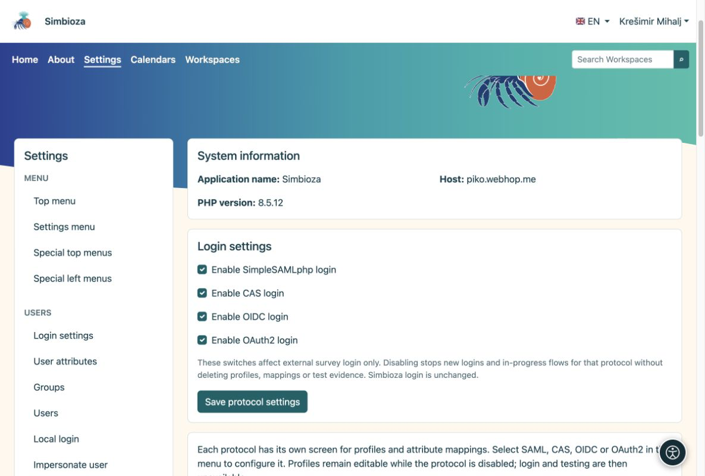
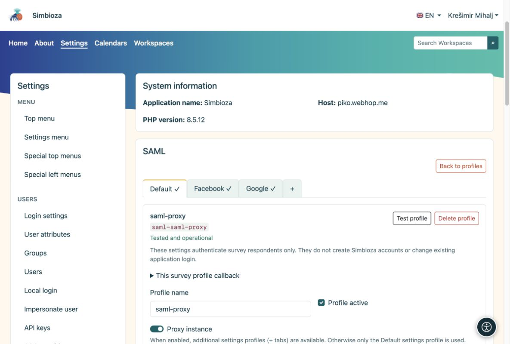

# Externe Anmeldung und Attributzuordnung

<a id="external-sign-in-and-attribute-mapping"></a>


> Die Bildschirmaufnahmen zeigen die englische Benutzeroberfläche.

[Für Administratoren](ankete-administratori_de.md)

**Ziel:** Bereiten Sie vertrauenswürdige Anmeldemethoden vor, die Autoren auswählen können. Dies ist nicht erforderlich, wenn Umfragen öffentlich sind oder nur für Simbioza-Benutzer.

1.  Öffnen Sie **Einstellungen → Umfragen → Authentifizierung** und aktivieren Sie die erforderlichen Protokolle: SAML, CAS, OIDC oder OAuth2.
2.  Erstellen Sie unter dem Protokoll ein Profil oder kopieren Sie ein gesamtes Auth-Profil. Übersichtsexemplare sind unabhängig; das Auth-Profil muss für die Anwendungsanmeldung nicht aktiviert sein.
3.  Konfigurieren Sie die Verbindung wie in Auth. Jedes Protokoll kann mehrere Profile haben. Aktivieren Sie das Profil und wählen Sie **Profil testen**; Beim Testen wird eine neue Anmeldung angefordert.

<figure>

<figcaption aria-hidden="true">Aktivieren Sie Protokolle, bevor Sie einzelne Profile konfigurieren.</figcaption>
</figure>

<a id="ordinary-profile-or-proxy"></a>

## Gewöhnliches Profil oder Proxy?

Ein gewöhnliches SAML-Profil hat eine Konfiguration. Eine **Proxy-Instanz** verfügt über eine Registerkarte „Standard“ und zusätzliche Unterprofile wie Google und Facebook. Konfigurieren Sie die gemeinsame Verbindung unter „Standard“ und jede Unterprofilzuordnung auf einer eigenen Registerkarte.

<figure>

<figcaption aria-hidden="true">Eine Proxy-Instanz gruppiert ihre Unterprofile in Registerkarten.</figcaption>
</figure>

<a id="how-do-i-choose-mappings"></a>

## Wie wähle ich Zuordnungen aus?

Vergleichen Sie nach einer Testanmeldung die **zurückgegebenen Attributnamen und -werte**. Verwenden Sie eine unveränderliche Personenkennung für den stabilen Betreff und die entsprechenden Felder für Name und E-Mail. Zugeordnete E-Mails von einem erfolgreich validierten Login reichen für die Liste der zulässigen Adressen aus; es kann sich um eine Adresse oder ein Array handeln. Es ist kein zusätzliches E-Mail-Verifizierungsattribut erforderlich.

Lesen Sie Domänen aus einem vertrauenswürdigen Attribut, das tatsächlich von diesem Anbieter bereitgestellt wird, z. B. person@domain oder einem Institutionsattribut. Lassen Sie Autoren nur dann Domänen filtern oder Proxy-Quellen auswählen, wenn diese Werte zuverlässig zugeordnet sind. Ausschlüsse haben Vorrang und Administrator- und Umfrageregeln gelten gemeinsam.

Registrieren Sie für OIDC/OAuth2 den genauen Rückruf, der im Umfrageprofil angezeigt wird. Seine Kennung gehört zum Profil und dient jeder Umfrage, die es verwendet. Authentifizierungsrückrufe sind unterschiedlich. Bevor Autoren das Profil auswählen können, sind ein erfolgreicher Test und korrekte Zuordnungen erforderlich.

**Ergebnis:** Autoren wählen vorbereitete Anmeldemethoden, ohne die Geheimnisse des Anbieters zu sehen. Die Anmeldung der Teilnehmer erfolgt getrennt von der Simbioza-Sitzung und es wird kein Anwendungskonto erstellt.

<div id="survey-settings-guide" class="section">


<a id="general-settings-and-advanced-provider-rules"></a>

## Allgemeine Einstellungen und erweiterte Anbieterregeln

Diese Einstellungen sind für Administratoren. Sie ändern nicht die Anwendungsanmeldung, erstellen keine Simbioza-Konten und schreiben keine gesammelten Antworten neu.


<a id="public-application-address"></a>

## Öffentliche Bewerbungsadresse

Die Umfrage verwendet `app.public_url` (oder `app.url`) oder die URL des öffentlichen Links, die bereits im aktivierten E-Mail-Modul konfiguriert ist. Eine reine Ursprungs-URL erhält das Anwendungsroutenpräfix, z. B. `/simbioza`, genau einmal. Die Anforderungsheader `Host` und `Forwarded` wählen niemals einen Authentifizierungsrückruf. Nur HTTP-Adressen ermöglichen keine externe Anmeldung.

Eine zuvor gespeicherte Umfrageadresse bleibt eine explizite Überschreibung. Dies ist optional unter **Allgemeine Einstellungen → Erweiterte technische Einstellungen → Andere öffentliche Adresse für Umfragen**. Lassen Sie es leer, um die Anwendungsadresse zu erben. Die effektive Adresse wird schreibgeschützt angezeigt. Wenn keine vertrauenswürdige HTTPS-Adresse vorhanden ist, warnt die Authentifizierung vor dem Test: Konfigurieren Sie die Anwendungsadresse oder verwenden Sie diese Ausnahme für einen eigenständigen Host. Es ist keine separate Adresse pro Anbieter oder Umfrage erforderlich. SAML behält sein vorhandenes SP/ACS; OIDC/OAuth2-Anbieter müssen weiterhin den angezeigten Profilrückruf registrieren.


<a id="understand-the-limits"></a>

## Verstehe die Grenzen

- **Anmeldung und Abschluss:** Die standardmäßige externe Anmeldung dauert 10 Minuten; eine Abschlusssitzung erlaubt 30 Minuten Inaktivität und dauert höchstens 8 Stunden. Dies ist nicht das Enddatum der Umfrage oder die Anmeldedauer Simbioza.
- **Umfrage- und Anhangsgröße:** begrenzt Seiten, Fragen und jede angehängte Inhaltsdatei. Der Webserver kann ein niedrigeres Upload-Limit festlegen. MB steht für 1.048.576 Byte.
- **Datenschutz und wiederholte Einreichungen:** Der öffentliche Ergebnisschwellenwert verbirgt kleine Zählungen; Beispielsweise zählt 5 Ausblenden von 1 bis 4. Der Managerzugriff bleibt unverändert. Die Cookie-Laufzeit begrenzt den browserseitigen Wiederholungsschutz für öffentliche Umfragen; das Löschen von Cookies oder die Verwendung eines anderen Browsers kann dies umgehen.
- **Erweiterte technische Einstellungen:** Das Anfragelimit gilt für eine Umfragedefinition oder Anfrage, nicht für alle Antworten. Die Frist für die endgültige Einreichung beginnt mit der Erstellung der öffentlichen Umfragebewertung und beträgt höchstens 60 Minuten.

Lesbare Einheiten werden exakt in den vorhandenen Sekunden-/Byte-Speicher umgerechnet. Bei ungewöhnlichen gespeicherten Werten wird eine kleinere exakte Einheit verwendet und niemals gerundet. Das Formular lehnt ungültige Einheiten, Überläufe und inkonsistente Grenzwerte ab. Vorhandene Einstellungen und Daten bleiben erhalten.


<a id="saml-proxy-and-login-sources--optional"></a>

## SAML-Proxy- und Anmeldequellen – optional

Dieser Abschnitt ist nur für SAML-Proxy-Instanzen und deren Registerkarten sichtbar. Es ist für gewöhnliche SAML-Instanzen ausgeblendet und fehlt für CAS, OIDC und OAuth2.

Normalerweise lassen Sie die Felder leer. Konfigurieren Sie **Standard**, Google, Facebook oder andere Tabs mit ihren eigenen Zuordnungen und Tests. Autoren wählen diese getesteten Registerkarten aus, wenn sie zulässige Anmeldungen auswählen. Das zusätzliche Quellattribut ist nur dann eine Alternative, wenn der Proxy vertrauenswürdige Beweise für den tatsächlichen Upstream-Anbieter sendet.

Wenn ein echter Test beispielsweise `identity_source = google` zurückgibt, geben Sie `identity_source` als Quellattribut und dann eine Zuordnung pro Zeile ein:

```text
aai=AAI@EduHr
google=Google
facebook=Facebook
```

Aktivieren Sie **Autoren können Identitätsquellen auswählen**, um diese Auswahlmöglichkeiten anzubieten. Die Werte auf der linken Seite müssen genau mit den zurückgegebenen Werten übereinstimmen. Die Namen auf der rechten Seite sind Anzeigebezeichnungen. `identity_source` ist nur ein Beispiel, kein erforderliches AAI-Attribut. Wenn kein solches Attribut vorhanden ist, erfinden Sie keins und schließen Sie keine Quelle aus einer E-Mail-Domäne ab. Verwenden Sie stattdessen die getesteten Tabs.


<a id="advanced-provider-rules"></a>

## Erweiterte Anbieterregeln

Bei diesen optionalen JSON-Objekten handelt es sich um Administratorrichtlinien, nicht um ausführbare PHP oder JavaScript. Belassen Sie sie bei `{}`, wenn keine zusätzliche Attributfilterung erforderlich ist.

**Zulässige Attributwerte für Autoren** bietet einen begrenzten Satz von Filtern; es schränkt die Anmeldung selbst nicht ein:

``` json
{"eduPersonAffiliation":["student","staff"]}
```

Ein Autor benötigt dann möglicherweise `student`, `staff` oder beide, kann aber kein weiteres Attribut oder keinen anderen Wert einführen. Verwenden Sie tatsächliche Namen und Werte aus dem Profiltest.

**Obligatorische Regeln** gelten für jede Umfrage, die dieses Profil verwendet, unabhängig von der Auswahl des Autors:

``` json
{"attributes":{"eduPersonAffiliation":["student"]}}
```

Nur ein zurückgegebener `student`-Wert wird übergeben. Beim Matching wird die Groß-/Kleinschreibung beachtet. Ein übereinstimmender Wert in jeder Liste ist ausreichend, aber verschiedene Attribute sowie obligatorische und Autorenrichtlinien müssen alle bestanden werden. Fehlende Attribute schlagen fehl. Eine leere Werteliste ist kein Platzhalter. Eine Änderung der Richtlinie erfordert ein erneutes Testen und schreibt niemals alte Antworten neu. Bevorzugen Sie die dedizierten Felder „Zulässige/Ausgeschlossene Domänen“ für Domänen; JSON akzeptiert auch `sources`, wenn ein vertrauenswürdiges Quellattribut konfiguriert ist.

</div>
