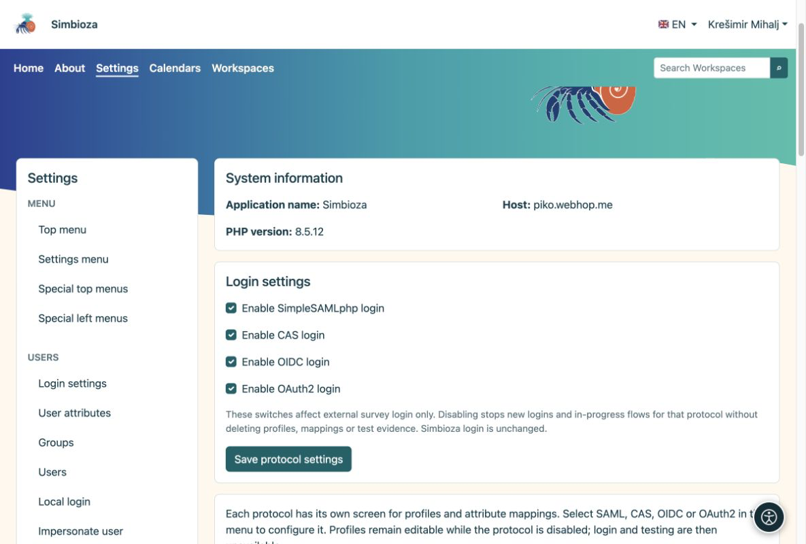
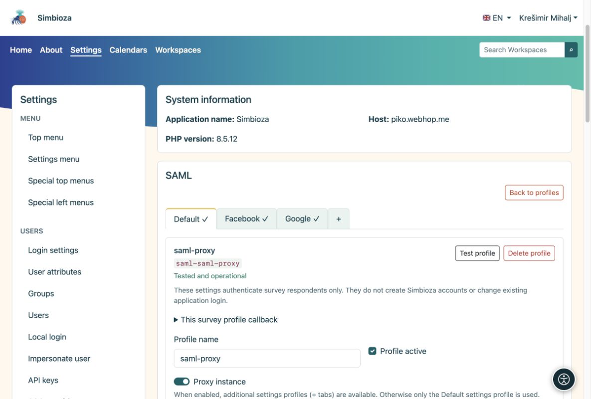

# External sign-in and attribute mapping

[For administrators](ankete-administratori_en.md)

**Goal:** prepare trusted sign-in methods that authors may select. This is unnecessary if surveys are public or only for Simbioza users.

1.  Open **Settings → Surveys → Authentication** and enable the required protocols: SAML, CAS, OIDC or OAuth2.
2.  Under the protocol, create a profile or copy an entire Auth profile. Survey copies are independent; the Auth profile need not be enabled for application login.
3.  Configure the connection as in Auth. Each protocol may have several profiles. Enable the profile and choose **Test profile**; testing requests a fresh login.

<figure>

<figcaption aria-hidden="true">Enable protocols before configuring individual profiles.</figcaption>
</figure>

## Ordinary profile or proxy?

An ordinary SAML profile has one configuration. A **Proxy instance** has a Default tab and additional subprofiles such as Google and Facebook. Configure the shared connection under Default and each subprofile mapping in its own tab.

<figure>

<figcaption aria-hidden="true">One proxy instance groups its subprofiles into tabs.</figcaption>
</figure>

## How do I choose mappings?

After a test login, compare the **returned attribute names and values**. Use an immutable person identifier for the stable subject, and the relevant fields for name and email. Mapped email from a successfully validated login is sufficient for the allowed-address list; it may be one address or an array. No additional email-verification attribute is required.

Read domains from a trusted attribute actually supplied by that provider, such as person@domain or an institution attribute. Let authors filter domains or choose proxy sources only when those values are reliably mapped. Exclusions take precedence, and administrator and survey rules apply together.

For OIDC/OAuth2, register the exact callback shown in the Survey profile. Its identifier belongs to the profile and serves every survey using it. Auth callbacks are different. A successful test and correct mappings are required before authors can select the profile.

**Result:** authors choose prepared login methods without seeing provider secrets. Participant sign-in is separate from the Simbioza session and creates no application account.

<div id="survey-settings-guide" class="section">


## General settings and advanced provider rules

These settings are for administrators. They do not change application login, create Simbioza accounts or rewrite collected responses.


## Public application address

Survey reuses `app.public_url` (or `app.url`), or the public link URL already configured in the enabled Email module. An origin-only URL receives the application route prefix, such as `/simbioza`, exactly once. Request `Host` and `Forwarded` headers never choose an authentication callback. HTTP-only addresses do not enable external login.

A previously saved Survey address remains an explicit override. It is optional, under **General settings → Advanced technical settings → Different public address for surveys**. Leave it empty to inherit the application address; the effective address is displayed read-only. If no trusted HTTPS address exists, Authentication warns before testing: configure the application address or use this exception for a standalone host. No separate address is required per provider or survey. SAML keeps its existing SP/ACS; OIDC/OAuth2 providers still need the displayed profile callback registered.


## Understand the limits

- **Login and completion:** default external login allows 10 minutes; a completion session allows 30 minutes of inactivity and lasts at most 8 hours. This is not the survey closing date or the Simbioza login duration.
- **Survey and attachment size:** limits pages, questions and each attached content file. The web server may impose a lower upload limit. MB represents 1,048,576 bytes.
- **Privacy and repeat submissions:** the public result threshold hides small counts; for example, 5 hides counts from 1 to 4. Manager access is unchanged. The cookie duration limits browser-side repeat protection for public surveys; clearing cookies or using another browser can bypass it.
- **Advanced technical settings:** the request limit applies to one survey definition or request, not all responses. The final-submission time limit starts when the public survey review is prepared and is at most 60 minutes.

Readable units convert exactly to the existing seconds/bytes storage. Unusual saved values use a smaller exact unit, never rounding. The form rejects invalid units, overflow and inconsistent limits. Existing settings and data are retained.


## SAML proxy and login sources — optional

This section is visible only for SAML proxy instances and their tabs. It is hidden for ordinary SAML instances and absent for CAS, OIDC and OAuth2.

Normally leave its fields empty. Configure **Default**, Google, Facebook or other tabs with their own mappings and tests. Authors select those tested tabs when choosing allowed logins. The extra source attribute is an alternative only when the proxy sends trustworthy evidence of the actual upstream provider.

For example, if a real test returns `identity_source = google`, enter `identity_source` as the source attribute, then one mapping per line:

```text
aai=AAI@EduHr
google=Google
facebook=Facebook
```

Enable **Authors may choose identity sources** to offer these choices. Left-hand values must match returned values exactly; right-hand names are display labels. `identity_source` is only an example, not a required AAI attribute. If no such attribute exists, do not invent one or infer a source from an email domain; use the tested tabs instead.


## Advanced provider rules

These optional JSON objects are administrator policy, not executable PHP or JavaScript. Leave them as `{}` if no extra attribute filtering is needed.

**Allowed attribute values for authors** offers a bounded set of filters; it does not restrict login by itself:

``` json
{"eduPersonAffiliation":["student","staff"]}
```

An author may then require `student`, `staff`, or both, but cannot introduce another attribute or value. Use actual names and values from the profile test.

**Mandatory rules** apply to every survey using this profile, independently of author choices:

``` json
{"attributes":{"eduPersonAffiliation":["student"]}}
```

Only a returned `student` value passes. Matching is case-sensitive. One matching value within each list is sufficient, but different attributes and mandatory and author policies must all pass. Missing attributes fail. An empty value list is not a wildcard. Changing policy requires retesting and never rewrites old responses. Prefer the dedicated Allowed/Excluded domains fields for domains; JSON also accepts `sources` when a trustworthy source attribute is configured.

</div>
