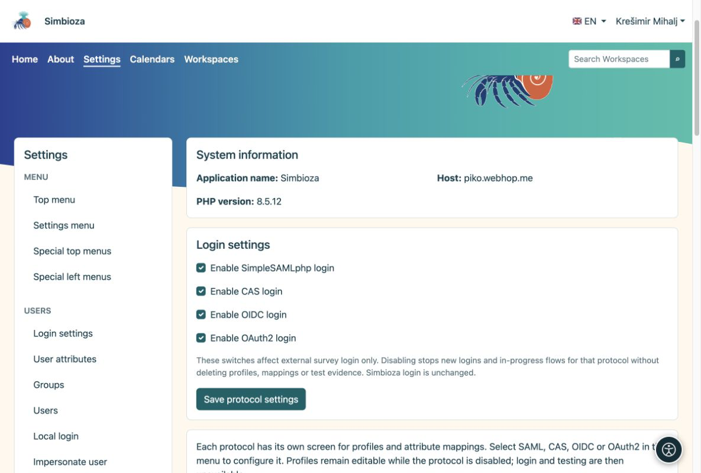
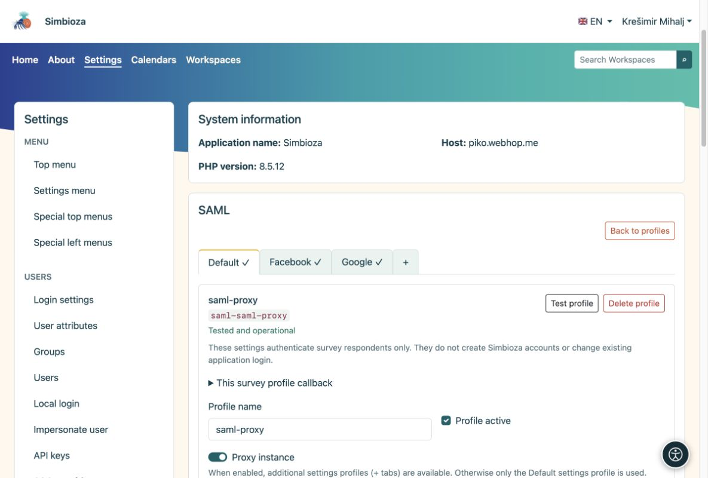

# Inicio de sesión externo y asignación de atributos

<a id="external-sign-in-and-attribute-mapping"></a>


> Las capturas de pantalla muestran la interfaz en inglés.

[Para administradores](ankete-administratori_es.md)

**Objetivo:** preparar métodos de inicio de sesión confiables que los autores puedan seleccionar. Esto no es necesario si las encuestas son públicas o solo para usuarios Simbioza.

1.  Abra **Configuración → Encuestas → Autenticación** y habilite los protocolos requeridos: SAML, CAS, OIDC o OAuth2.
2.  Según el protocolo, cree un perfil o copie un perfil de autenticación completo. Las copias de la encuesta son independientes; No es necesario habilitar el perfil de autenticación para iniciar sesión en la aplicación.
3.  Configure la conexión como en Auth. Cada protocolo puede tener varios perfiles. Habilite el perfil y elija **Probar perfil**; La prueba solicita un nuevo inicio de sesión.

<figure>

<figcaption aria-hidden="true">Habilite los protocolos antes de configurar perfiles individuales.</figcaption>
</figure>

<a id="ordinary-profile-or-proxy"></a>

## ¿Perfil ordinario o proxy?

Un perfil SAML normal tiene una configuración. Una **instancia de proxy** tiene una pestaña Predeterminada y subperfiles adicionales como Google y Facebook. Configure la conexión compartida en Predeterminado y cada asignación de subperfil en su propia pestaña.

<figure>

<figcaption aria-hidden="true">Una instancia de proxy agrupa sus subperfiles en pestañas.</figcaption>
</figure>

<a id="how-do-i-choose-mappings"></a>

## ¿Cómo elijo asignaciones?

Después de un inicio de sesión de prueba, compare los **nombres y valores de atributos devueltos**. Utilice un identificador de persona inmutable para el identificador estable y los campos relevantes para nombre y correo electrónico. El correo electrónico asignado desde un inicio de sesión validado exitosamente es suficiente para la lista de direcciones permitidas; puede ser una dirección o una matriz. No se requiere ningún atributo adicional de verificación de correo electrónico.

Lea dominios a partir de un atributo confiable proporcionado realmente por ese proveedor, como persona@dominio o un atributo de institución. Permita a los autores filtrar dominios o elegir fuentes proxy solo cuando esos valores estén asignados de manera confiable. Las exclusiones tienen prioridad y las reglas del administrador y de la encuesta se aplican juntas.

Para OIDC/OAuth2, registre la devolución de llamada exacta que se muestra en el perfil de la encuesta. Su identificador pertenece al perfil y sirve a todas las encuestas que lo utilizan. Las devoluciones de llamada de autenticación son diferentes. Se requiere una prueba exitosa y asignaciones correctas antes de que los autores puedan seleccionar el perfil.

**Resultado:** los autores eligen métodos de inicio de sesión preparados sin ver los secretos del proveedor. El inicio de sesión del participante es independiente de la sesión Simbioza y no crea ninguna cuenta de aplicación.

<div id="survey-settings-guide" class="section">


<a id="general-settings-and-advanced-provider-rules"></a>

## Configuración general y reglas avanzadas de proveedores

Estas configuraciones son para administradores. No cambian el inicio de sesión de la aplicación, no crean cuentas Simbioza ni reescriben las respuestas recopiladas.


<a id="public-application-address"></a>

## Dirección de solicitud pública

La encuesta reutiliza `app.public_url` (o `app.url`), o la URL del enlace público ya configurada en el módulo de correo electrónico habilitado. Una URL de solo origen recibe el prefijo de ruta de la aplicación, como `/simbioza`, exactamente una vez. Los encabezados de solicitud `Host` y `Forwarded` nunca eligen una devolución de llamada de autenticación. Las direcciones exclusivas HTTP no permiten el inicio de sesión externo.

Una dirección de encuesta previamente guardada sigue siendo una anulación explícita. Es opcional, en **Configuración general → Configuración técnica avanzada → Dirección pública diferente para encuestas**. Déjelo vacío para heredar la dirección de la aplicación; la dirección efectiva se muestra como de solo lectura. Si no existe una dirección HTTPS confiable, la autenticación advierte antes de realizar la prueba: configure la dirección de la aplicación o use esta excepción para un host independiente. No se requiere una dirección separada por proveedor o encuesta. SAML mantiene su SP/ACS existente; Los proveedores OIDC/OAuth2 aún necesitan registrar la devolución de llamada del perfil mostrado.


<a id="understand-the-limits"></a>

## entender los límites

- **Inicio de sesión y finalización:** el inicio de sesión externo predeterminado permite 10 minutos; una sesión de finalización permite 30 minutos de inactividad y dura como máximo 8 horas. Esta no es la fecha de cierre de la encuesta ni la duración del inicio de sesión Simbioza.
- **Tamaño de la encuesta y los archivos adjuntos:** limita las páginas, las preguntas y cada archivo de contenido adjunto. El servidor web puede imponer un límite de carga inferior. MB representa 1.048.576 bytes.
- **Privacidad y envíos repetidos:** el umbral de resultados públicos oculta recuentos pequeños; por ejemplo, 5 ocultaciones cuentan del 1 al 4. El acceso del gestor no se modifica. La duración de la cookie limita la protección repetida del navegador para encuestas públicas; borrar las cookies o usar otro navegador puede evitarlo.
- **Configuración técnica avanzada:** el límite de solicitudes se aplica a una definición o solicitud de encuesta, no a todas las respuestas. El tiempo límite para la presentación final comienza cuando se prepara la revisión de la encuesta pública y es de 60 minutos como máximo.

Las unidades legibles se convierten exactamente al almacenamiento de segundos/bytes existente. Los valores guardados inusuales utilizan una unidad exacta más pequeña, nunca se redondean. El formulario rechaza unidades no válidas, desbordamientos y límites inconsistentes. Se conservan la configuración y los datos existentes.


<a id="saml-proxy-and-login-sources--optional"></a>

## SAML fuentes de inicio de sesión y proxy: opcional

Esta sección solo es visible para las instancias de proxy SAML y sus pestañas. Está oculto para instancias SAML ordinarias y ausente para CAS, OIDC y OAuth2.

Normalmente deja sus campos vacíos. Configure pestañas **Predeterminada**, Google, Facebook u otras con sus propias asignaciones y pruebas. Los autores seleccionan esas pestañas probadas al elegir los inicios de sesión permitidos. El atributo de fuente adicional es una alternativa solo cuando el proxy envíe evidencia confiable del proveedor ascendente real.

Por ejemplo, si una prueba real devuelve `identity_source = google`, ingrese `identity_source` como atributo de origen y luego una asignación por línea:

```text
aai=AAI@EduHr
google=Google
facebook=Facebook
```

Habilite **Los autores pueden elegir fuentes de identidad** para ofrecer estas opciones. Los valores de la izquierda deben coincidir exactamente con los valores devueltos; Los nombres de la derecha son etiquetas de visualización. `identity_source` es sólo un ejemplo, no un atributo AAI obligatorio. Si no existe tal atributo, no invente uno ni infiera una fuente a partir de un dominio de correo electrónico; utilice las pestañas probadas en su lugar.


<a id="advanced-provider-rules"></a>

## Reglas avanzadas de proveedores

Estos objetos JSON opcionales son políticas de administrador, no ejecutables PHP o JavaScript. Déjelos como `{}` si no se necesita ningún filtrado de atributos adicional.

**Valores de atributos permitidos para autores** ofrece un conjunto limitado de filtros; no restringe el inicio de sesión por sí solo:

``` json
{"eduPersonAffiliation":["student","staff"]}
```

Un autor puede entonces requerir `student`, `staff` o ambos, pero no puede introducir otro atributo o valor. Utilice nombres y valores reales de la prueba de perfil.

**Reglas obligatorias** se aplican a todas las encuestas que utilicen este perfil, independientemente de las elecciones del autor:

``` json
{"attributes":{"eduPersonAffiliation":["student"]}}
```

Solo pasa un valor `student` devuelto. La coincidencia distingue entre mayúsculas y minúsculas. Un valor coincidente dentro de cada lista es suficiente, pero deben pasar diferentes atributos y políticas obligatorias y de autor. Los atributos faltantes fallan. Una lista de valores vacía no es un comodín. Cambiar la política requiere volver a realizar pruebas y nunca reescribir respuestas antiguas. Prefiera los campos dedicados a Dominios permitidos/excluidos para los dominios; JSON también acepta `sources` cuando se configura un atributo de fuente confiable.

</div>
