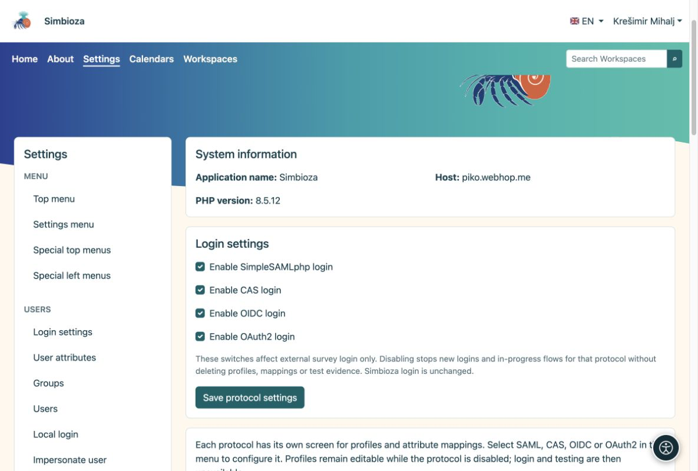
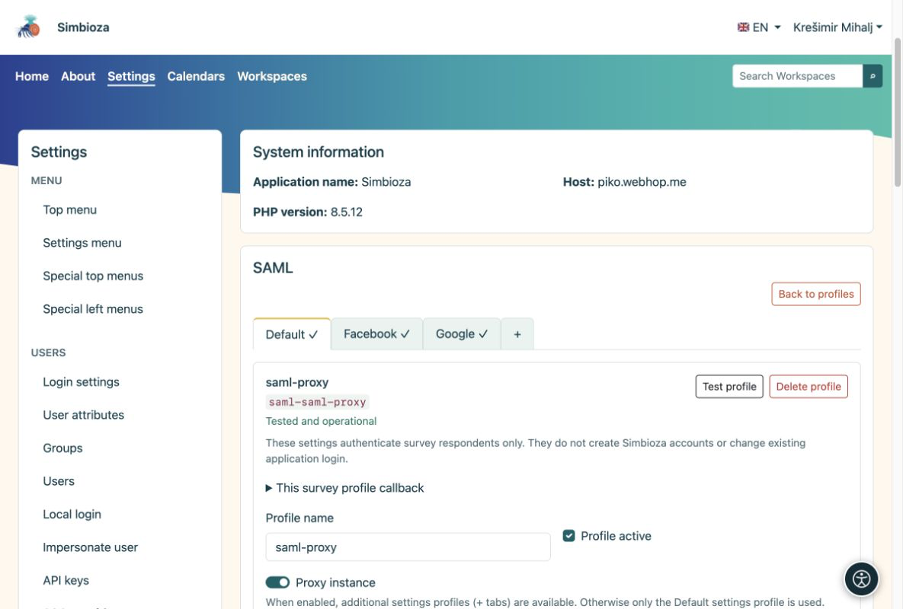

# Connexion externe et correspondance des attributs

<a id="external-sign-in-and-attribute-mapping"></a>


> Les captures d’écran présentent l’interface en anglais.

[Pour les administrateurs](ankete-administratori_fr.md)

**Objectif :** préparer des méthodes de connexion fiables que les auteurs peuvent sélectionner. Ceci n'est pas nécessaire si les sondages sont publics ou uniquement pour les utilisateurs Simbioza.

1.  Ouvrez **Paramètres → Sondages → Authentification** et activez les protocoles requis : SAML, CAS, OIDC ou OAuth2.
2.  Sous le protocole, créez un profil ou copiez un profil d'authentification complet. Les copies du sondage sont indépendantes ; le profil Auth n'a pas besoin d'être activé pour la connexion à l'application.
3.  Configurez la connexion comme dans Auth. Chaque protocole peut avoir plusieurs profils. Activez le profil et choisissez **Tester le profil** ; testing demande une nouvelle connexion.

<figure>

<figcaption aria-hidden="true">Activez les protocoles avant de configurer des profils individuels.</figcaption>
</figure>

<a id="ordinary-profile-or-proxy"></a>

## Profil ordinaire ou proxy ?

Un profil SAML ordinaire a une configuration. Une **instance de proxy** possède un onglet Par défaut et des sous-profils supplémentaires tels que Google et Facebook. Configurez la connexion partagée sous Par défaut et chaque mappage de sous-profil dans son propre onglet.

<figure>

<figcaption aria-hidden="true">Une instance de proxy regroupe ses sous-profils en onglets.</figcaption>
</figure>

<a id="how-do-i-choose-mappings"></a>

## Comment choisir les mappages ?

Après une connexion test, comparez les **noms et valeurs d'attribut renvoyés**. Utilisez un identifiant de personne immuable pour le sujet stable et les champs appropriés pour le nom et l'adresse e-mail. L'e-mail mappé à partir d'une connexion validée avec succès est suffisant pour la liste d'adresses autorisées ; il peut s'agir d'une adresse ou d'un tableau. Aucun attribut de vérification de courrier électronique supplémentaire n'est requis.

Lisez les domaines à partir d'un attribut de confiance réellement fourni par ce fournisseur, tel que personne@domaine ou un attribut d'institution. Laissez les auteurs filtrer les domaines ou choisir des sources proxy uniquement lorsque ces valeurs sont mappées de manière fiable. Les exclusions sont prioritaires et les règles d'administrateur et de sondage s'appliquent ensemble.

Pour OIDC/OAuth2, enregistrez le rappel exact indiqué dans le profil de sondage. Son identifiant appartient au profil et sert chaque sondage qui l'utilise. Les rappels d'authentification sont différents. Un test réussi et des mappages corrects sont requis avant que les auteurs puissent sélectionner le profil.

**Résultat :** les auteurs choisissent des méthodes de connexion préparées sans voir les secrets du fournisseur. La connexion des participants est distincte de la session Simbioza et ne crée aucun compte d'application.

<div id="survey-settings-guide" class="section">


<a id="general-settings-and-advanced-provider-rules"></a>

## Paramètres généraux et règles avancées du fournisseur

Ces paramètres sont destinés aux administrateurs. Ils ne modifient pas la connexion à l'application, ne créent pas de comptes Simbioza et ne réécrivent pas les réponses collectées.


<a id="public-application-address"></a>

## Adresse publique de candidature

Le sondage réutilise `app.public_url` (ou `app.url`) ou l'URL du lien public déjà configurée dans le module Email activé. Une URL d'origine uniquement reçoit le préfixe de route d'application, tel que `/simbioza`, une seule fois. Les en-têtes de requête `Host` et `Forwarded` ne choisissent jamais de rappel d’authentification. Les adresses HTTP uniquement ne permettent pas la connexion externe.

Une adresse de sondage précédemment enregistrée reste un remplacement explicite. C'est facultatif, sous **Paramètres généraux → Paramètres techniques avancés → Adresse publique différente pour les sondages**. Laissez-le vide pour hériter de l'adresse de l'application ; l'adresse effective est affichée en lecture seule. Si aucune adresse HTTPS approuvée n'existe, l'authentification vous avertit avant de tester : configurez l'adresse de l'application ou utilisez cette exception pour un hôte autonome. Aucune adresse distincte n’est requise par fournisseur ou sondage. SAML conserve son SP/ACS existant ; Les fournisseurs OIDC/OAuth2 ont toujours besoin que le rappel de profil affiché soit enregistré.


<a id="understand-the-limits"></a>

## Comprendre les limites

- **Connexion et achèvement :** la connexion externe par défaut autorise 10 minutes ; une séance de complétion permet 30 minutes d'inactivité et dure au maximum 8 heures. Il ne s'agit pas de la date de clôture du sondage ni de la durée de connexion Simbioza.
- **Taille du sondage et des pièces jointes :** limite les pages, les questions et chaque fichier de contenu joint. Le serveur Web peut imposer une limite de téléchargement inférieure. Mo représente 1 048 576 octets.
- **Confidentialité et soumissions répétées :** le seuil de résultats publics cache de petits décomptes ; par exemple, 5 masque les comptes de 1 à 4. L'accès du gestionnaire est inchangé. La durée du cookie limite la protection répétée côté navigateur pour les sondages publics ; effacer les cookies ou utiliser un autre navigateur peut le contourner.
- **Paramètres techniques avancés :** la limite de requêtes s'applique à une définition de sondage ou à une requête, et non à toutes les réponses. Le délai de soumission finale commence lorsque l'examen du sondage public est préparé et est d'une durée maximale de 60 minutes.

Les unités lisibles se convertissent exactement en secondes/octets de stockage existants. Les valeurs enregistrées inhabituelles utilisent une unité exacte plus petite, sans jamais être arrondies. Le formulaire rejette les unités invalides, les débordements et les limites incohérentes. Les paramètres et données existants sont conservés.


<a id="saml-proxy-and-login-sources--optional"></a>

## SAML sources de proxy et de connexion – facultatif

Cette section est visible uniquement pour les instances de proxy SAML et leurs onglets. Il est masqué pour les instances SAML ordinaires et absent pour CAS, OIDC et OAuth2.

Laissez normalement ses champs vides. Configurez **Par défaut**, Google, Facebook ou d'autres onglets avec leurs propres mappages et tests. Les auteurs sélectionnent ces onglets testés lors du choix des connexions autorisées. L'attribut source supplémentaire n'est une alternative que lorsque le proxy envoie une preuve fiable du véritable fournisseur en amont.

Par exemple, si un test réel renvoie `identity_source = google`, saisissez `identity_source` comme attribut source, puis un mappage par ligne :

```text
aai=AAI@EduHr
google=Google
facebook=Facebook
```

Activez **Les auteurs peuvent choisir des sources d'identité** pour proposer ces choix. Les valeurs de gauche doivent correspondre exactement aux valeurs renvoyées ; les noms de droite sont des étiquettes d’affichage. `identity_source` n'est qu'un exemple et non un attribut AAI obligatoire. Si aucun attribut de ce type n’existe, n’en inventez pas et ne déduisez pas une source à partir d’un domaine de messagerie ; utilisez plutôt les onglets testés.


<a id="advanced-provider-rules"></a>

## Règles avancées du fournisseur

Ces objets JSON facultatifs sont une stratégie d'administrateur et ne sont pas exécutables PHP ou JavaScript. Laissez-les sous la forme `{}` si aucun filtrage d'attributs supplémentaire n'est nécessaire.

**Valeurs d'attribut autorisées pour les auteurs** offre un ensemble limité de filtres ; il ne restreint pas la connexion en soi :

``` json
{"eduPersonAffiliation":["student","staff"]}
```

Un auteur peut alors exiger `student`, `staff`, ou les deux, mais ne peut pas introduire un autre attribut ou une autre valeur. Utilisez les noms et valeurs réels du test de profil.

**Des règles obligatoires** s'appliquent à chaque sondage utilisant ce profil, indépendamment du choix de l'auteur :

``` json
{"attributes":{"eduPersonAffiliation":["student"]}}
```

Seule une valeur `student` renvoyée est transmise. La correspondance est sensible à la casse. Une valeur correspondante dans chaque liste est suffisante, mais différents attributs et stratégies obligatoires et d'auteur doivent tous être transmis. Les attributs manquants échouent. Une liste de valeurs vide n'est pas un caractère générique. Changer de politique nécessite de retester et ne réécrit jamais les anciennes réponses. Préférez les champs dédiés Domaines autorisés/exclus pour les domaines ; JSON accepte également `sources` lorsqu'un attribut source digne de confiance est configuré.

</div>
