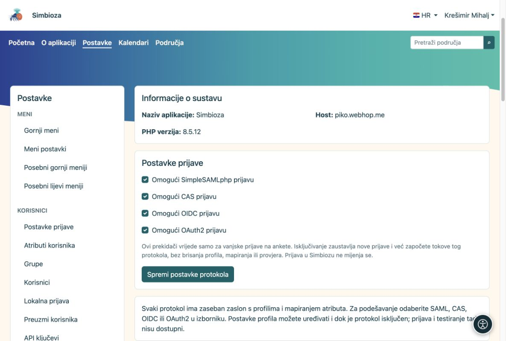
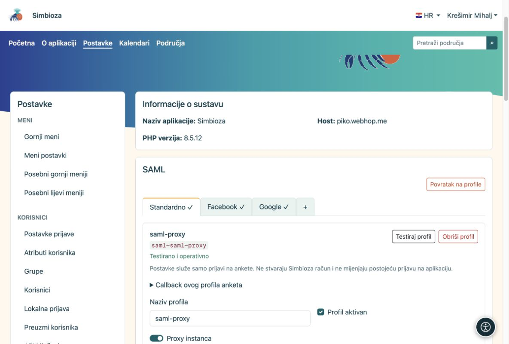

# Vanjska prijava i mapiranje podataka

[Za administratore](ankete-administratori_hr.md)

**Cilj:** pripremiti pouzdane načine prijave koje sastavljači mogu birati u svojim anketama. Ako koristite samo javne ankete ili korisnike Simbioze, ovo nije potrebno.

1.  Otvorite **Postavke → Ankete → Autentikacija** i uključite potrebne protokole: SAML, CAS, OIDC ili OAuth2.
2.  U podstavci protokola kreirajte novi profil ili kopirajte cijeli profil iz Autha. Kopija anketa potpuno je neovisna; Auth profil ne mora biti uključen za prijavu u aplikaciju.
3.  Podesite tehničku vezu kao u Authu. Jedan protokol može imati više profila. Uključite profil i pokrenite **Testiraj profil**. Test traži svježu prijavu.

<figure>

<figcaption aria-hidden="true">Protokoli se uključuju prije podešavanja pojedinih profila.</figcaption>
</figure>

## Običan profil ili proxy?

Običan SAML profil ima jednu konfiguraciju. **Proxy instanca** ima karticu Standardno i dodatne podprofile, primjerice Google i Facebook. Zajednička veza podešava se u Standardno, a mapiranja podprofila u pripadajućoj kartici.

<figure>

<figcaption aria-hidden="true">Jedna proxy instanca grupira svoje podprofile u kartice.</figcaption>
</figure>

## Kako odabrati mapiranja?

Nakon testne prijave usporedite **nazive atributa i njihove vraćene vrijednosti**. Za stabilni identifikator odaberite nepromjenjivu oznaku osobe, a za ime i e-mail pripadajuće podatke. Mapirani e-mail iz uspješno provjerene prijave dovoljan je za usporedbu s popisom ispitanika; može biti jedna adresa ili niz. Ne treba poseban atribut potvrde e-maila.

Domenu čitajte iz potvrđenog atributa koji taj provider zaista isporučuje. Primjeri mogu biti oznaka osoba@domena ili zaseban atribut ustanove. Dopustite sastavljačima domenske filtre ili izbor proxy izvora samo kada su ti podaci pouzdano mapirani. Isključenja imaju prednost; pravila administratora i ankete primjenjuju se zajedno.

Za OIDC/OAuth2 u registru providera dodajte točnu povratnu adresu prikazanu u Survey profilu. Njezina oznaka pripada profilu i služi svim anketama koje ga koriste. Povratna adresa Autha nije ista. Uspješan test i pravilna mapiranja preduvjet su ponude profila autoru.

**Rezultat:** autor bira pripremljene prijave bez pristupa tajnama providera. Prijava ispitanika odvojena je od sesije Simbioze i ne stvara aplikacijski račun.

<div id="survey-settings-guide" class="section">


## Opće postavke i napredna pravila providera

Ove postavke namijenjene su administratorima. Ne mijenjaju prijavu u aplikaciju, ne stvaraju Simbioza račune i ne prepisuju prikupljene odgovore.


## Javna adresa aplikacije

Survey koristi `app.public_url` (ili `app.url`), odnosno javni URL poveznica već podešen u uključenom modulu Email. Ako je spremljena samo domena, dodaje se putanja aplikacije, primjerice `/simbioza`, samo jednom. Host i Forwarded zaglavlja zahtjeva ne određuju adresu povratka iz prijave. Adresa koja koristi samo HTTP ne omogućuje vanjsku prijavu.

Ranije spremljena adresa anketa ostaje izričita iznimka. Sada je neobavezna, pod **Opće postavke → Napredne tehničke postavke → Druga javna adresa za ankete**. Ostavite je praznom za nasljeđivanje adrese aplikacije; efektivna adresa prikazuje se samo za čitanje. Ako pouzdana HTTPS adresa ne postoji, Autentikacija upozorava prije testa: podesite adresu aplikacije ili ovu iznimku za samostalan sustav. Ne treba zasebna adresa po provideru ili anketi. SAML zadržava postojeći SP/ACS; za OIDC/OAuth2 kod providera i dalje treba registrirati prikazani callback profila.


## Što ograničenja znače

- **Prijava i ispunjavanje:** zadana vanjska prijava traje najviše 10 minuta; sesija ispunjavanja dopušta 30 minuta neaktivnosti i ukupno najviše 8 sati. To nije datum zatvaranja ankete ni trajanje prijave u Simbiozu.
- **Veličina ankete i privitaka:** ograničava stranice, pitanja i pojedinu datoteku dodanu sadržaju. Poslužitelj može imati niže ograničenje prijenosa. MB predstavlja 1 048 576 bajtova.
- **Privatnost i ponavljanje:** prag javnih rezultata skriva premale brojeve; primjerice 5 skriva vrijednosti od 1 do 4. Pristup upravitelja ostaje isti. Trajanje kolačića ograničava zaštitu od ponavljanja javne predaje u pregledniku; brisanje kolačića ili drugi preglednik mogu je zaobići.
- **Napredne tehničke postavke:** veličina zahtjeva odnosi se na jednu definiciju ankete ili zahtjev, ne na sve odgovore. Rok konačne predaje počinje pripremom završnog pregleda javne ankete i može trajati najviše 60 minuta.

Čitljive jedinice točno se pretvaraju u postojeću pohranu sekundi/bajtova. Neuobičajena spremljena vrijednost prikazuje se u manjoj točnoj jedinici, bez zaokruživanja. Obrazac odbija nevaljane jedinice, prevelike i nedosljedne vrijednosti. Postojeće postavke i podaci ostaju sačuvani.


## SAML proxy i izvori prijave — neobavezno

Odjeljak je vidljiv samo za SAML proxy instance i njihove kartice. Skriven je za običnu SAML instancu, a ne postoji za CAS, OIDC ili OAuth2.

Obično ova polja ostaju prazna. Podesite **Standardno**, Google, Facebook ili druge kartice s vlastitim mapiranjima i testovima. Autor ih označuje pri izboru dopuštenih prijava. Dodatni atribut izvora alternativa je samo kada proxy šalje pouzdan dokaz o stvarnom izvoru identiteta.

Primjerice, ako stvarni test vrati `identity_source = google`, kao naziv atributa upišite `identity_source`, a zatim mapiranja po jedan redak:

```text
aai=AAI@EduHr
google=Google
facebook=Facebook
```

**Autori smiju odabirati izvore identiteta** uključite kako biste im ponudili ove odabire. Lijeve vrijednosti moraju se točno podudarati s vraćenim vrijednostima; desni tekst samo je naziv za prikaz. `identity_source` je primjer, ne obvezan AAI atribut. Ako takav atribut ne postoji, ne izmišljajte ga i ne zaključujte izvor iz domene e-pošte; koristite testirane kartice.


## Napredna pravila providera

Ovi neobavezni JSON objekti predstavljaju administratorska pravila, ne izvršivi PHP ili JavaScript. Ostavite `{}` ako dodatni filtar atributa nije potreban.

**Dopuštene vrijednosti atributa za autore** nude ograničen skup filtara; same po sebi ne ograničavaju prijavu:

``` json
{"eduPersonAffiliation":["student","staff"]}
```

Autor zatim smije tražiti `student`, `staff` ili oboje, ali ne smije dodati drugi atribut ili vrijednost. Koristite stvarne nazive i vrijednosti iz testa profila.

**Obvezna pravila** ograničavaju svaku anketu koja koristi profil, neovisno o autorovu izboru:

``` json
{"attributes":{"eduPersonAffiliation":["student"]}}
```

Prolazi samo vraćena vrijednost `student`. Usporedba razlikuje velika i mala slova. U svakom popisu dovoljno je jedno podudaranje, ali različiti atributi i obvezna i autorska pravila moraju svi proći. Atribut koji nedostaje ne prolazi. Prazan popis vrijednosti nije zamjenski znak za sve. Promjena pravila zahtijeva novi test i ne prepisuje stare odgovore. Domene uobičajeno podesite zasebnim poljima dopuštenih/isključenih domena; JSON prihvaća i `sources` za konfigurirani pouzdan atribut izvora.

</div>
