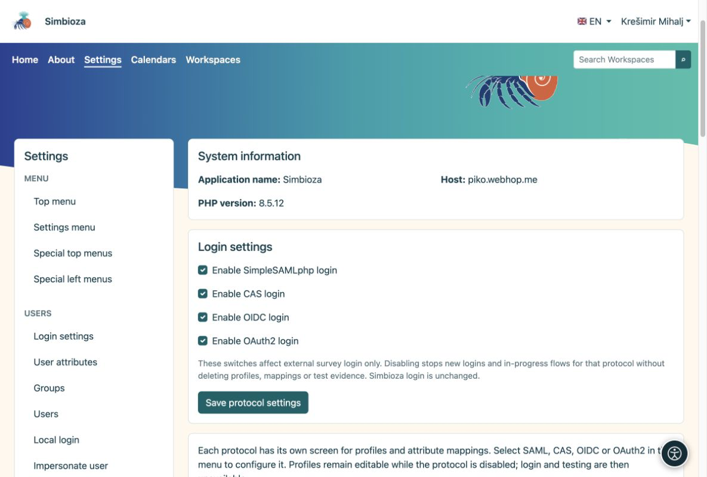
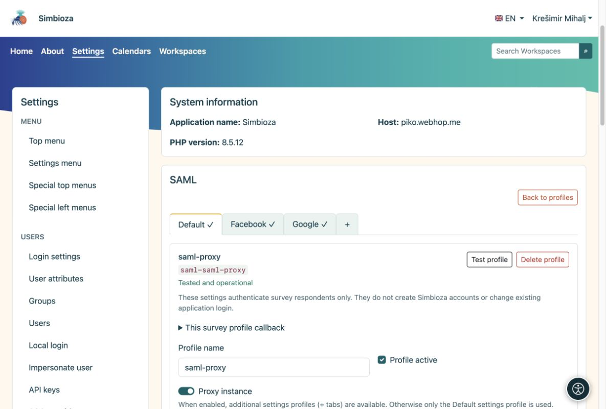

# Accesso esterno e mappatura degli attributi

<a id="external-sign-in-and-attribute-mapping"></a>


> Le schermate mostrano l’interfaccia in inglese.

[Per amministratori](ankete-administratori_it.md)

**Obiettivo:** preparare metodi di accesso affidabili che gli autori possono selezionare. Ciò non è necessario se i sondaggi sono pubblici o solo per gli utenti Simbioza.

1.  Apri **Impostazioni → Sondaggi → Autenticazione** e abilita i protocolli richiesti: SAML, CAS, OIDC o OAuth2.
2.  Sotto il protocollo, crea un profilo oppure copia un intero profilo Auth. Le copie di Survey sono indipendenti; il profilo Auth non deve necessariamente essere abilitato per l'accesso all'applicazione.
3.  Configura il collegamento come in Auth. Ogni protocollo può avere più profili. Abilita il profilo e scegli **Verifica profilo**; la verifica richiede un nuovo accesso.

<figure>

<figcaption aria-hidden="true">Abilitare i protocolli prima di configurare i singoli profili.</figcaption>
</figure>

<a id="ordinary-profile-or-proxy"></a>

## Profilo ordinario o proxy?

Un profilo SAML ordinario ha una configurazione. Un'**istanza proxy** ha una scheda Predefinita e sottoprofili aggiuntivi come Google e Facebook. Configura la connessione condivisa in Predefinito e la mappatura di ciascun sottoprofilo nella propria scheda.

<figure>

<figcaption aria-hidden="true">Un'istanza proxy raggruppa i propri sottoprofili in schede.</figcaption>
</figure>

<a id="how-do-i-choose-mappings"></a>

## Come scelgo le mappature?

Dopo un accesso di prova, confronta i **nomi e i valori degli attributi restituiti**. Usa un identificatore personale immutabile per identificare stabilmente il soggetto, e i campi pertinenti per nome ed email. L'email mappata da un accesso convalidato correttamente basta per l'elenco degli indirizzi consentiti; può essere un singolo indirizzo o un array. Non è richiesto un ulteriore attributo di verifica dell'email.

Leggi i domini da un attributo attendibile effettivamente fornito da quel provider, come persona@dominio o un attributo di istituzione. Consenti agli autori di filtrare i domini o scegliere origini proxy solo quando tali valori sono mappati in modo affidabile. Le esclusioni hanno la precedenza e le regole dell'amministratore e del sondaggio si applicano insieme.

Per OIDC/OAuth2, registra l'esatto indirizzo di callback mostrato nel profilo Survey. Il suo identificatore appartiene al profilo e serve tutti i sondaggi che lo utilizzano. I callback di Auth sono differenti. Prima che gli autori possano selezionare il profilo, occorrono una verifica riuscita e mappature corrette.

**Risultato:** gli autori scelgono metodi di accesso preparati senza vedere i segreti del provider. L'accesso dei partecipanti è separato dalla sessione Simbioza e non crea alcun account dell'applicazione.

<div id="survey-settings-guide" class="section">


<a id="general-settings-and-advanced-provider-rules"></a>

## Impostazioni generali e regole avanzate del provider

Queste impostazioni sono destinate agli amministratori. Non modificano l'accesso all'applicazione, non creano account Simbioza né riscrivono le risposte raccolte.


<a id="public-application-address"></a>

## Indirizzo pubblico dell'applicazione

Il sondaggio riutilizza `app.public_url` (o `app.url`) o l'URL del collegamento pubblico già configurato nel modulo Email abilitato. Un URL solo origine riceve il prefisso della route dell'applicazione, ad esempio `/simbioza`, esattamente una volta. Le intestazioni delle richieste `Host` e `Forwarded` non scelgono mai un callback di autenticazione. Gli indirizzi HTTP-only non abilitano l'accesso esterno.

Un indirizzo del sondaggio salvato in precedenza rimane una sostituzione esplicita. È facoltativo, in **Impostazioni generali → Impostazioni tecniche avanzate → Indirizzo pubblico diverso per sondaggi**. Lasciarlo vuoto per ereditare l'indirizzo dell'applicazione; l'indirizzo effettivo viene visualizzato in sola lettura. Se non esiste alcun indirizzo HTTPS attendibile, l'autenticazione avvisa prima del test: configurare l'indirizzo dell'applicazione o utilizzare questa eccezione per un host autonomo. Non è richiesto alcun indirizzo separato per fornitore o sondaggio. SAML mantiene il suo SP/ACS esistente; I provider OIDC/OAuth2 necessitano ancora della registrazione della richiamata del profilo visualizzato.


<a id="understand-the-limits"></a>

## Comprendere i limiti

- **Accesso e completamento:** l'accesso esterno predefinito prevede 10 minuti; una sessione di completamento consente 30 minuti di inattività e dura al massimo 8 ore. Questa non è la data di chiusura del sondaggio o la durata dell'accesso Simbioza.
- **Dimensioni sondaggio e allegati:** limita le pagine, le domande e ciascun file di contenuto allegato. Il server web può imporre un limite di caricamento inferiore. MB rappresenta 1.048.576 byte.
- **Privacy e invii ripetuti:** la soglia dei risultati pubblici nasconde piccoli conteggi; ad esempio, 5 nasconde i conteggi da 1 a 4. L'accesso manager è invariato. La durata del cookie limita la protezione ripetuta sul lato browser per i sondaggi pubblici; cancellando i cookie o utilizzando un altro browser è possibile aggirarlo.
- **Impostazioni tecniche avanzate:** il limite di richieste si applica a una definizione o richiesta di sondaggio, non a tutte le risposte. Il termine ultimo per la presentazione inizia quando viene preparata la revisione del sondaggio pubblico ed è al massimo di 60 minuti.

Le unità leggibili vengono convertite esattamente nella memoria esistente di secondi/byte. I valori salvati insoliti utilizzano un'unità esatta più piccola, senza mai arrotondare. Il modulo rifiuta unità non valide, overflow e limiti incoerenti. Le impostazioni e i dati esistenti vengono mantenuti.


<a id="saml-proxy-and-login-sources--optional"></a>

## SAML origini proxy e accesso: facoltativo

Questa sezione è visibile solo per le istanze proxy SAML e le relative schede. È nascosto per le istanze ordinarie di SAML ed assente per CAS, OIDC e OAuth2.

Normalmente lascia i suoi campi vuoti. Configura **Default**, Google, Facebook o altre schede con le proprie mappature e test. Gli autori selezionano le schede testate quando scelgono gli accessi consentiti. L'attributo source aggiuntivo è un'alternativa solo quando il proxy invia prove affidabili dell'effettivo fornitore a monte.

Ad esempio, se un test reale restituisce `identity_source = google`, inserisci `identity_source` come attributo source, quindi una mappatura per riga:

```text
aai=AAI@EduHr
google=Google
facebook=Facebook
```

Abilita **Gli autori possono scegliere le fonti di identità** per offrire queste scelte. I valori a sinistra devono corrispondere esattamente ai valori restituiti; i nomi a destra sono etichette visualizzate. `identity_source` è solo un esempio, non un attributo AAI obbligatorio. Se tale attributo non esiste, non inventarne uno né dedurre una fonte da un dominio di posta elettronica; utilizzare invece le schede testate.


<a id="advanced-provider-rules"></a>

## Regole avanzate del fornitore

Questi oggetti JSON facoltativi sono criteri dell'amministratore, non eseguibili PHP o JavaScript. Lasciarli come `{}` se non è necessario alcun filtro aggiuntivo sugli attributi.

**Valori degli attributi consentiti per gli autori** offre un insieme limitato di filtri; non limita l'accesso da solo:

``` json
{"eduPersonAffiliation":["student","staff"]}
```

Un autore può quindi richiedere `student`, `staff` o entrambi, ma non può introdurre un altro attributo o valore. Utilizzare nomi e valori effettivi dal test del profilo.

**Regole obbligatorie** si applicano a ogni sondaggio che utilizza questo profilo, indipendentemente dalle scelte dell'autore:

``` json
{"attributes":{"eduPersonAffiliation":["student"]}}
```

Passa solo il valore restituito `student`. La corrispondenza fa distinzione tra maiuscole e minuscole. È sufficiente un valore corrispondente all'interno di ogni elenco, ma devono essere superati attributi diversi, criteri obbligatori e di autore. Gli attributi mancanti falliscono. Una lista valori vuota non è un carattere jolly. La modifica della policy richiede un nuovo test e non riscrive mai le vecchie risposte. Preferire i campi dedicati Domini consentiti/Esclusi per i domini; JSON accetta anche `sources` quando è configurato un attributo di origine affidabile.

</div>
