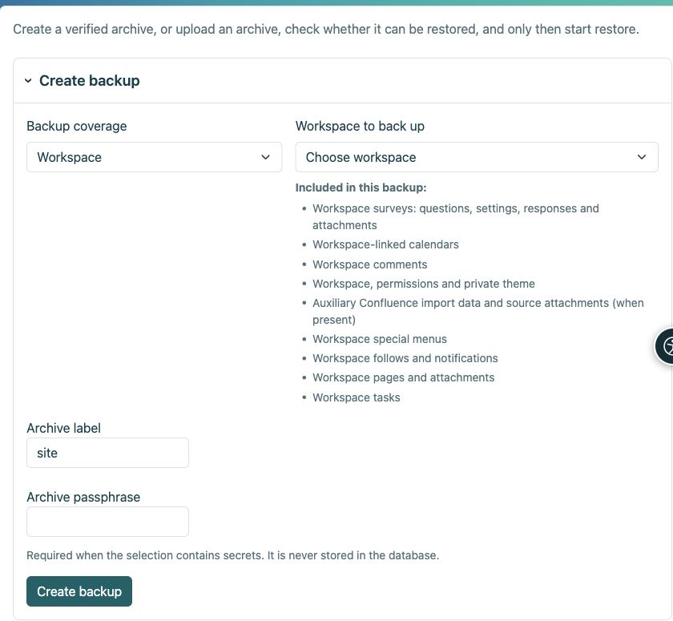

# Sichern und Wiederherstellen

> Die Bildschirmaufnahmen zeigen die englische Benutzeroberfläche.

[Für Administratoren](ankete-administratori_de.md)

**Ziel:** Eine Umfrage bewahren, damit sie zusammen mit ihren Antworten wiederhergestellt werden kann. Die Exporte CSV und HTML sind keine operativen Umfragesicherungen.

| Aktion | Was es enthält |
|----|----|
| Arbeitsbereich HTML exportieren | Statische Seiten; Auf Umfragen wird verzichtet, da sie eine Antragstellung voraussetzen. |
| Ergebnis CSV | Daten zur Analyse, keine wiederherstellbare Funktionserhebung. |
| Verschlüsselter Arbeitsbereich oder Sicherung der Umfrageseite | Definitionen, Übersetzungen, Überarbeitungen, Antworten, anwendbare Berechtigungen, Anhänge und erforderliche private Schlüssel. |
| Vollständige Site-Sicherung | Das Obige plus allgemeine Umfrageeinstellungen, Protokollwechsel, unabhängige Anbieter, Proxy-Unterprofile, Zuordnungen und globale Zuschüsse. |

1.  Verwenden Sie die Arbeitsbereichs-Verwaltung für ein Arbeitsbereichs-Archiv oder **Einstellungen → Sichern und Wiederherstellen** für eine vollständige Site. Wählen Sie den richtigen Bereich.
2.  Geben Sie eine Passphrase ein und laden Sie das verschlüsselte Archiv herunter. Speichern Sie die Passphrase separat.
3.  Laden Sie zum Wiederherstellen das Archiv und die Passphrase hoch, wählen Sie das Ziel aus und führen Sie Preflight aus. Überprüfen Sie alle Fehler und Warnungen, bevor Sie sie bestätigen.
4.  Ersetzen Sie nur das vorgesehene Ziel, bei Bedarf mit einem Sicherheits-Snapshot und einem Wartungsmodus. Führen Sie niemals eine Wiederherstellungsübung über die Live-Installation durch.

<figure>

<figcaption aria-hidden="true">Wählen Sie den Archivierungsumfang, bevor Sie das Backup erstellen.</figcaption>
</figure>

**Nach der Wiederherstellung:** Veröffentlichung, Zugriff, Anhänge und Ergebnisse prüfen. Konfigurieren Sie die externe Anmeldung an einer anderen Installationsadresse neu und testen Sie sie. Inhaltssicherungen enthalten keine Anbietergeheimnisse. Die Wiederherstellung von Berichtsplänen ist deaktiviert, bis die Empfänger überprüft wurden. Aktive Sitzungen und unvollständige Antworten sind keine dauerhaften Daten. Senden Sie ein Archiv und seine Passphrase nicht zusammen.

## Was bedeutet der Confluence-Eintrag?

Bei den importierten Seiten handelt es sich um normale Arbeitsbereichs-Seiten. Der Confluence-Sicherungseintrag behält nur zusätzliche Importdatensätze, Quell-Link-Zuordnungen und alle beibehaltenen Quellanhänge bei, wenn das Importmodul aktiviert ist. Es ersetzt keine Seiten und deren Anhänge. Umfragen werden separat aufgelistet: Fragen, Einstellungen, Antworten und Anhänge.
