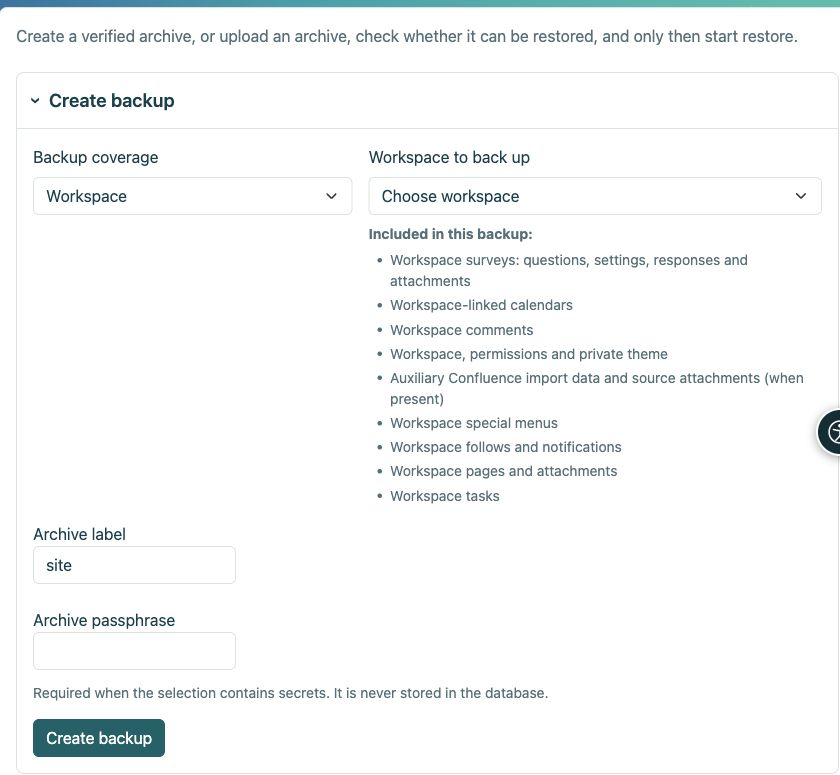

# Backup and restore

[For administrators](ankete-administratori_en.md)

**Goal:** preserve a survey so it can be restored together with its answers. CSV and HTML exports are not operational survey backups.

| Action | What it contains |
|----|----|
| Workspace HTML export | Static pages; surveys are omitted because they require the application. |
| Result CSV | Data for analysis, not a restorable functional survey. |
| Encrypted Workspace or survey-page backup | Definitions, translations, revisions, answers, applicable permissions, attachments and required private keys. |
| Full-site backup | The above plus general Survey settings, protocol switches, independent providers, proxy subprofiles, mappings and global grants. |

1.  Use Workspace management for a Workspace archive or **Settings → Backup and restore** for a full site. Choose the correct scope.
2.  Enter a passphrase and download the encrypted archive. Store the passphrase separately.
3.  To restore, upload the archive and passphrase, choose the target and run preflight. Review every error and warning before confirming.
4.  Replace only the intended target, with a safety snapshot and maintenance mode where required. Never perform a restore drill over the live installation.

<figure>

<figcaption aria-hidden="true">Choose the archive scope before creating the backup.</figcaption>
</figure>

**After restoration:** check publication, access, attachments and results. On a different installation address, reconfigure and test external sign-in; content backups do not carry provider secrets. Report schedules restore disabled until recipients are checked. Active sessions and unfinished answers are not durable data. Do not send an archive and its passphrase together.

## What does the Confluence entry mean?

Imported pages are ordinary Workspace pages. The Confluence backup entry preserves only auxiliary import records, source-link mappings and any retained source attachments when the import module is enabled. It does not replace pages and their attachments. Surveys are listed separately: questions, settings, responses and attachments.
