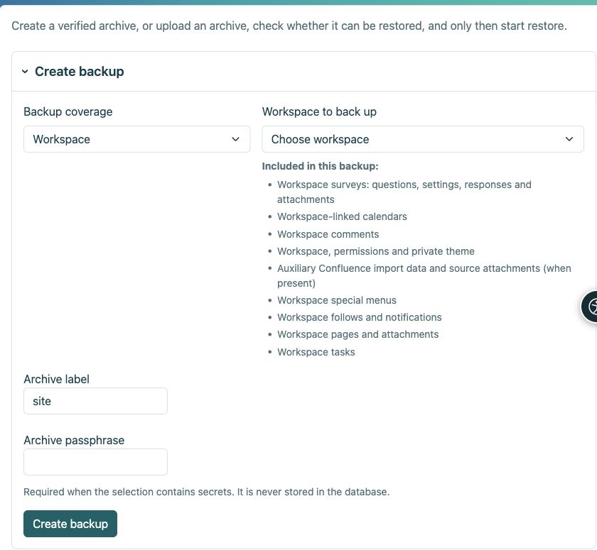

# Copias de seguridad y restauración

> Las capturas de pantalla muestran la interfaz en inglés.

[Para administradores](ankete-administratori_es.md)

**Objetivo:** preservar una encuesta para poder restaurarla junto con sus respuestas. Las exportaciones CSV y HTML no son copias de seguridad de encuestas operativas.

| Acción | que contiene |
|----|----|
| Exportación del espacio de trabajo HTML | Páginas estáticas; Se omiten encuestas porque requieren la aplicación. |
| Resultado CSV | Datos para análisis, no una encuesta funcional restaurable. |
| Espacio de trabajo cifrado o copia de seguridad de la página de la encuesta | Definiciones, traducciones, revisiones, respuestas, permisos aplicables, archivos adjuntos y claves privadas requeridas. |
| Copia de seguridad de todo el sitio | Lo anterior más la configuración general de la encuesta, cambios de protocolo, proveedores independientes, subperfiles de proxy, asignaciones y permisos globales. |

1.  Utilice la administración de Workspace para un archivo de Workspace o **Configuración → Copia de seguridad y restauración** para un sitio completo. Elija el alcance correcto.
2.  Ingrese una frase de contraseña y descargue el archivo cifrado. Guarde la frase de contraseña por separado.
3.  Para restaurar, cargue el archivo y la frase de contraseña, elija el destino y ejecute la verificación previa. Revise cada error y advertencia antes de confirmar.
4.  Reemplace solo el objetivo previsto, con una instantánea de seguridad y un modo de mantenimiento cuando sea necesario. Nunca realice un simulacro de restauración sobre la instalación activa.

<figure>

<figcaption aria-hidden="true">Elija el alcance del archivo antes de crear la copia de seguridad.</figcaption>
</figure>

**Después de la restauración:** consultar publicación, acceso, archivos adjuntos y resultados. En una dirección de instalación diferente, reconfigure y pruebe el inicio de sesión externo; Las copias de seguridad de contenido no contienen secretos del proveedor. La restauración de los programas de informes está deshabilitada hasta que se verifiquen los destinatarios. Las sesiones activas y las respuestas inacabadas no son datos duraderos. No envíe un archivo y su contraseña juntos.

## ¿Qué significa la entrada Confluence?

Las páginas importadas son páginas normales de Workspace. La entrada de copia de seguridad de Confluence conserva solo los registros de importación auxiliares, las asignaciones de enlaces de origen y cualquier archivo adjunto de origen retenido cuando el módulo de importación está habilitado. No reemplaza las páginas y sus archivos adjuntos. Las encuestas se enumeran por separado: preguntas, configuraciones, respuestas y archivos adjuntos.
