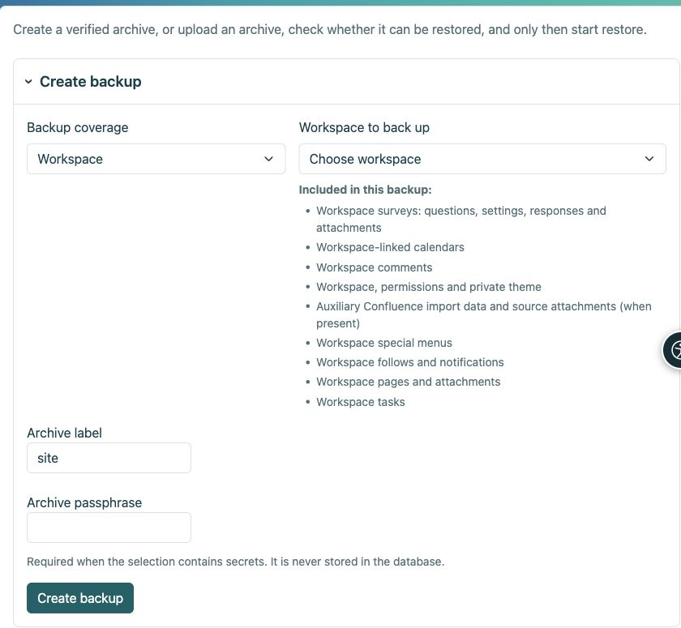

# Sauvegarde et restauration

> Les captures d’écran présentent l’interface en anglais.

[Pour les administrateurs](ankete-administratori_fr.md)

**Objectif :** conserver un sondage afin qu'il puisse être restauré avec ses réponses. Les exportations CSV et HTML ne sont pas des sauvegardes d'interrogation opérationnelles.

| Action | Ce qu'il contient |
|----|----|
| Exportation de l'espace de travail HTML | Pages statiques ; les sondages sont omis car ils nécessitent une candidature. |
| Résultat CSV | Données à analyser, pas un sondage fonctionnel restaurable. |
| Espace de travail chiffré ou sauvegarde de page de sondage | Définitions, traductions, révisions, réponses, autorisations applicables, pièces jointes et clés privées requises. |
| Sauvegarde de l'intégralité du site | Les éléments ci-dessus, ainsi que les paramètres généraux de Survey, l’activation des protocoles, les fournisseurs indépendants, les sous-profils proxy, les correspondances d’attributs et les droits globaux. |

1.  Utilisez la gestion Espace de travail pour une archive Espace de travail ou **Paramètres → Sauvegarde et restauration** pour un site complet. Choisissez la bonne portée.
2.  Entrez une phrase secrète et téléchargez l'archive cryptée. Stockez la phrase secrète séparément.
3.  Pour restaurer, téléchargez l'archive et la phrase secrète, choisissez la cible et exécutez le contrôle en amont. Passez en revue chaque erreur et avertissement avant de confirmer.
4.  Remplacez uniquement la cible prévue, avec un instantané de sécurité et un mode de maintenance si nécessaire. N’effectuez jamais d’exercice de restauration sur l’installation en direct.

<figure>

<figcaption aria-hidden="true">Choisissez la portée de l'archive avant de créer la sauvegarde.</figcaption>
</figure>

**Après restauration :** vérifiez la publication, l'accès, les pièces jointes et les résultats. Sur une adresse d'installation différente, reconfigurez et testez la connexion externe ; les sauvegardes de contenu ne contiennent pas de secrets de fournisseur. La restauration des planifications de rapports est désactivée jusqu'à ce que les destinataires soient vérifiés. Les sessions actives et les réponses inachevées ne sont pas des données durables. N'envoyez pas une archive et sa phrase secrète ensemble.

## Que signifie l’entrée Confluence ?

Les pages importées sont des pages Espace de travail ordinaires. L'entrée de sauvegarde Confluence conserve uniquement les enregistrements d'importation auxiliaires, les mappages de liens source et toutes les pièces jointes source conservées lorsque le module d'importation est activé. Il ne remplace pas les pages et leurs pièces jointes. Les sondages sont répertoriés séparément : questions, paramètres, réponses et pièces jointes.
