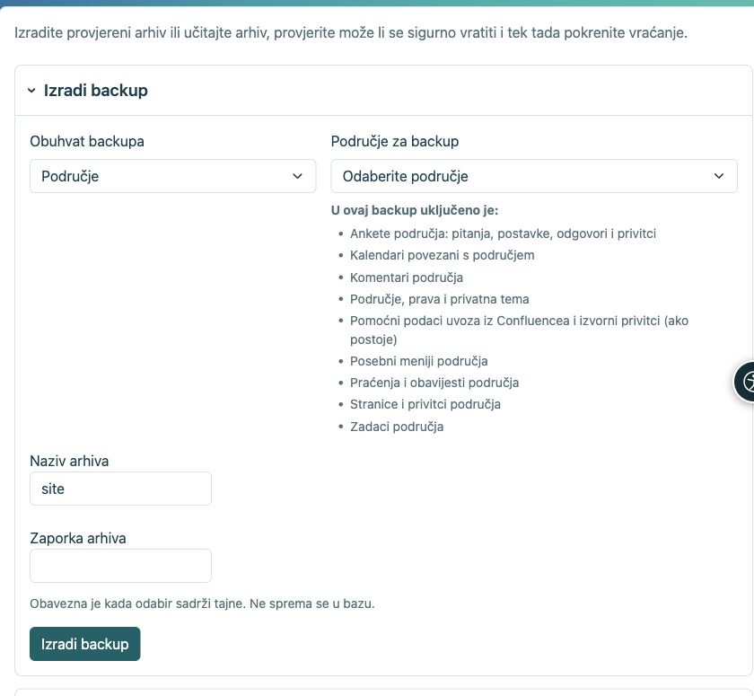

# Sigurnosne kopije i vraćanje

[Za administratore](ankete-administratori_hr.md)

**Cilj:** sačuvati anketu tako da se kasnije može vratiti zajedno s odgovorima. CSV i HTML izvoz nisu sigurnosna kopija ankete.

| Radnja | Što dobivate |
|----|----|
| HTML izvoz područja | Statične stranice; ankete se izostavljaju jer bez aplikacije ne mogu raditi. |
| CSV rezultata | Podatke za analizu, ne funkcionalnu anketu za vraćanje. |
| Šifrirani backup područja ili ankete | Definicije, prijevode, revizije, odgovore, pripadajuće ovlasti, privitke i potrebne privatne ključeve. |
| Backup cijelog sitea | Prethodno navedeno te opće postavke anketa, protokole, neovisne providere, proxy podprofile, mapiranja i globalne ovlasti. |

1.  Otvorite upravljanje područjem za kopiju područja ili **Postavke → Backup i vraćanje** za cijeli site. Odaberite pravi opseg.
2.  Upišite zaporku i preuzmite šifrirani arhiv. Zaporku čuvajte odvojeno.
3.  Za vraćanje učitajte arhiv i zaporku, odaberite cilj te pokrenite preflight provjeru. Pročitajte sve greške i upozorenja prije potvrde.
4.  Zamjenu pokrećite samo nad namjeravanim ciljem, uz sigurnosnu snimku i održavanje kada su potrebni. Provjeru povrata ne radite preko aktivne instalacije.

<figure>

<figcaption aria-hidden="true">Prije stvaranja arhiva odaberite što želite sačuvati.</figcaption>
</figure>

**Nakon vraćanja:** provjerite objavu, pristup, privitke i rezultate. Na drugoj adresi instalacije ponovno podesite i testirajte vanjske prijave; sadržajni backup ne nosi tajne providera. Izvještaji se vraćaju isključeni dok ne provjerite primatelje. Aktivne sesije i nedovršeni odgovori nisu dio trajnih podataka. Nikome ne šaljite arhiv zajedno sa zaporkom.

## Što znači stavka Confluence?

Uvezene stranice obične su stranice područja. Confluence stavka u backupu čuva samo pomoćne zapise uvoza, mapiranja izvornih poveznica i eventualne izvorne privitke, ako je modul uvoza uključen. Ne zamjenjuje stranice i njihove privitke. Ankete su zasebno navedene u popisu: pitanja, postavke, odgovori i privitci.
