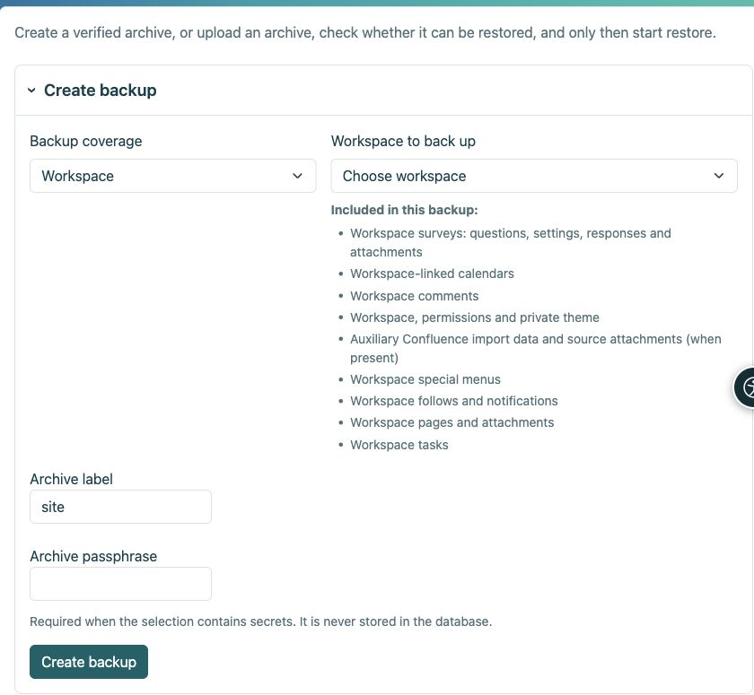

# Backup e ripristino

> Le schermate mostrano l’interfaccia in inglese.

[Per amministratori](ankete-administratori_it.md)

**Obiettivo:** conservare un sondaggio in modo da poterlo ripristinare insieme alle sue risposte. Le esportazioni CSV e HTML non sono copie di sicurezza per il ripristino operativo dei sondaggi.

| Azione | Cosa contiene |
|----|----|
| Area di lavoro HTML esportazione | Pagine statiche; i sondaggi vengono omessi perché richiedono l'applicazione. |
| Risultato CSV | Dati per l'analisi, non un sondaggio funzionante che sia possibile ripristinare. |
| Backup crittografato dell'area di lavoro o della pagina del sondaggio | Definizioni, traduzioni, revisioni, risposte, permessi applicabili, allegati e chiavi private richieste. |
| Backup dell'intero sito | Quanto sopra, più le impostazioni generali di Survey, l'abilitazione dei protocolli, i servizi di accesso indipendenti, i sottoprofili proxy, le mappature e le autorizzazioni globali. |

1.  Utilizza la gestione dell'area di lavoro per un archivio dell'area di lavoro o **Impostazioni → Backup e ripristino** per un sito completo. Scegli l'ambito corretto.
2.  Inserisci una passphrase e scarica l'archivio crittografato. Memorizzare la passphrase separatamente.
3.  Per ripristinare, carica l'archivio e la passphrase, scegli la destinazione ed esegui il preflight. Esamina ogni errore e avviso prima di confermare.
4.  Sostituisci solo l'obiettivo previsto, con un'istantanea di sicurezza e una modalità di manutenzione ove richiesto. Non eseguire mai un'esercitazione di ripristino sull'installazione live.

<figure>

<figcaption aria-hidden="true">Scegli l'ambito dell'archivio prima di creare il backup.</figcaption>
</figure>

**Dopo il ripristino:** verifica pubblicazione, accesso, allegati e risultati. Se l'indirizzo di installazione è diverso, riconfigura e verifica l'accesso esterno; i backup dei contenuti non includono i segreti dei servizi di accesso. Le pianificazioni dei rapporti vengono ripristinate disabilitate finché non sono stati verificati i destinatari. Le sessioni attive e le risposte incomplete non sono dati conservati stabilmente. Non inviare insieme un archivio e la sua passphrase.

## Cosa significa la voce Confluence?

Le pagine importate sono normali pagine di Workspace. La voce di backup di Confluence conserva solo i record di importazione ausiliari, le mappature dei collegamenti di origine e tutti gli allegati di origine conservati quando il modulo di importazione è abilitato. Non sostituisce le pagine e i relativi allegati. I sondaggi sono elencati separatamente: domande, impostazioni, risposte e allegati.
