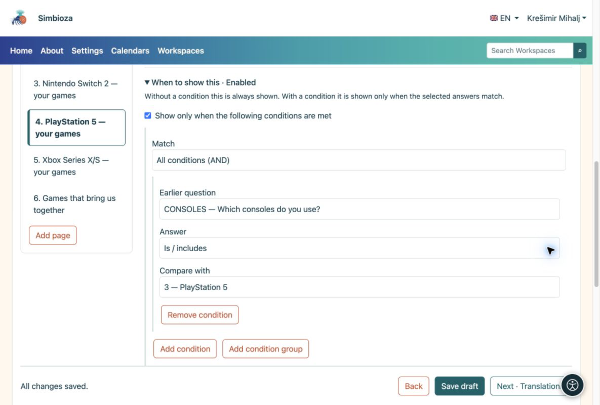
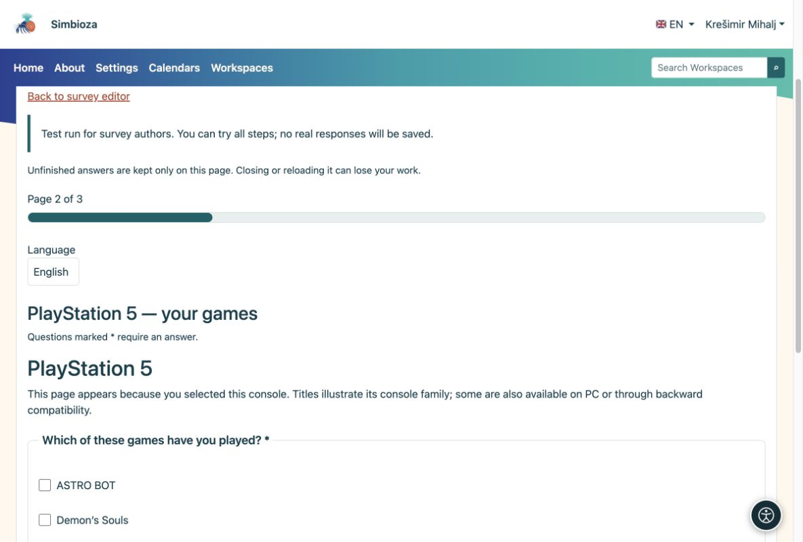
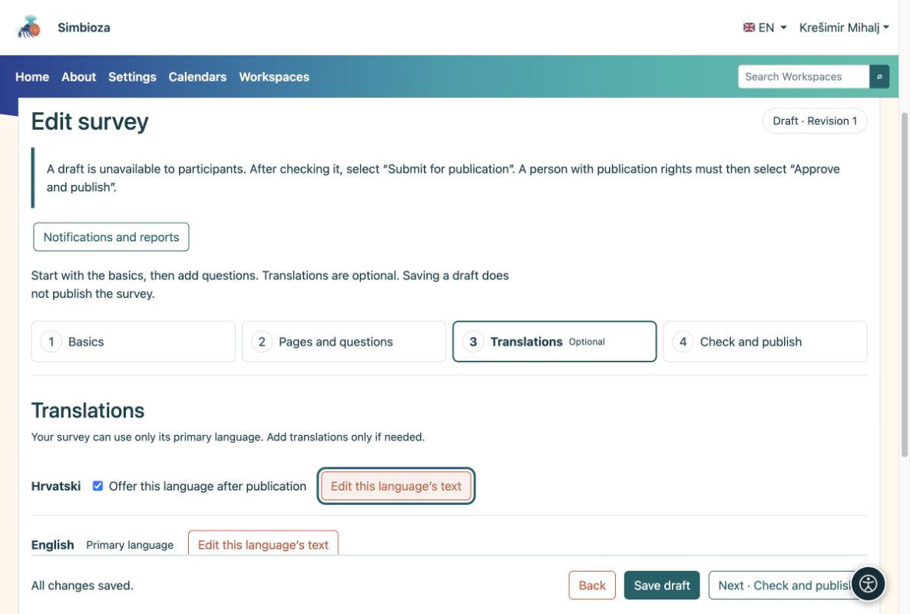

# Bedingte Fragen und Sprachen

> Die Bildschirmaufnahmen zeigen die englische Benutzeroberfläche.

[Für Umfrageautoren](ankete-autori_de.md)

Sie können diese Seite überspringen, wenn Sie Ihre erste einfache Umfrage durchführen.

## Nur zutreffende Fragen anzeigen

**Beispiel:** Jemand wählt unter „Welche Konsolen verwenden Sie?“ Nintendo Switch und PlayStation 5 aus. Sie möchten nur Fragen für diese beiden Konsolen anzeigen.

1.  Fügen Sie eine **Multiple-Choice**-Frage mit Konsolen als Auswahlmöglichkeiten hinzu.
2.  Fügen Sie für jede Konsole eine separate Seite hinzu. Öffnen Sie auf der PlayStation 5-Seite **Wann soll dies angezeigt werden**.
3.  Wählen Sie die frühere Konsolenfrage und die Option **PlayStation 5** aus. Stellen Sie auf den anderen Seiten die entsprechende Konsole ein. Eine Bedingung kann auch nur für eine Frage gelten.
4.  Platzieren Sie häufige Fragen ohne diese Bedingung auf einer Seite. Probieren Sie im Test verschiedene Kombinationen aus und prüfen Sie das Ergebnis.

<figure>

<figcaption aria-hidden="true">Die Seitenbedingung bezieht sich auf eine ausgewählte Auswahl in einer früheren Frage.</figcaption>
</figure>

<figure>

<figcaption aria-hidden="true">Der Teilnehmer sieht Fragen zur ausgewählten Konsole.</figcaption>
</figure>

**Ergebnis:** Teilnehmer beantworten keine irrelevanten Fragen. Wenn sich eine frühere Antwort ändert, werden die Antworten in neu ausgeblendeten Fragen gelöscht. Die gleiche Methode funktioniert für macOS, Linux und Windows oder alle anderen Gruppen.

## Kombinieren Sie Bedingungen bei Bedarf

Für die meisten Umfragen reicht eine Bedingung aus. Für eine Kombination verwenden Sie **Bedingung hinzufügen** oder **Bedingungsgruppe hinzufügen** unter **Wann soll dies angezeigt werden**:

- **Alle Bedingungen (AND)** erfordert, dass alle Bedingungen übereinstimmen.
- **Mindestens eine Bedingung (ODER)** erfordert mindestens eine Übereinstimmung.

**Beispiel:** Zeigen Sie eine Folgefrage an jemanden, der PlayStation 5 oder Nintendo Switch verwendet **und** eine Bewertung von mindestens 4 abgegeben hat. Platzieren Sie die Konsolenfrage und die Bewertungsfrage früher in der Umfrage. Wählen Sie im späteren Folgeprozess **Alle Bedingungen (UND)** aus. Fügen Sie eine Gruppe **Mindestens eine Bedingung (ODER)** hinzu, die die beiden Konsolenoptionen enthält, und fügen Sie neben dieser Gruppe eine Bedingung hinzu, die erfordert, dass die frühere Bewertung mindestens 4 beträgt.

Die verfügbaren Vergleiche hängen von der vorherigen Frage ab: ob sie beantwortet wurde, ob eine Auswahl getroffen wurde, ob der Text einen Wert enthält oder ob eine Zahl, Bewertung, ein Datum oder eine Uhrzeit über/unter einer Grenze liegt. Wählen Sie für eine Matrix auch die zu vergleichende Zeile aus.

**Ergebnis:** Das Follow-up erscheint nur für die vorgesehene Kombination. Eine Bedingung darf nur frühere Fragen verwenden, nicht sich selbst oder eine spätere Frage. Überprüfen Sie die Bedingungen erneut, nachdem Sie Fragen verschoben oder entfernt haben. Testen Sie bei der Testteilnahme sowohl eine Kombination, die die Frage anzeigen soll, als auch eine, die sie verbergen soll.

## Bieten Sie eine andere Sprache nur bei Bedarf an

1.  Öffnen Sie **Übersetzungen** und fügen Sie die Sprache hinzu. Es sind nur installierte und aktive Anwendungssprachen verfügbar.
2.  Kopieren Sie optional den vorhandenen Text und übersetzen Sie dann den Titel, die Einleitung, die Fragen und alle Auswahlmöglichkeiten. Kopieren ist keine automatische Übersetzung.
3.  Aktivieren Sie **Diese Sprache nach Veröffentlichung anbieten** nur, wenn die Übersetzung abgeschlossen ist.

<figure>

<figcaption aria-hidden="true">Übersetzungen sind optional und werden separat aktiviert.</figcaption>
</figure>

Die Fragenstruktur und -bedingungen werden von allen Sprachen gemeinsam genutzt. Sie übersetzen den Text und erstellen keine weitere Umfrage.
