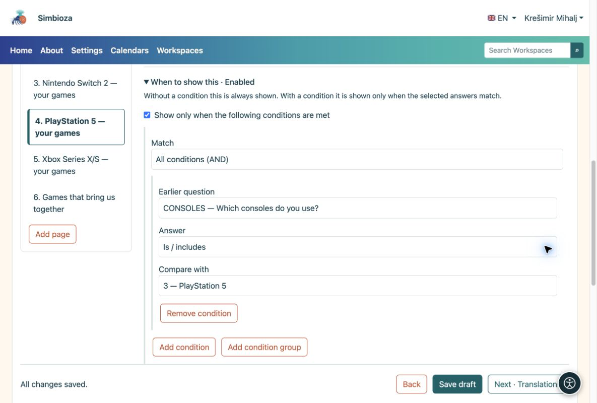
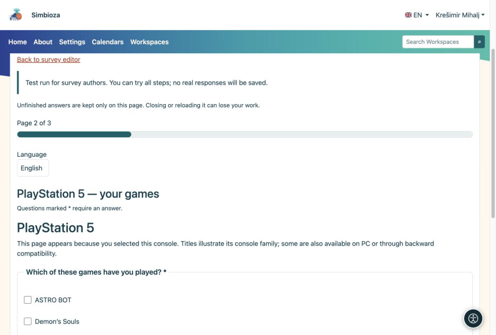
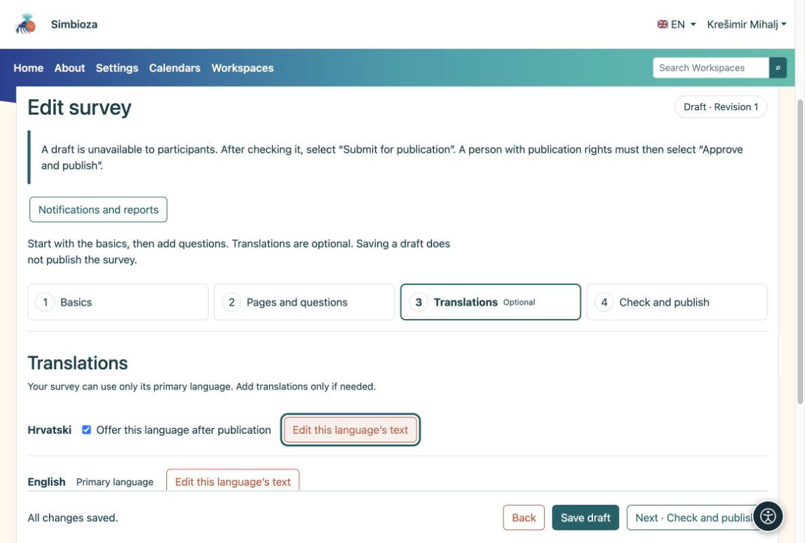

# Conditional questions and languages

[For survey authors](ankete-autori_en.md)

You can skip this page when making your first simple survey.

## Show only questions that apply

**Example:** someone selects Nintendo Switch and PlayStation 5 in “Which consoles do you use?”. You want to show questions for those two consoles only.

1.  Add a **Multiple choice** question with consoles as its choices.
2.  Add a separate page for each console. On the PlayStation 5 page, open **When to show this**.
3.  Select the earlier console question and the **PlayStation 5** choice. Set the corresponding console on the other pages. A condition can also apply to just one question.
4.  Place common questions on a page without that condition. Try different combinations in the trial and check the outcome.

<figure>

<figcaption aria-hidden="true">The page condition refers to a selected choice in an earlier question.</figcaption>
</figure>

<figure>

<figcaption aria-hidden="true">The participant sees questions for the selected console.</figcaption>
</figure>

**Result:** participants do not answer irrelevant questions. If an earlier answer changes, answers in newly hidden questions are cleared. The same method works for macOS, Linux and Windows, or any other groups.

## Offer another language only when needed

1.  Open **Translations** and add the language. Only installed and active application languages are available.
2.  Optionally copy the existing text, then translate the title, introduction, questions and every choice. Copying is not automatic translation.
3.  Enable **Offer this language after publication** only when the translation is complete.

<figure>

<figcaption aria-hidden="true">Translations are optional and enabled separately.</figcaption>
</figure>

Question structure and conditions are shared between languages. You translate the text, not create another survey.
