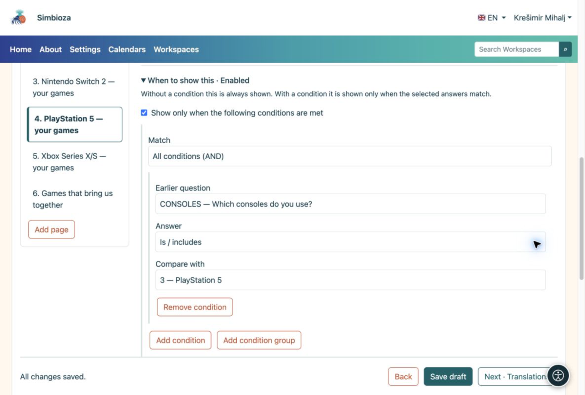
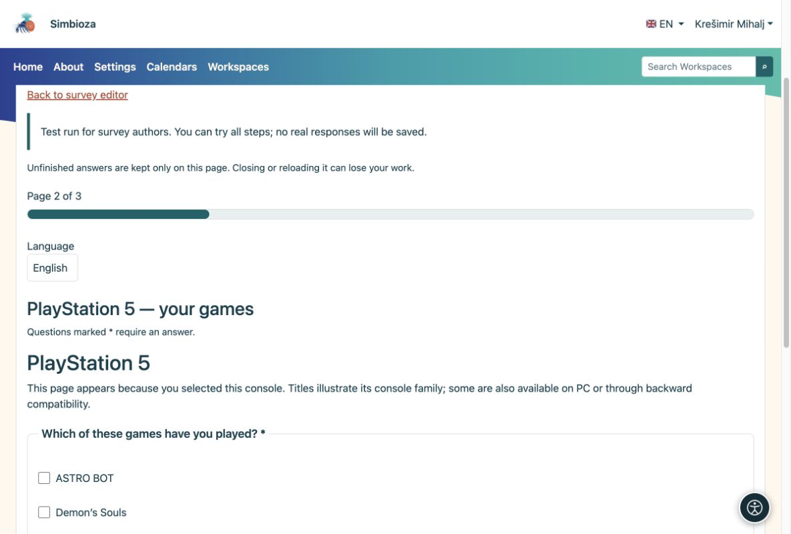
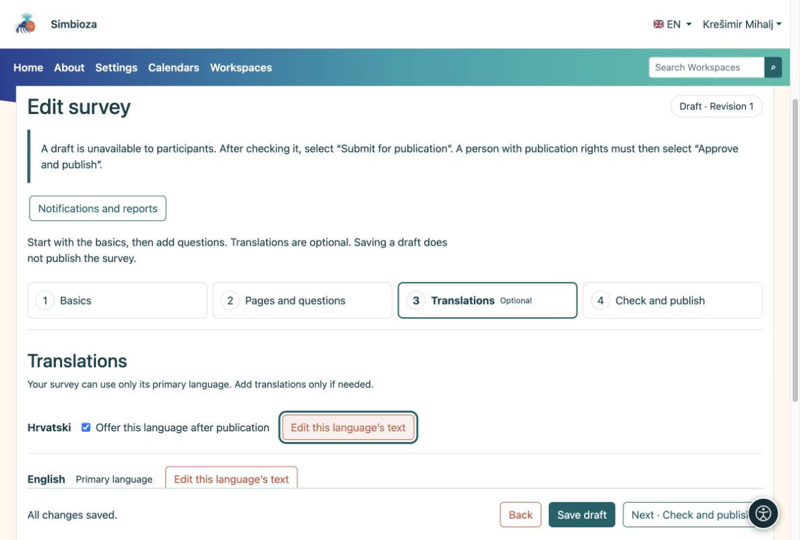

# Preguntas condicionales e idiomas

> Las capturas de pantalla muestran la interfaz en inglés.

[Para autores de encuestas](ankete-autori_es.md)

Puede omitir esta página cuando realice su primera encuesta simple.

## Mostrar solo las preguntas que correspondan

**Ejemplo:** alguien selecciona Nintendo Switch y PlayStation 5 en "¿Qué consolas usas?". Desea mostrar preguntas solo para esas dos consolas.

1.  Agregue una pregunta de **opción múltiple** con consolas como opciones.
2.  Agregue una página separada para cada consola. En la página de PlayStation 5, abre **Cuándo mostrar esto**.
3.  Seleccione la pregunta anterior sobre la consola y la opción **PlayStation 5**. Configure la consola correspondiente en las otras páginas. Una condición también puede aplicarse a una sola pregunta.
4.  Coloque preguntas comunes en una página sin esa condición. Pruebe diferentes combinaciones en la prueba y compruebe el resultado.

<figure>

<figcaption aria-hidden="true">La condición de la página se refiere a una opción seleccionada en una pregunta anterior.</figcaption>
</figure>

<figure>

<figcaption aria-hidden="true">El participante ve preguntas para la consola seleccionada.</figcaption>
</figure>

**Resultado:** los participantes no responden preguntas irrelevantes. Si cambia una respuesta anterior, se borran las respuestas de las preguntas ocultas recientemente. El mismo método funciona para macOS, Linux y Windows, o cualquier otro grupo.

## Combine condiciones cuando sea necesario

Una condición es suficiente para la mayoría de las encuestas. Para una combinación, use **Agregar condición** o **Agregar grupo de condiciones** en **Cuándo mostrar esto**:

- **Todas las condiciones (Y)** requiere que todas las condiciones coincidan.
- **Al menos una condición (O)** requiere al menos una coincidencia.

**Ejemplo:** mostrar una pregunta de seguimiento a alguien que usa PlayStation 5 o Nintendo Switch **y** dio una calificación de al menos 4. Coloque la pregunta sobre la consola y la pregunta de calificación anteriormente en la encuesta. En el seguimiento posterior, elija **Todas las condiciones (Y)**. Agregue un grupo **Al menos una condición (O)** que contenga las dos opciones de consola y, junto a ese grupo, agregue una condición que requiera que la calificación anterior sea al menos 4.

Las comparaciones disponibles dependen de la pregunta anterior: si se respondió, si se seleccionó una opción, si el texto contiene un valor o si un número, calificación, fecha u hora está por encima o por debajo de un límite. Para una matriz, seleccione también la fila a comparar.

**Resultado:** el seguimiento aparece solo para la combinación prevista. Una condición puede utilizar únicamente preguntas anteriores, no ella misma ni una pregunta posterior. Vuelva a verificar las condiciones después de mover o eliminar preguntas. En la participación en la prueba, pruebe una combinación que debería mostrar la pregunta y otra que debería ocultarla.

## Ofrecer otro idioma solo cuando sea necesario.

1.  Abra **Traducciones** y agregue el idioma. Sólo están disponibles los idiomas de las aplicaciones instaladas y activas.
2.  Opcionalmente, copie el texto existente, luego traduzca el título, la introducción, las preguntas y todas las opciones. Copiar no es una traducción automática.
3.  Habilite **Ofrecer este idioma después de la publicación** solo cuando la traducción esté completa.

<figure>

<figcaption aria-hidden="true">Las traducciones son opcionales y se habilitan por separado.</figcaption>
</figure>

La estructura y las condiciones de las preguntas se comparten entre idiomas. Tú traduces el texto, no creas otra encuesta.
