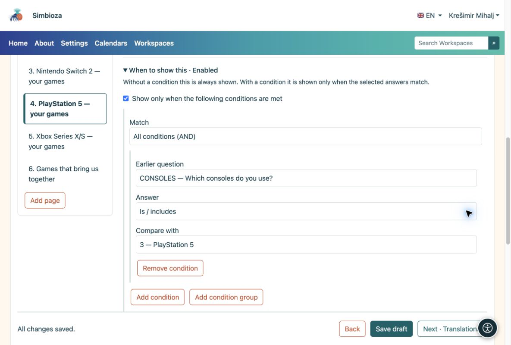
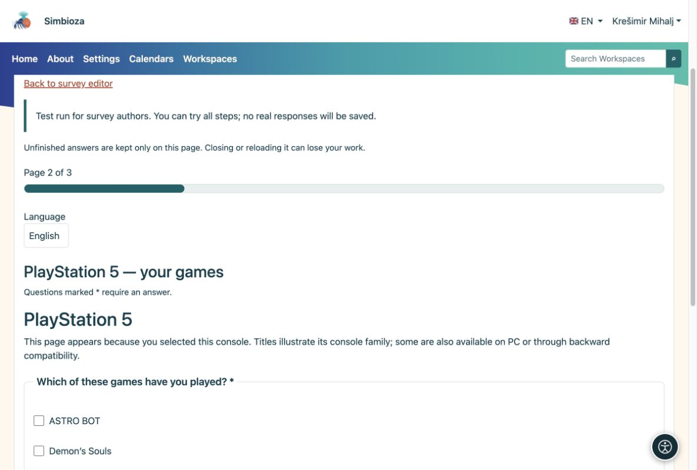
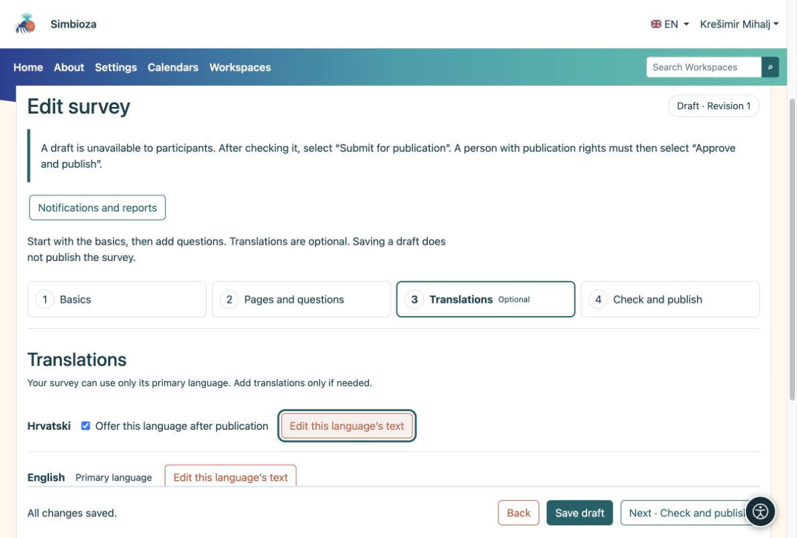

# Questions conditionnelles et langues

> Les captures d’écran présentent l’interface en anglais.

[Pour les auteurs du sondage](ankete-autori_fr.md)

Vous pouvez ignorer cette page lors de votre premier sondage simple.

## Afficher uniquement les questions qui s'appliquent

**Exemple :** quelqu'un sélectionne Nintendo Switch et PlayStation 5 dans "Quelles consoles utilisez-vous ?". Vous souhaitez afficher les questions pour ces deux consoles uniquement.

1.  Ajoutez une question **À choix multiple** avec des consoles comme choix.
2.  Ajoutez une page distincte pour chaque console. Sur la page PlayStation 5, ouvrez **Quand afficher ceci**.
3.  Sélectionnez la question précédente sur la console et le choix **PlayStation 5**. Définissez la console correspondante sur les autres pages. Une condition peut également s’appliquer à une seule question.
4.  Placez les questions courantes sur une page sans cette condition. Essayez différentes combinaisons dans l'essai et vérifiez le résultat.

<figure>

<figcaption aria-hidden="true">La condition de page fait référence à un choix sélectionné dans une question précédente.</figcaption>
</figure>

<figure>

<figcaption aria-hidden="true">Le participant voit les questions pour la console sélectionnée.</figcaption>
</figure>

**Résultat :** les participants ne répondent pas aux questions non pertinentes. Si une réponse antérieure change, les réponses aux questions nouvellement masquées sont effacées. La même méthode fonctionne pour macOS, Linux et Windows, ou tout autre groupe.

## Combinez les conditions si nécessaire

Une seule condition suffit pour la plupart des sondages. Pour une combinaison, utilisez **Ajouter une condition** ou **Ajouter un groupe de conditions** sous **Quand afficher ceci** :

- **Toutes les conditions (ET)** exigent que chaque condition corresponde.
- **Au moins une condition (OR)** nécessite au moins une correspondance.

**Exemple :** posez une question de suivi à quelqu'un qui utilise une PlayStation 5 ou une Nintendo Switch **et** qui a donné une note d'au moins 4. Posez la question sur la console et la question d'évaluation plus tôt dans le sondage. Lors du suivi ultérieur, choisissez **Toutes les conditions (ET)**. Ajoutez un groupe **Au moins une condition (OR)** contenant les deux choix de console, et à côté de ce groupe, ajoutez une condition exigeant que la note précédente soit d'au moins 4.

Les comparaisons disponibles dépendent de la question précédente : si elle a reçu une réponse, si un choix a été sélectionné, si le texte contient une valeur ou si un nombre, une note, une date ou une heure se trouve au-dessus/en dessous d'une limite. Pour une matrice, sélectionnez également la ligne à comparer.

**Résultat :** le suivi apparaît uniquement pour la combinaison prévue. Une condition peut utiliser uniquement des questions antérieures, et non elle-même ou une question ultérieure. Revérifiez les conditions après avoir déplacé ou supprimé des questions. Lors de la participation à l'essai, testez à la fois une combinaison qui doit afficher la question et une autre qui doit la masquer.

## Proposer une autre langue uniquement en cas de besoin

1.  Ouvrez **Traductions** et ajoutez la langue. Seules les langues d'application installées et actives sont disponibles.
2.  Copiez éventuellement le texte existant, puis traduisez le titre, l'introduction, les questions et tous les choix. La copie n'est pas une traduction automatique.
3.  Activez **Proposer cette langue après publication** uniquement lorsque la traduction est terminée.

<figure>

<figcaption aria-hidden="true">Les traductions sont facultatives et activées séparément.</figcaption>
</figure>

La structure et les conditions des questions sont partagées entre les langues. Vous traduisez le texte, vous ne créez pas un autre sondage.
