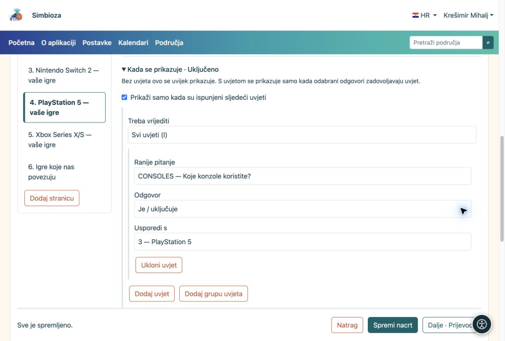
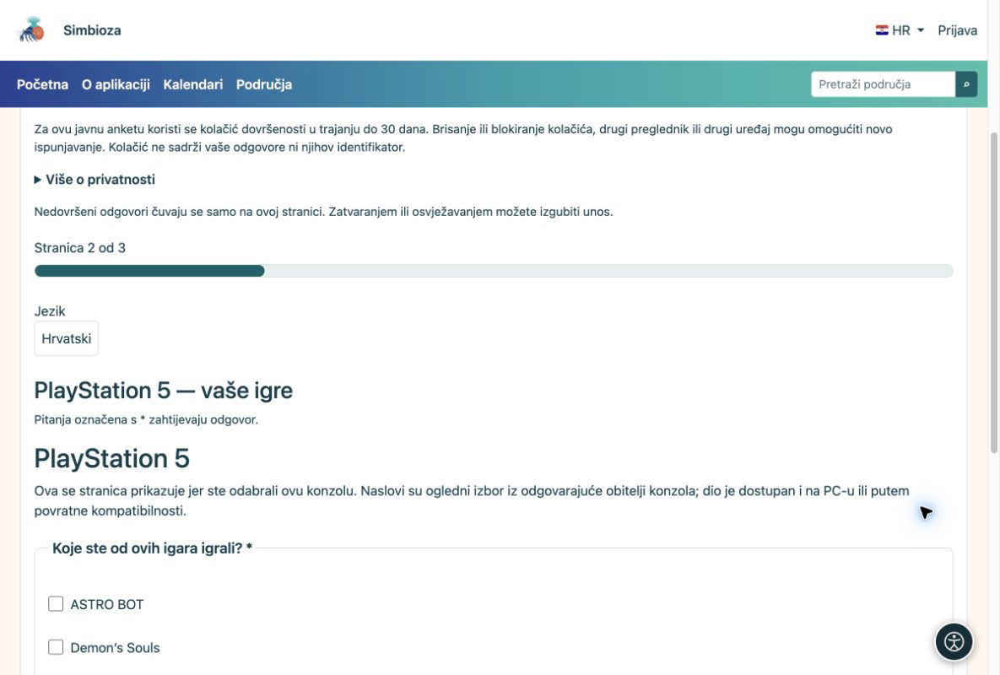
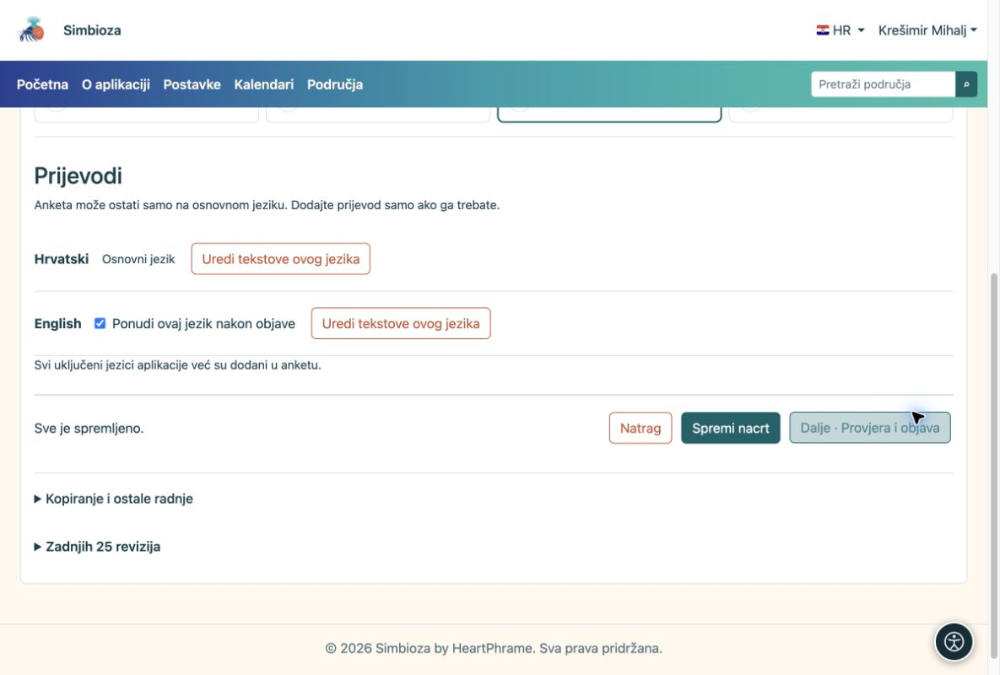

# Uvjetna pitanja i više jezika

[Za sastavljače anketa](ankete-autori_hr.md)

Ovo možete preskočiti za prvu jednostavnu anketu.

## Prikažite samo pitanja koja se odnose na osobu

**Primjer:** u pitanju „Koje konzole koristite?” osoba označi Nintendo Switch i PlayStation 5. Želite joj prikazati pitanja samo za te dvije konzole.

1.  Dodajte pitanje vrste **Više odabira** s konzolama kao ponuđenim odgovorima.
2.  Dodajte zasebnu stranicu za svaku konzolu. Na stranici za PlayStation 5 otvorite **Kada se prikazuje**.
3.  Odaberite ranije pitanje o konzolama i odgovor **PlayStation 5**. Za druge stranice odaberite pripadajuću konzolu. Isto pravilo možete zadati samo pojedinom pitanju.
4.  Zajednička pitanja stavite na stranicu bez takvog uvjeta. U probnom ispunjavanju označite različite kombinacije i provjerite rezultat.

<figure>

<figcaption aria-hidden="true">Uvjet stranice povezuje se s odabranim odgovorom na ranije pitanje.</figcaption>
</figure>

<figure>

<figcaption aria-hidden="true">Ispitanik vidi pitanja za konzolu koju je odabrao.</figcaption>
</figure>

**Rezultat:** osoba ne prolazi pitanja koja se na nju ne odnose. Ako promijeni raniji odgovor, odgovori na sada skrivena pitanja brišu se. Isti postupak vrijedi za macOS, Linux i Windows ili bilo koje druge skupine.

## Ponudite drugi jezik samo ako ga trebate

1.  Otvorite **Prijevodi** i dodajte željeni jezik. Nude se samo instalirani i aktivni jezici aplikacije.
2.  Po želji kopirajte postojeći tekst, zatim prevedite naslov, uvod, pitanja i sve odgovore. Kopiranje nije automatski prijevod.
3.  Uključite **Ponudi ovaj jezik nakon objave** tek kada je prijevod dovršen.

<figure>

<figcaption aria-hidden="true">Prijevod je neobvezan i uključuje se zasebno.</figcaption>
</figure>

Pitanja i uvjeti zajednički su svim jezicima. Prevodite tekstove, ne izrađujete drugu anketu.
