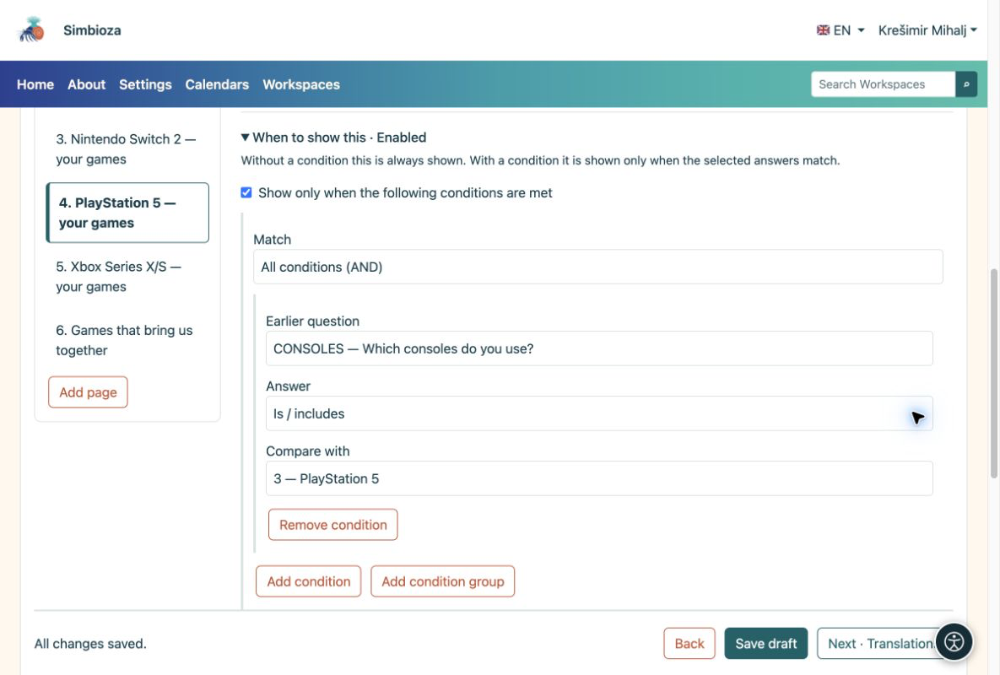
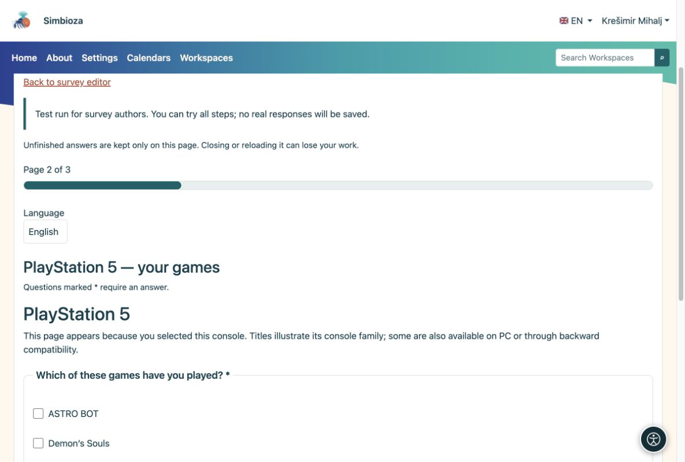
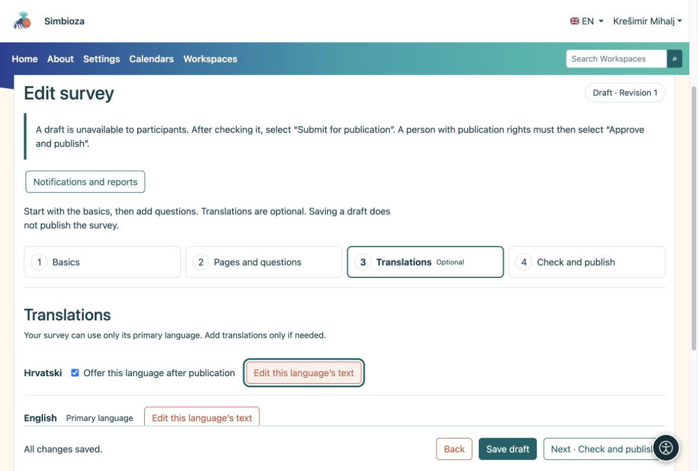

# Domande condizionali e lingue

> Le schermate mostrano l’interfaccia in inglese.

[Per gli autori del sondaggio](ankete-autori_it.md)

Puoi saltare questa pagina quando effettui il tuo primo semplice sondaggio.

## Mostra solo le domande pertinenti

**Esempio:** qualcuno seleziona Nintendo Switch e PlayStation 5 in "Quali console usi?". Vuoi mostrare le domande solo per quelle due console.

1.  Aggiungi una domanda **a scelta multipla** con le console come scelte.
2.  Aggiungi una pagina separata per ciascuna console. Nella pagina PlayStation 5, apri **Quando mostrarlo**.
3.  Seleziona la domanda precedente sulla console e la scelta **PlayStation 5**. Imposta la console corrispondente nelle altre pagine. Una condizione può applicarsi anche a una sola domanda.
4.  Posiziona le domande comuni su una pagina senza tale condizione. Prova diverse combinazioni nella prova e controlla il risultato.

<figure>

<figcaption aria-hidden="true">La condizione della pagina si riferisce a una scelta selezionata in una domanda precedente.</figcaption>
</figure>

<figure>

<figcaption aria-hidden="true">Il partecipante vede le domande per la console selezionata.</figcaption>
</figure>

**Risultato:** i partecipanti non rispondono a domande irrilevanti. Se una risposta precedente cambia, le risposte nelle domande appena nascoste vengono cancellate. Lo stesso metodo funziona per macOS, Linux e Windows o qualsiasi altro gruppo.

## Combina le condizioni quando necessario

Per la maggior parte dei sondaggi è sufficiente una condizione. Per una combinazione, utilizza **Aggiungi condizione** o **Aggiungi gruppo condizioni** in **Quando mostrarlo**:

- **Tutte le condizioni (AND)** richiedono che tutte le condizioni corrispondano.
- **Almeno una condizione (OR)** richiede almeno una corrispondenza.

**Esempio:** mostra una domanda di follow-up a qualcuno che usa PlayStation 5 o Nintendo Switch **e** ha dato una valutazione di almeno 4. Inserisci la domanda sulla console e la domanda di valutazione all'inizio del sondaggio. Nella fase successiva, seleziona **Tutte le condizioni (AND)**. Aggiungi un gruppo **Almeno una condizione (OR)** contenente le due scelte della console e accanto a quel gruppo aggiungi una condizione che richiede che la valutazione precedente sia almeno 4.

I confronti disponibili dipendono dalla domanda precedente: se è stata data una risposta, se è stata selezionata una scelta, se il testo contiene un valore o se un numero, una valutazione, una data o un'ora si trova sopra/sotto un limite. Per una matrice, seleziona anche la riga da confrontare.

**Risultato:** il follow-up viene visualizzato solo per la combinazione prevista. Una condizione può utilizzare solo le domande precedenti, non se stessa o una domanda successiva. Ricontrolla le condizioni dopo aver spostato o rimosso le domande. Nella partecipazione alla prova, prova sia una combinazione che dovrebbe mostrare la domanda sia una che dovrebbe nasconderla.

## Offri un'altra lingua solo quando necessario

1.  Apri **Traduzioni** e aggiungi la lingua. Sono disponibili solo le lingue dell'applicazione installate e attive.
2.  Facoltativamente copia il testo esistente, quindi traduci il titolo, l'introduzione, le domande e ogni scelta. La copia non è una traduzione automatica.
3.  Abilita **Offri questa lingua dopo la pubblicazione** solo quando la traduzione è completa.

<figure>

<figcaption aria-hidden="true">Le traduzioni sono facoltative e abilitate separatamente.</figcaption>
</figure>

La struttura e le condizioni delle domande sono condivise tra le lingue. Traduci il testo, non crei un altro sondaggio.
