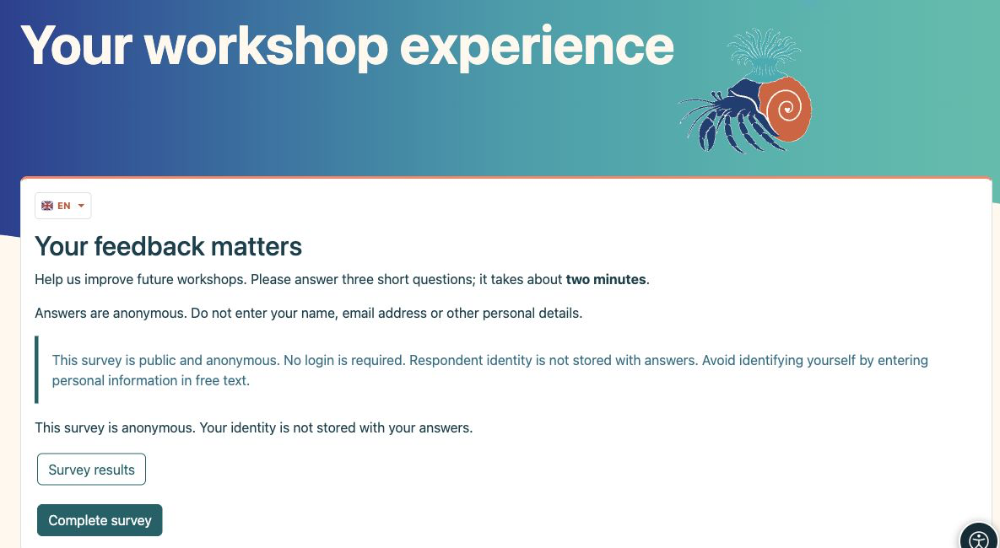
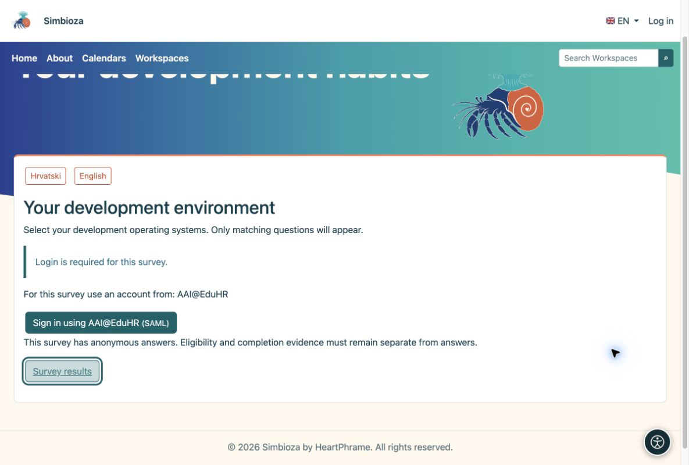
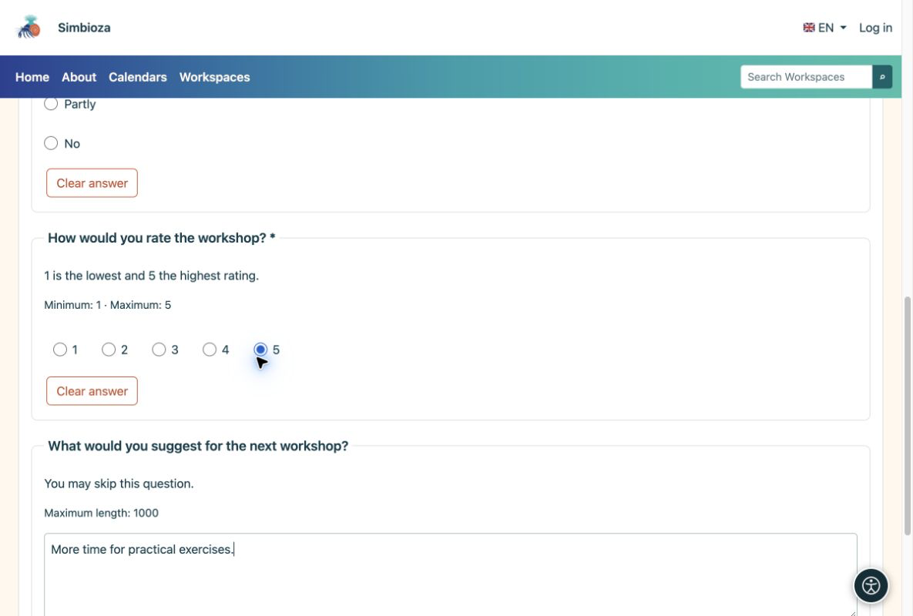
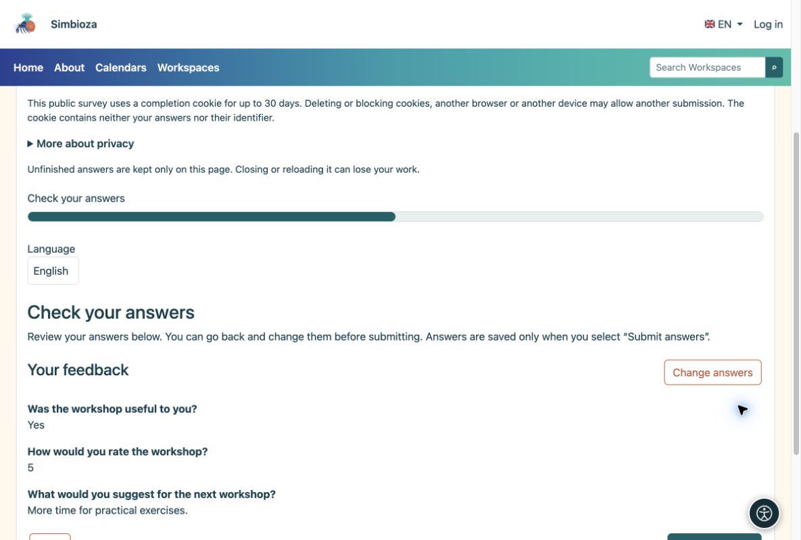
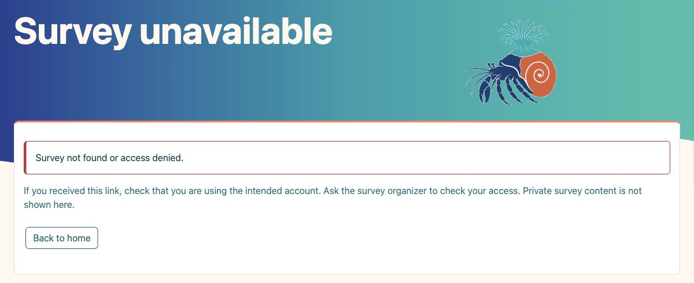
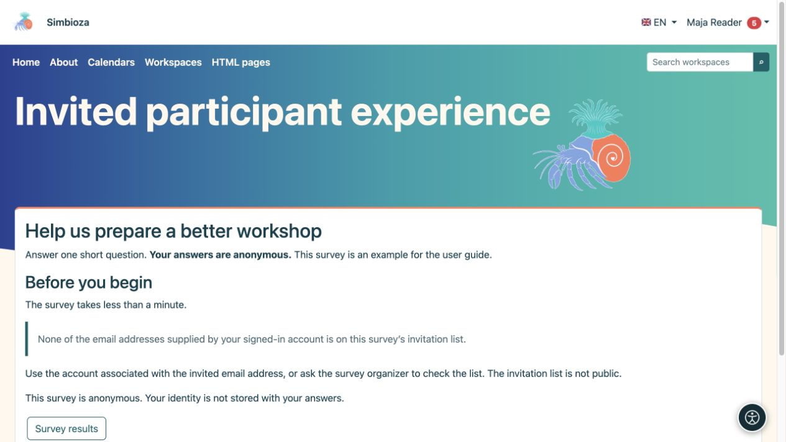

# Für Teilnehmer – eine Umfrage ausfüllen

> Die Bildschirmaufnahmen zeigen die englische Benutzeroberfläche.

[Umfragen](ankete_de.md)

Normalerweise öffnen Sie eine Umfrage über einen Link, den Ihnen jemand gesendet hat, oder über eine Arbeitsbereichs-Seite. Sie müssen nicht wissen, wie es gebaut wurde.

## 1. Lesen Sie die Einleitung

In der Einleitung wird der Zweck erläutert. Überprüfen Sie die Datenschutz-, Anmelde- und Dauerhinweise und wählen Sie dann **Umfrage abschließen**.

<figure>

<figcaption aria-hidden="true">Lesen Sie den Zweck und die Datenschutzerklärung, bevor Sie antworten.</figcaption>
</figure>

Wenn die Umfrage übersetzt ist, öffnen Sie das Dropdown-Menü mit der **Flagge und dem Sprachcode** (zum Beispiel EN) und wählen Sie eine Übersetzung aus. Es werden nur vom Autor freigegebene Übersetzungen angeboten. Wenn Sie beim Antworten die Sprache ändern, werden vorhandene Antworten nicht gelöscht. Dadurch ändert sich die Umfragesprache, nicht die Sprache der Anwendungsoberfläche.

## 2. Melden Sie sich nur an, wenn Sie dazu aufgefordert werden

Für eine öffentliche Umfrage ist kein Login erforderlich. Eine Umfrage für Simbioza-Benutzer verwendet Ihr Anwendungs-Login. Wenn eine externe Anmeldung angeboten wird, wählen Sie eine zulässige Methode und verwenden Sie das entsprechende Konto. Eine Kontoanforderung einer bestimmten Institution akzeptiert kein anderes Konto. Wenn Sie sich nur für eine Umfrage anmelden, wird kein Simbioza-Konto erstellt.

<figure>

<figcaption aria-hidden="true">Wenn eine Anmeldung erforderlich ist, bietet die Umfrage die zulässigen Methoden an.</figcaption>
</figure>

**Anonym mit Login ist möglich:** Durch die Anmeldung kann die Berechtigung bestätigt und wiederholte Einreichungen verhindert werden, ohne dass Ihr Name bei den Antworten gespeichert wird. Eine bekannte Umfrage besagt dies ausdrücklich.

## 3. Beantworten Sie die Fragen

Wählen Sie Optionen aus oder geben Sie Text ein. Ein Sternchen markiert eine erforderliche Antwort. Wählen Sie **Weiter**, um fortzufahren, und **Zurück**, um eine frühere Antwort zu korrigieren. Einige Fragen erscheinen erst nach einer bestimmten Auswahl; das wird erwartet.

<figure>

<figcaption aria-hidden="true">Beantworten Sie die erforderlichen Fragen; ein optionaler Kommentar kann leer gelassen werden.</figcaption>
</figure>

## 4. Überprüfen und absenden

Überprüfen Sie Ihre Antworten im abschließenden Review. Wenn sie richtig sind, wählen Sie **Antworten senden**. Durch Klicken auf „Weiter“ allein werden sie nicht übermittelt. Warten Sie auf die Bestätigung.

<figure>

<figcaption aria-hidden="true">Mit der abschließenden Überprüfung können Sie vor dem Absenden eine Überprüfung durchführen.</figcaption>
</figure>

**Fertig:** Die Annahmebestätigung bedeutet, dass Ihre Antworten gespeichert sind. Falls verfügbar, wählen Sie **Umfrageergebnisse**, um die Ergebnisse anzuzeigen.

## Wenn Sie nicht auf eine Umfrage zugreifen können

**Falsche Domain:** Melden Sie sich mit einem Konto einer für diese Umfrage zugelassenen Institution an. **Nicht auf der Einladungsliste:** Verwenden Sie ein Konto, dessen eingeladene E-Mail-Adresse vom Anmeldeanbieter überprüft wurde. Eine lediglich in ein Profil eingegebene Adresse ist kein Beweis für eine Einladung. Wenn Ihr Konto mehrere Adressen liefert, reicht ein Treffer. Wenn Sie sich nicht sicher sind, wenden Sie sich an die Person, die Ihnen die Umfrage gesendet hat.

**Private oder nicht verfügbare Umfrage:** Ein Link allein gewährt keinen Zugriff. Überprüfen Sie Ihr Konto oder fragen Sie den Veranstalter um Berechtigung. Andere private Seiten und Antworten werden nicht angezeigt.

<figure>

<figcaption aria-hidden="true">Eine nicht verfügbare Umfrage erläutert das Problem und bietet eine sichere Rückgabe ohne Offenlegung privater Inhalte.</figcaption>
</figure>

<figure class="my-4">

<figcaption>Das angemeldete Konto verfügt über keine übereinstimmende bestätigte Adresse. Durch die Anmeldung allein werden weder die Fragen geöffnet noch ist eine Einreichung möglich.</figcaption>
</figure>

## Wenn etwas schief geht

| Sie sehen ... | Was zu tun |
|----|----|
| Eine Nachricht mit fehlender Antwort | Folgen Sie dem Link zur markierten Frage, beantworten Sie diese und fahren Sie fort. |
| Nicht verfügbare oder geschlossene Umfrage | Überprüfen Sie den Link und melden Sie sich mit dem richtigen Konto an. Kontaktieren Sie bei Bedarf den Absender. |
| Sie haben bereits eingereicht | Diese Umfrage erlaubt keine weitere Einreichung. Sie müssen es nicht erneut senden. |
| Schaltfläche „Keine Ergebnisse“. | Der Autor darf die Ergebnisse nicht weitergeben oder sie erst nach Schließung veröffentlichen. |

Aktualisieren oder schließen Sie die Registerkarte vor dem Absenden nicht. Unvollendete Antworten gehen möglicherweise verloren. Geben Sie in Kommentaren keine persönlichen Informationen ein, die Sie nicht preisgeben möchten, auch nicht bei einer anonymen Umfrage.
