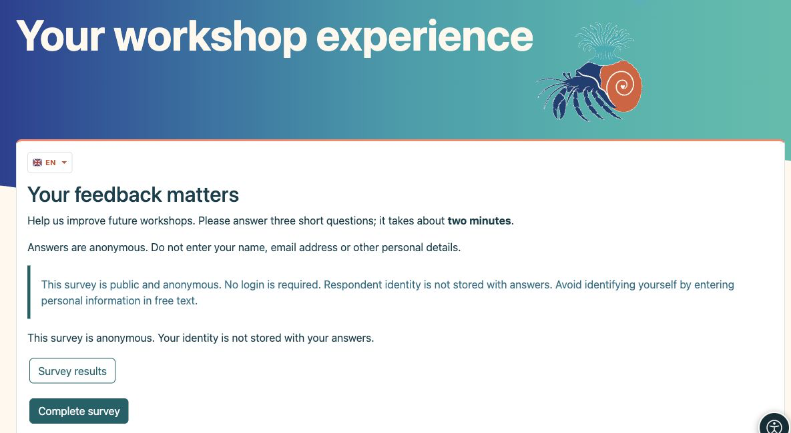
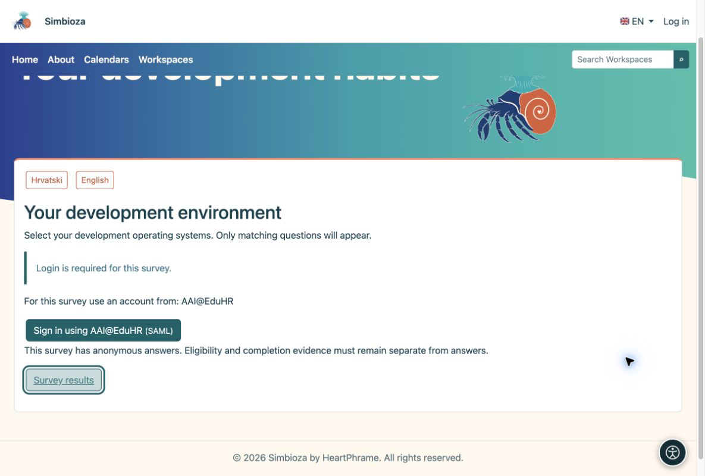
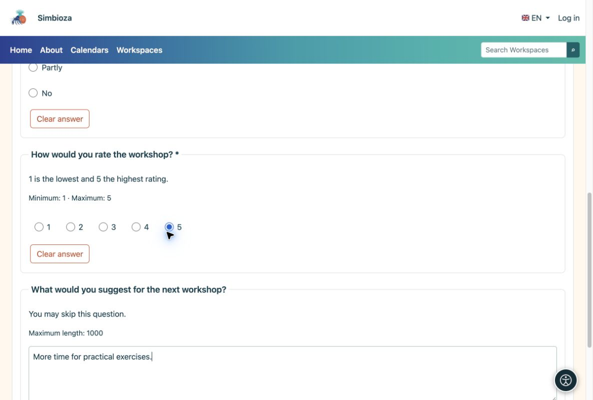
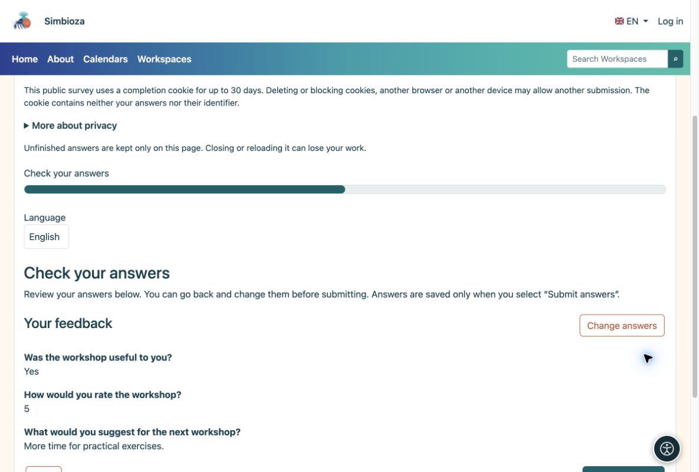
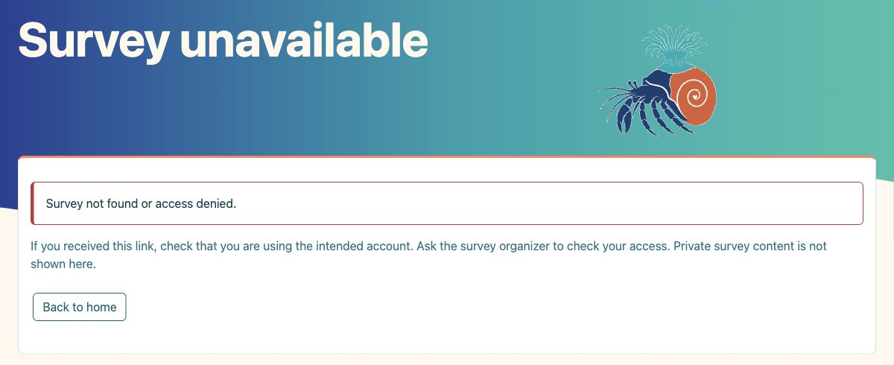

# For participants — complete a survey

[Surveys](ankete_en.md)

You usually open a survey from a link someone sent you or from a Workspace page. You do not need to know how it was built.

## 1. Read the introduction

The introduction explains the purpose. Check the privacy, sign-in and duration notices, then choose **Complete survey**.

<figure>

<figcaption aria-hidden="true">Read the purpose and privacy notice before answering.</figcaption>
</figure>

If the survey is translated, open the dropdown with the **flag and language code** (for example EN) and choose a translation. Only translations enabled by the author are offered. Changing language while answering does not clear existing answers. This changes the survey language, not the application interface language.

## 2. Sign in only when asked

A public survey needs no login. A survey for Simbioza users uses your application login. If external sign-in is offered, choose an allowed method and use the appropriate account. A request for an account from a particular institution will not accept a different account. Signing in only for a survey does not create a Simbioza account.

<figure>

<figcaption aria-hidden="true">When sign-in is required, the survey offers the allowed methods.</figcaption>
</figure>

**Anonymous with login is possible:** sign-in can confirm eligibility and prevent repeat submissions without storing your name with the answers. An identified survey says so explicitly.

## 3. Answer the questions

Select choices or enter text. An asterisk marks a required answer. Choose **Next** to continue and **Back** to correct an earlier answer. Some questions appear only after a particular selection; this is expected.

<figure>

<figcaption aria-hidden="true">Answer required questions; an optional comment can be left blank.</figcaption>
</figure>

## 4. Review and submit

Check your answers on the final review. If they are correct, choose **Submit answers**. Clicking Next alone does not submit them. Wait for confirmation.

<figure>

<figcaption aria-hidden="true">The final review lets you check before submitting.</figcaption>
</figure>

**Finished:** the acceptance confirmation means your answers are saved. If available, choose **Survey results** to see the results.

## If you cannot access a survey

**Wrong domain:** sign in with an account from an institution allowed for this survey. **Not on the invitation list:** use an account containing the invited email address. If your account supplies several addresses, one match is enough. If unsure, contact the person who sent you the survey.

**Private or unavailable survey:** a link alone does not grant access. Check your account or ask the organizer for permission. Other private pages and answers are not displayed.

<figure>

<figcaption aria-hidden="true">An unavailable survey explains the problem and offers a safe return without revealing private content.</figcaption>
</figure>

## If something goes wrong

| You see… | What to do |
|----|----|
| A missing-answer message | Follow the link to the marked question, answer it and continue. |
| Unavailable or closed survey | Check the link and sign in with the right account. Contact the sender if needed. |
| You have already submitted | This survey does not allow another submission. You do not need to send it again. |
| No results button | The author may not share results, or may release them only after closure. |

Do not refresh or close the tab before submitting: unfinished answers may be lost. Do not type personal information you do not wish to disclose into comments, even in an anonymous survey.
