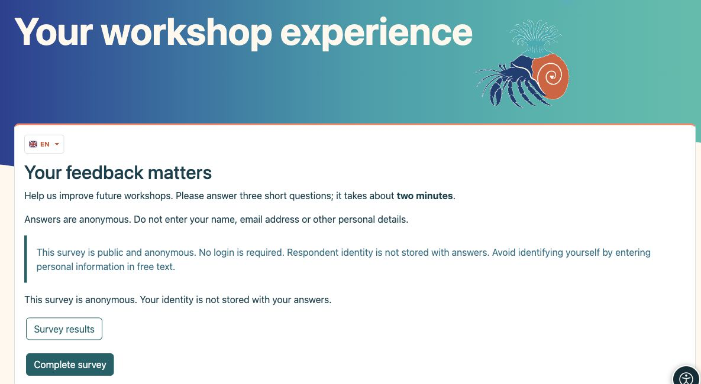
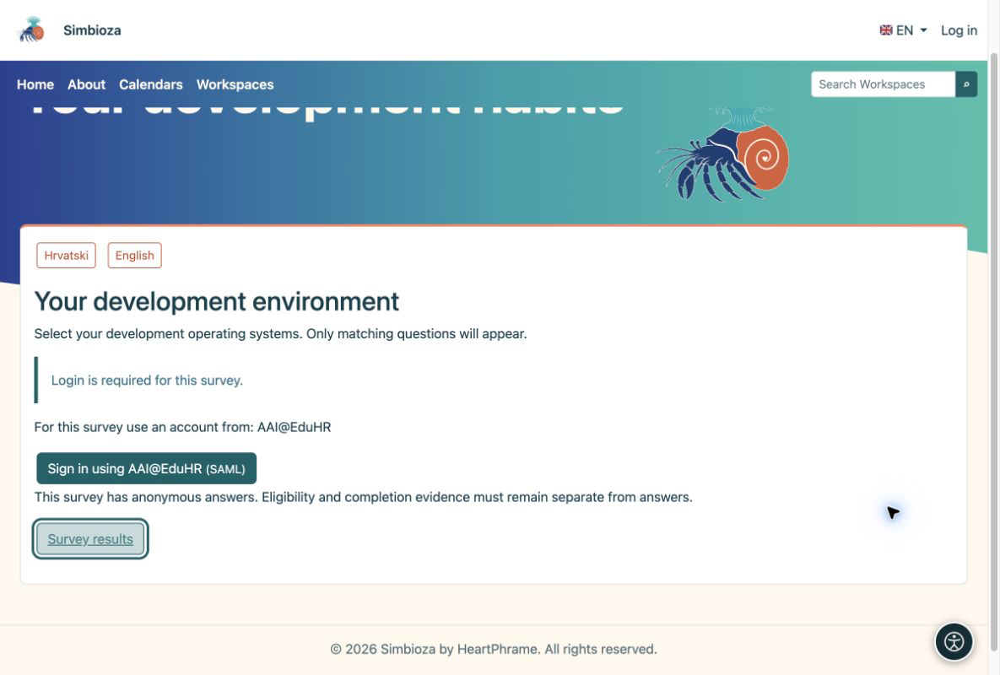
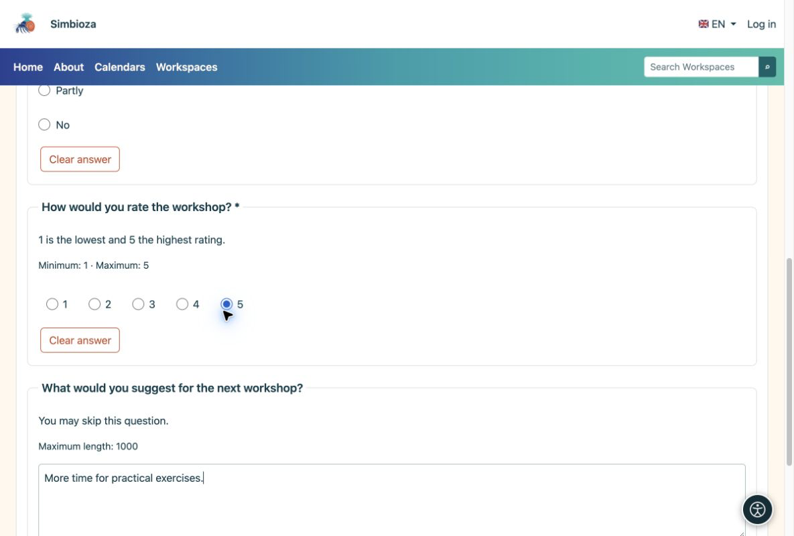
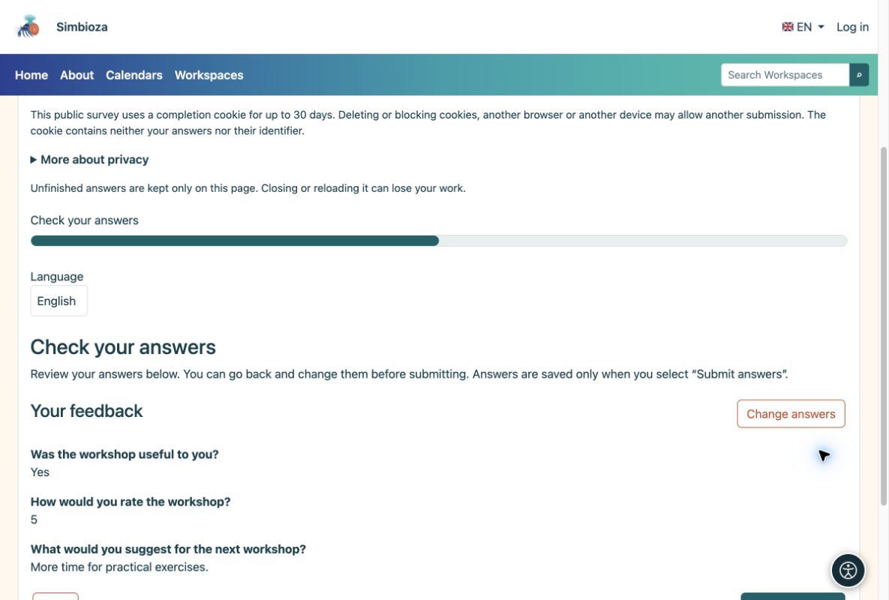
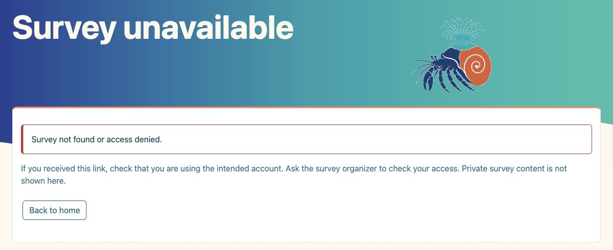
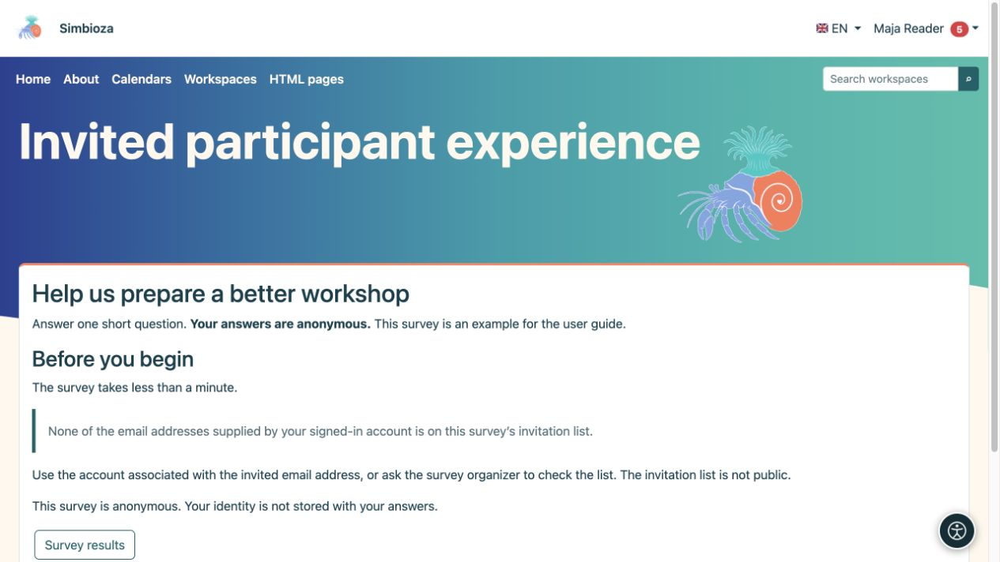

# Para participantes: completar una encuesta

> Las capturas de pantalla muestran la interfaz en inglés.

[Encuestas](ankete_es.md)

Por lo general, abres una encuesta desde un enlace que alguien te envió o desde una página de Workspace. No es necesario saber cómo se construyó.

## 1. Lee la introducción

La introducción explica el propósito. Verifique los avisos de privacidad, inicio de sesión y duración, luego elija **Completar encuesta**.

<figure>

<figcaption aria-hidden="true">Lea el propósito y el aviso de privacidad antes de contestar.</figcaption>
</figure>

Si la encuesta está traducida, abra el menú desplegable con la **bandera y código de idioma** (por ejemplo, EN) y elija una traducción. Sólo se ofrecen traducciones habilitadas por el autor. Cambiar el idioma mientras se responde no borra las respuestas existentes. Esto cambia el idioma de la encuesta, no el idioma de la interfaz de la aplicación.

## 2. Inicie sesión solo cuando se le solicite

Una encuesta pública no necesita iniciar sesión. Una encuesta para usuarios de Simbioza utiliza el inicio de sesión de su aplicación. Si se ofrece inicio de sesión externo, elija un método permitido y utilice la cuenta adecuada. Una solicitud de cuenta de una institución en particular no aceptará una cuenta diferente. Iniciar sesión solo para una encuesta no crea una cuenta Simbioza.

<figure>

<figcaption aria-hidden="true">Cuando es necesario iniciar sesión, la encuesta ofrece los métodos permitidos.</figcaption>
</figure>

**Es posible iniciar sesión de forma anónima:** el inicio de sesión puede confirmar la elegibilidad y evitar envíos repetidos sin almacenar su nombre con las respuestas. Una encuesta identificada lo dice explícitamente.

## 3. Responde las preguntas

Seleccione opciones o ingrese texto. Un asterisco marca una respuesta obligatoria. Elija **Siguiente** para continuar y **Atrás** para corregir una respuesta anterior. Algunas preguntas aparecen sólo después de una selección particular; esto es lo esperado.

<figure>

<figcaption aria-hidden="true">Responder las preguntas requeridas; un comentario opcional se puede dejar en blanco.</figcaption>
</figure>

## 4. Revisar y enviar

Compruebe sus respuestas en la revisión final. Si son correctas, elija **Enviar respuestas**. Al hacer clic en Siguiente por sí solo no se envían. Espere la confirmación.

<figure>

<figcaption aria-hidden="true">La revisión final le permite verificar antes de enviar.</figcaption>
</figure>

**Terminado:** la confirmación de aceptación significa que sus respuestas se guardan. Si está disponible, elija **Resultados de la encuesta** para ver los resultados.

## Si no puede acceder a una encuesta

**Dominio incorrecto:** inicie sesión con una cuenta de una institución permitida para esta encuesta. **No en la lista de invitados:** use una cuenta cuya dirección de correo electrónico de invitado esté verificada por el proveedor de inicio de sesión. Una dirección que usted simplemente escribió en un perfil no es prueba de una invitación. Si su cuenta proporciona varias direcciones, una coincidencia es suficiente. Si no está seguro, comuníquese con la persona que le envió la encuesta.

**Encuesta privada o no disponible:** un enlace por sí solo no otorga acceso. Verifique su cuenta o solicite permiso al organizador. Otras páginas privadas y respuestas no se muestran.

<figure>

<figcaption aria-hidden="true">Una encuesta no disponible explica el problema y ofrece un retorno seguro sin revelar contenido privado.</figcaption>
</figure>

<figure class="my-4">

<figcaption>La cuenta iniciada no tiene una dirección verificada coincidente. Iniciar sesión por sí solo no abre las preguntas ni permite un envío.</figcaption>
</figure>

## Si algo sale mal

| Verás… | Qué hacer |
|----|----|
| Un mensaje sin respuesta | Siga el enlace a la pregunta marcada, respóndala y continúe. |
| Encuesta no disponible o cerrada | Consulte el enlace e inicie sesión con la cuenta correcta. Póngase en contacto con el remitente si es necesario. |
| Ya has enviado | Esta encuesta no permite otro envío. No es necesario que lo envíes nuevamente. |
| Botón sin resultados | El autor no puede compartir los resultados o puede publicarlos sólo después del cierre. |

No actualice ni cierre la pestaña antes de enviar: las respuestas sin terminar pueden perderse. No escriba información personal que no desee revelar en los comentarios, ni siquiera en una encuesta anónima.
