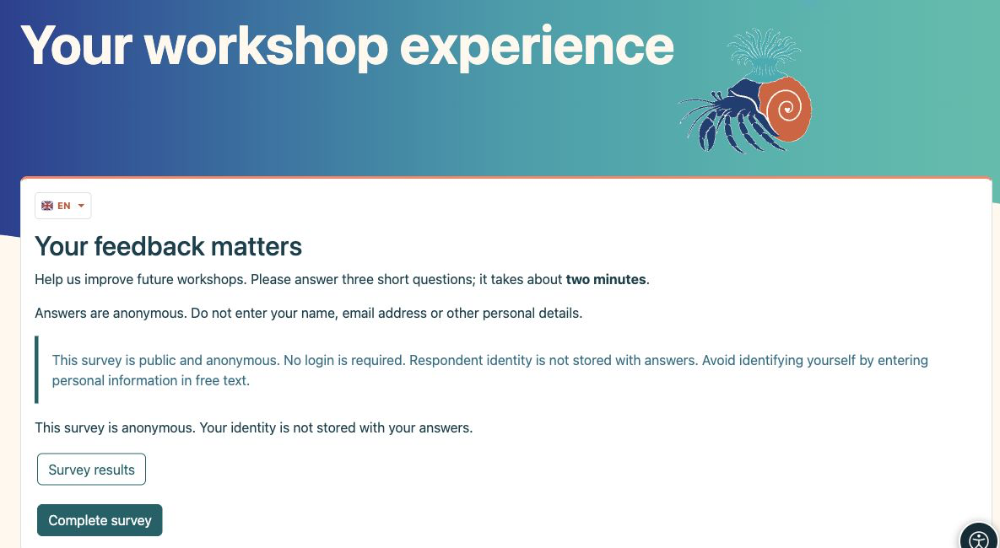
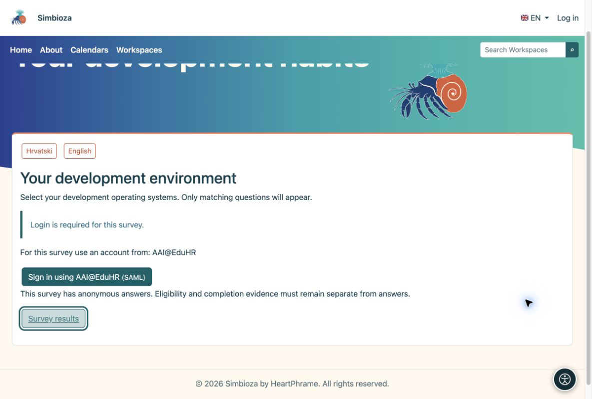
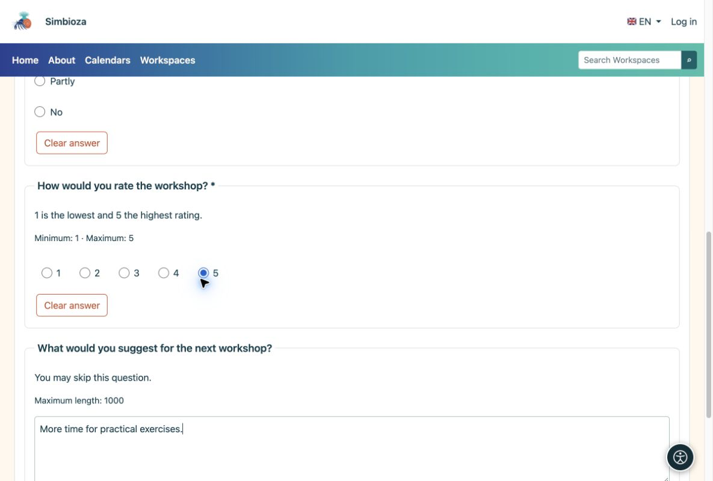
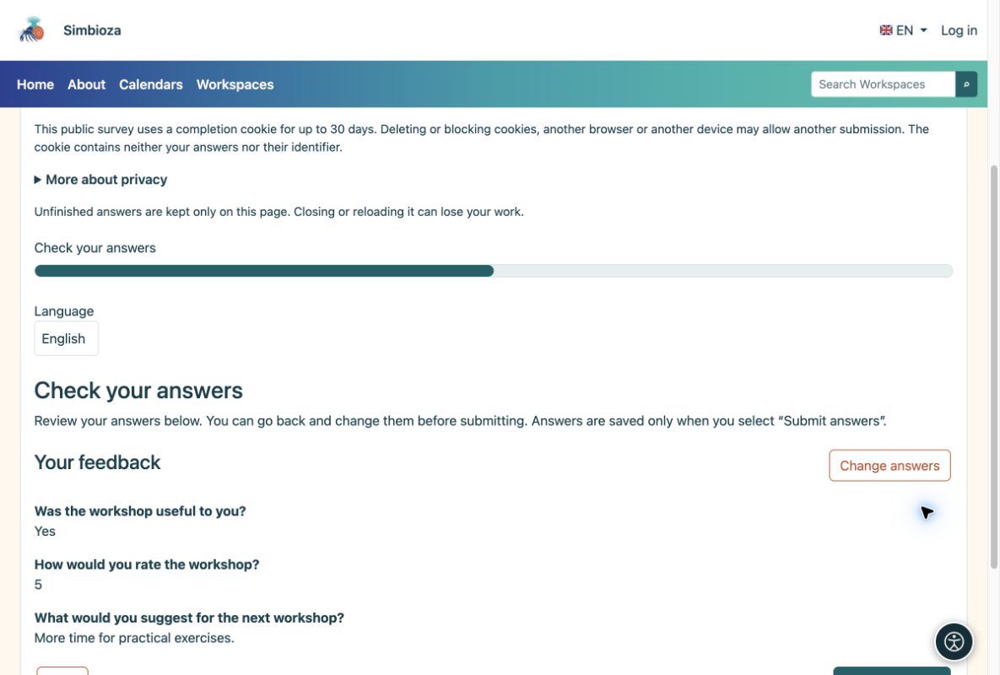
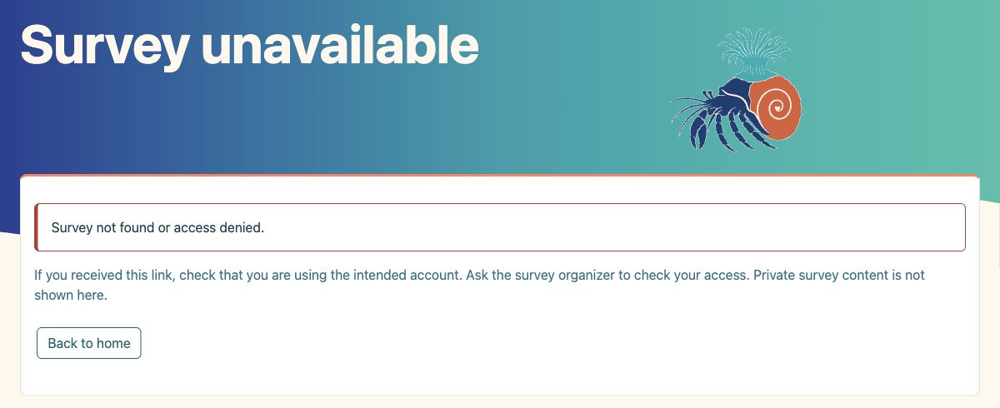
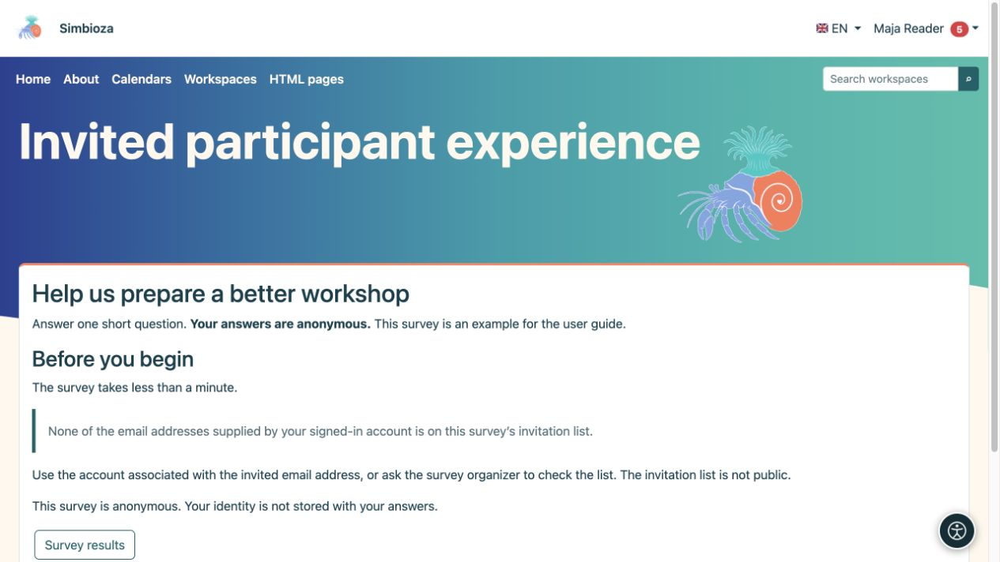

# Pour les participants — répondre à un sondage

> Les captures d’écran présentent l’interface en anglais.

[Sondages](ankete_fr.md)

Vous ouvrez généralement un sondage depuis un lien reçu ou depuis une page d’un espace de travail. Vous n’avez pas besoin de savoir comment il a été créé.

## 1. Lire l’introduction

L’introduction explique l’objectif. Consultez les indications sur la confidentialité, la connexion et la durée, puis choisissez **Répondre au sondage**.

<figure>

<figcaption aria-hidden="true">Lisez l’objectif et les informations de confidentialité avant de répondre.</figcaption>
</figure>

Si le sondage est traduit, ouvrez la liste déroulante portant le **drapeau et le code de langue** (EN, par exemple) et choisissez une traduction. Seules les traductions activées par l’auteur sont proposées. Changer de langue pendant la saisie n’efface pas les réponses existantes. Cela modifie la langue du sondage, pas celle de l’interface de l’application.

## 2. Se connecter uniquement sur demande

Un sondage public ne nécessite pas de connexion. Un sondage destiné aux utilisateurs de Simbioza utilise votre connexion à l’application. Si une connexion externe est proposée, choisissez une méthode autorisée et utilisez le compte approprié. Lorsqu’un compte d’un établissement précis est demandé, un autre compte ne sera pas accepté. Une connexion uniquement pour répondre à un sondage ne crée pas de compte Simbioza.

<figure>

<figcaption aria-hidden="true">Lorsque la connexion est nécessaire, le sondage propose les méthodes autorisées.</figcaption>
</figure>

**L’anonymat avec connexion est possible :** la connexion peut confirmer le droit de participer et empêcher les envois répétés sans enregistrer votre nom avec les réponses. Un sondage dont les réponses sont nominatives l’indique explicitement.

## 3. Répondre aux questions

Sélectionnez les choix ou saisissez du texte. Un astérisque indique une réponse obligatoire. Choisissez **Suivant** pour continuer et **Retour** pour corriger une réponse précédente. Certaines questions n’apparaissent qu’après un choix particulier ; ce fonctionnement est normal.

<figure>

<figcaption aria-hidden="true">Répondez aux questions obligatoires ; un commentaire facultatif peut rester vide.</figcaption>
</figure>

## 4. Vérifier et envoyer

Vérifiez vos réponses sur le récapitulatif final. Si elles sont correctes, choisissez **Envoyer les réponses**. Cliquer sur Suivant ne suffit pas à les envoyer. Attendez la confirmation.

<figure>

<figcaption aria-hidden="true">Le récapitulatif final permet de vérifier les réponses avant de les envoyer.</figcaption>
</figure>

**Terminé :** la confirmation d’acceptation signifie que vos réponses sont enregistrées. Si l’option est disponible, choisissez **Résultats du sondage** pour les consulter.

## Si vous ne pouvez pas accéder à un sondage

**Mauvais domaine :** connectez-vous avec un compte d’un établissement autorisé pour ce sondage. **Absence de la liste d’invitation :** utilisez un compte dont l’adresse invitée est vérifiée par le fournisseur de connexion. Une adresse simplement saisie dans un profil ne prouve pas que vous êtes invité. Si votre compte fournit plusieurs adresses, une seule correspondance suffit. En cas de doute, contactez la personne qui vous a envoyé le sondage.

**Sondage privé ou indisponible :** un lien seul ne donne pas accès. Vérifiez votre compte ou demandez l’autorisation à l’organisateur. Les autres pages privées et les réponses ne sont pas affichées.

<figure>

<figcaption aria-hidden="true">Un sondage indisponible explique le problème et propose un retour sûr sans révéler de contenu privé.</figcaption>
</figure>

<figure class="my-4">

<figcaption>Le compte connecté ne possède aucune adresse vérifiée correspondante. Se connecter ne suffit pas à ouvrir les questions ni à autoriser l’envoi d’une réponse.</figcaption>
</figure>

## En cas de problème

| Vous voyez… | Que faire |
|----|----|
| Un message signalant une réponse manquante | Suivez le lien vers la question signalée, répondez-y et continuez. |
| Un sondage indisponible ou fermé | Vérifiez le lien et connectez-vous avec le bon compte. Contactez l’expéditeur si nécessaire. |
| Vous avez déjà répondu | Ce sondage n’autorise pas un nouvel envoi. Vous n’avez pas à renvoyer vos réponses. |
| Aucun bouton de résultats | L’auteur peut avoir choisi de ne pas partager les résultats ou de les rendre disponibles seulement après la fermeture. |

N’actualisez pas la page et ne fermez pas l’onglet avant l’envoi : les réponses inachevées pourraient être perdues. Ne saisissez pas dans les commentaires des informations personnelles que vous ne souhaitez pas divulguer, même dans un sondage anonyme.
