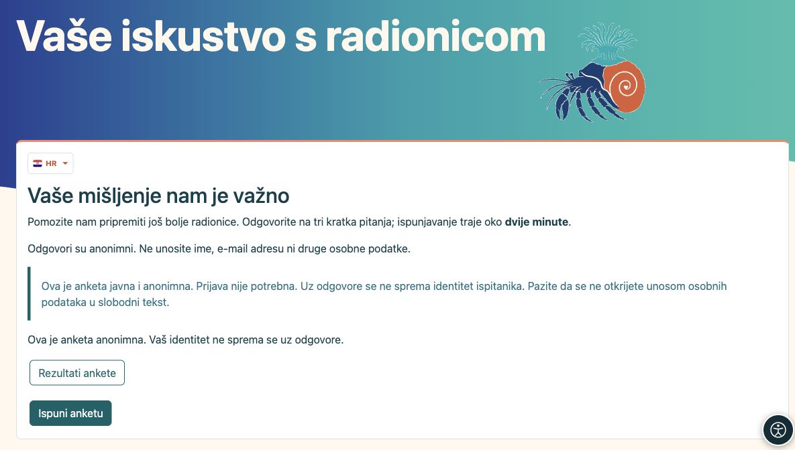
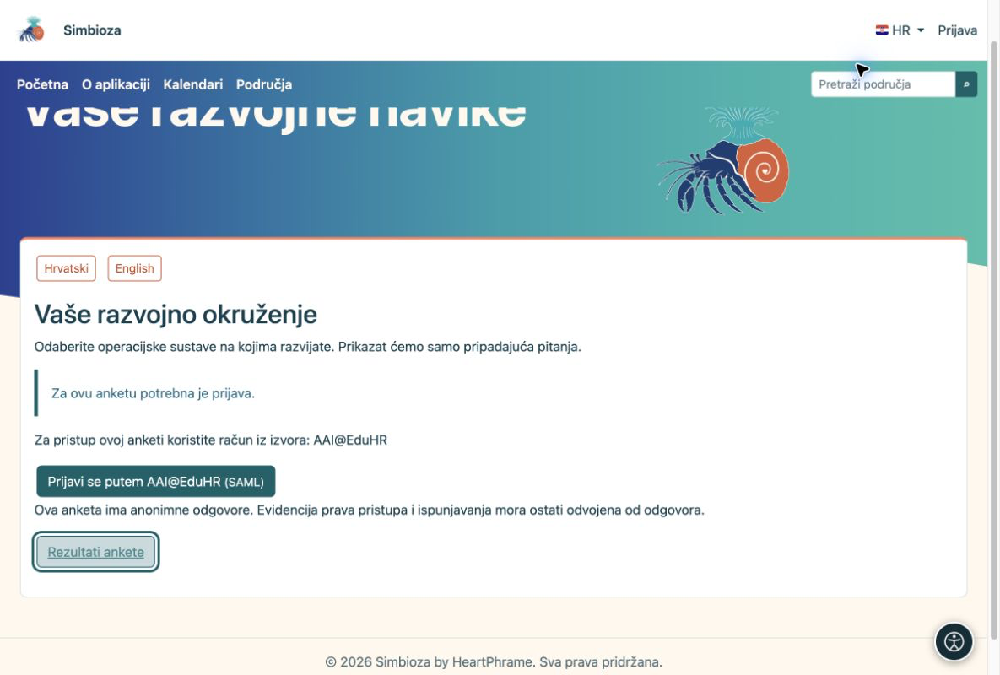
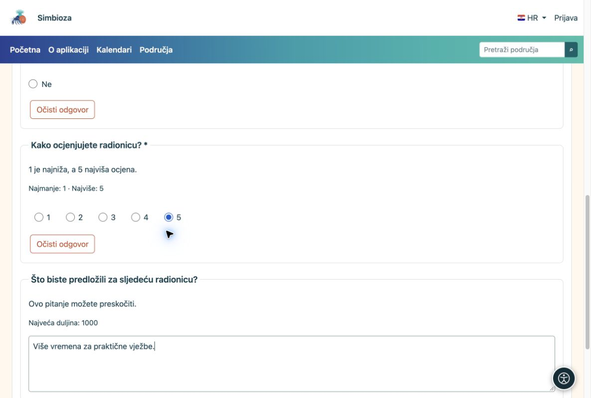
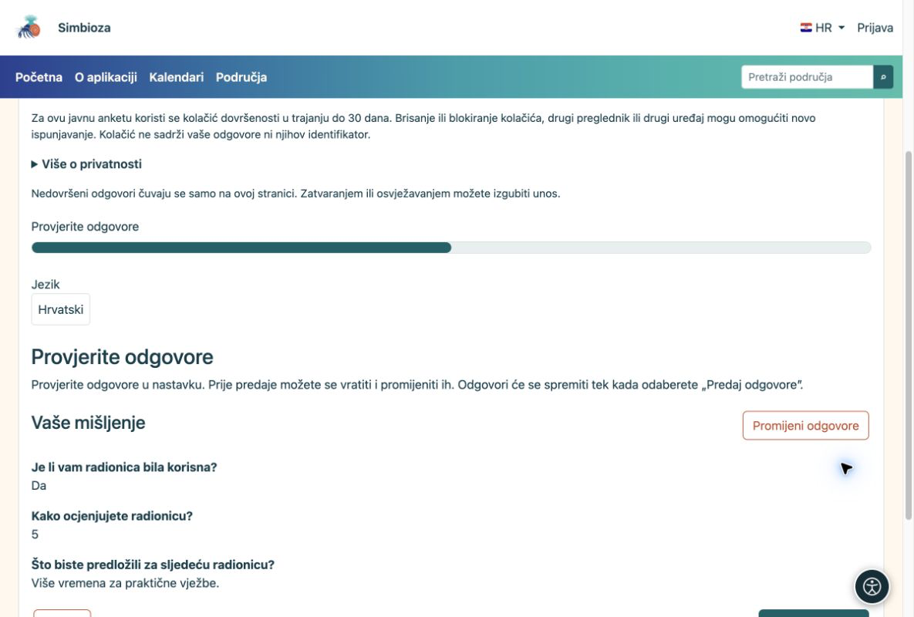
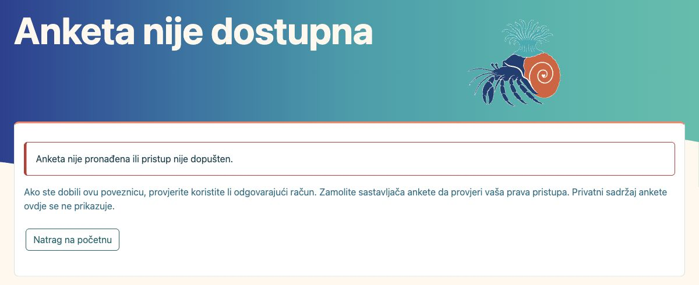
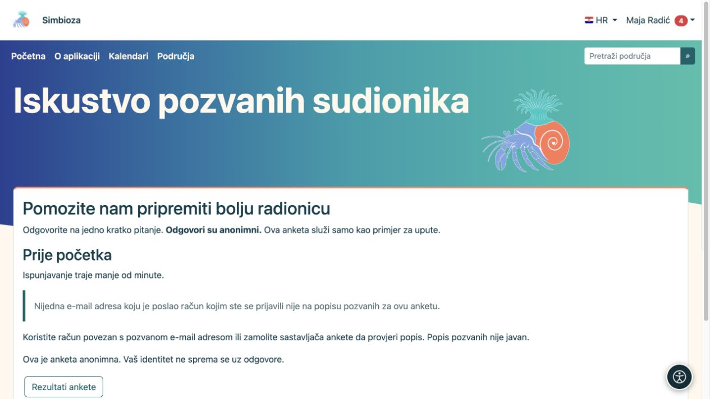

# Za ispitanike — ispunite anketu

[Ankete](ankete_hr.md)

Anketu obično otvarate preko poveznice koju vam je netko poslao ili preko stranice u području. Ne morate znati kako je anketa napravljena.

## 1. Pročitajte uvod

U uvodu piše čemu anketa služi. Provjerite i obavijest o anonimnosti, prijavi i trajanju. Odaberite **Ispuni anketu**.

<figure>

<figcaption aria-hidden="true">Prije odgovaranja pročitajte svrhu ankete i obavijest o privatnosti.</figcaption>
</figure>

Ako je anketa prevedena, otvorite izbornik sa **zastavicom i oznakom jezika** (npr. HR) te odaberite prijevod. Nude se samo prijevodi koje je autor uključio. Promjena jezika pri ispunjavanju ne briše već unesene odgovore. Mijenja se jezik ankete, ne jezik sučelja aplikacije.

## 2. Prijavite se samo ako se to traži

Javna anketa ne traži prijavu. Anketa za korisnike Simbioze koristi vašu prijavu u aplikaciju. Ako se nudi vanjska prijava, odaberite dopušteni način i koristite odgovarajući račun. Ako poruka traži račun određene ustanove, drugi račun neće biti prihvaćen. Vanjska prijava samo radi ankete ne stvara račun u Simbiozi.

<figure>

<figcaption aria-hidden="true">Kada se traži prijava, anketa nudi dopuštene načine prijave.</figcaption>
</figure>

**Anonimno uz prijavu nije proturječje:** prijava može potvrditi da smijete odgovoriti i spriječiti ponavljanje, a da se ime ne spremi uz odgovore. Kod identificirane ankete to je posebno navedeno.

## 3. Odgovorite na pitanja

Označite odgovore ili upišite tekst. Pitanje označeno zvjezdicom traži odgovor. Za sljedeću stranicu odaberite **Dalje**; za ispravak ranijeg odgovora **Natrag**. Neka se pitanja prikažu tek nakon vašeg odabira — to je očekivano.

<figure>

<figcaption aria-hidden="true">Odgovorite na obvezna pitanja; neobvezni komentar možete preskočiti.</figcaption>
</figure>

## 4. Pregledajte i predajte

Na završnom pregledu provjerite odgovore. Ako su točni, odaberite **Predaj odgovore**. Sam klik na Dalje još nije predaja. Pričekajte potvrdu primitka.

<figure>

<figcaption aria-hidden="true">Završni pregled služi provjeri prije stvarne predaje.</figcaption>
</figure>

**Gotovo:** nakon potvrde primitka odgovori su spremljeni. Ako je dopušteno, rezultate možete otvoriti preko **Rezultati ankete**.

## Ako nemate pristup

**Pogrešna domena:** prijavite se računom ustanove koja je dopuštena za anketu. **Niste na popisu pozvanih:** koristite račun s pozvanom e-mail adresom koju je potvrdio sustav prijave. Adresa koju ste samo upisali u profil nije dokaz pozivnice. Ako račun ima više adresa, dovoljno je podudaranje jedne od njih. Ako niste sigurni, javite se osobi koja vam je poslala anketu.

**Privatna ili nedostupna anketa:** sama poveznica ne daje pristup. Provjerite račun ili zatražite dopuštenje od sastavljača. Druge privatne stranice i odgovori ne prikazuju se.

<figure>

<figcaption aria-hidden="true">Nedostupna anketa daje objašnjenje i siguran povratak, bez otkrivanja privatnog sadržaja.</figcaption>
</figure>

<figure class="my-4">

<figcaption>Poruka objašnjava da prijavljeni račun nema odgovarajuću potvrđenu adresu. Pitanja i predaja nisu otvoreni samom prijavom.</figcaption>
</figure>

## Ako zapne

| Vidite… | Što napraviti |
|----|----|
| Poruku da nedostaje odgovor | Odaberite poveznicu na označeno pitanje, odgovorite pa nastavite. |
| Anketa nije dostupna ili je zatvorena | Provjerite jeste li otvorili pravu poveznicu i prijavili se odgovarajućim računom. Ako treba, javite se pošiljatelju. |
| Već ste predali odgovore | Anketa ne dopušta ponavljanje. Ne trebate ponovno slati. |
| Nema gumba za rezultate | Autor možda ne dijeli rezultate ili ih otvara tek nakon zatvaranja. |

Ne osvježavajte i ne zatvarajte karticu prije predaje: nedovršeni odgovori mogu se izgubiti. U slobodni komentar ne unosite osobne podatke koje ne želite otkriti, ni kada je anketa anonimna.
