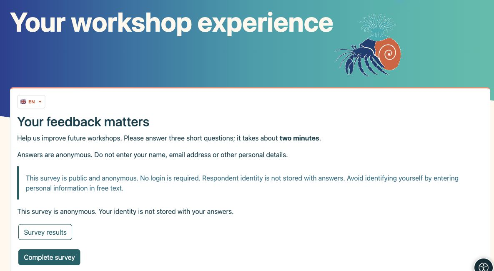
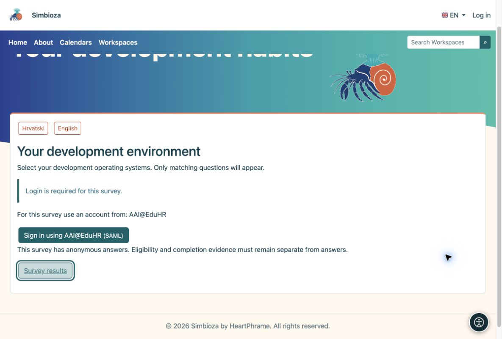
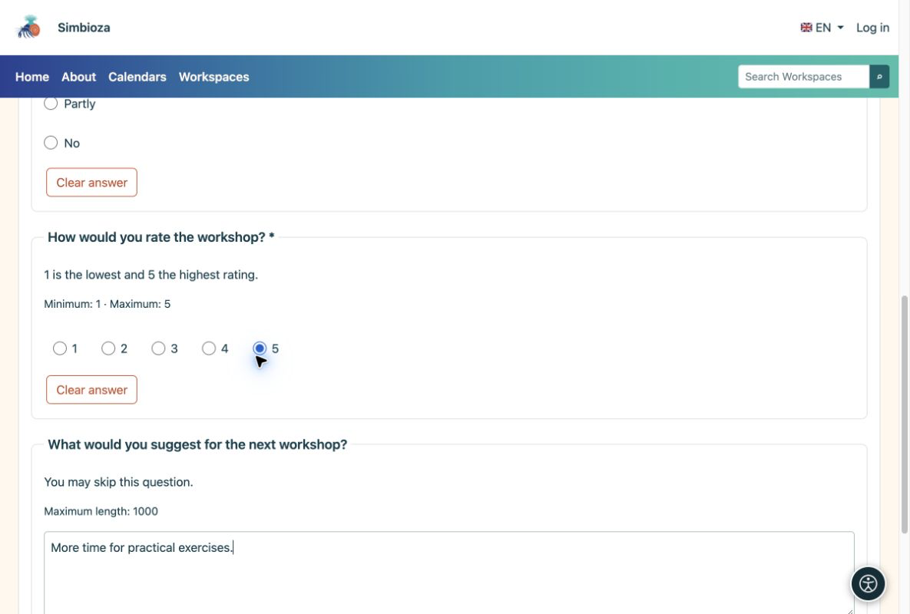
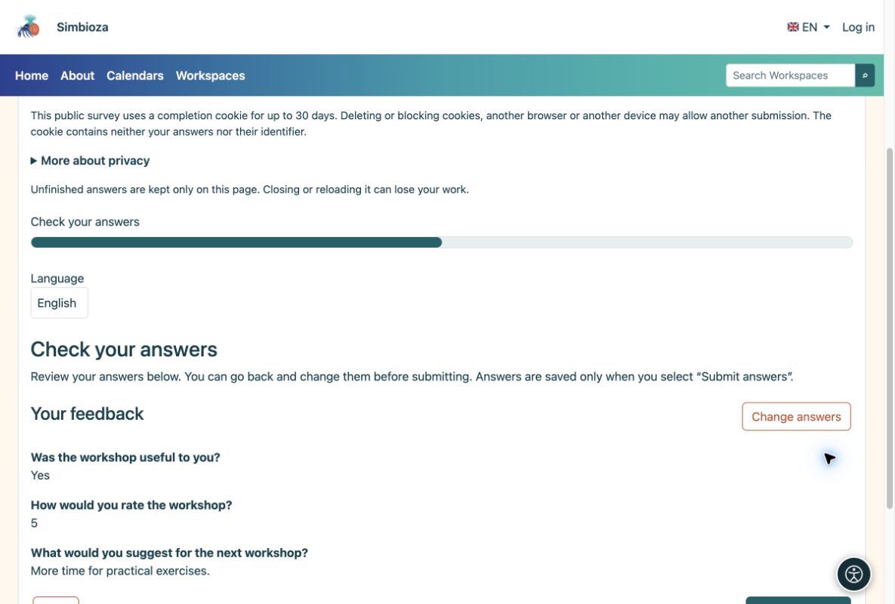
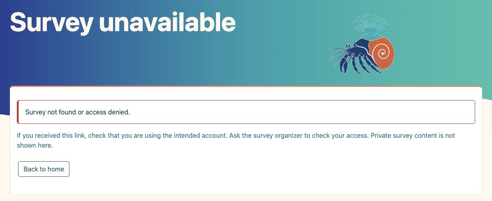
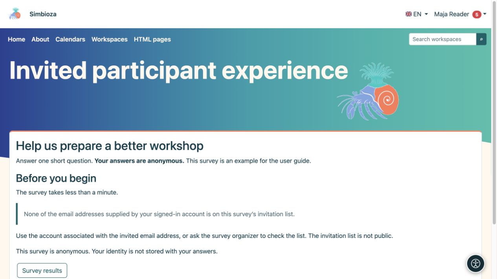

# Per i partecipanti: completare un sondaggio

> Le schermate mostrano l’interfaccia in inglese.

[Sondaggi](ankete_it.md)

Di solito apri un sondaggio da un collegamento che qualcuno ti ha inviato o da una pagina di Workspace. Non è necessario sapere come è stato costruito.

## 1. Leggi l'introduzione

L'introduzione spiega lo scopo. Controlla gli avvisi su privacy, accesso e durata, quindi seleziona **Completa sondaggio**.

<figure>

<figcaption aria-hidden="true">Leggi lo scopo e l'informativa sulla privacy prima di rispondere.</figcaption>
</figure>

Se il sondaggio è tradotto, apri il menu a discesa con la **bandiera e il codice della lingua** (ad esempio EN) e scegli una traduzione. Vengono offerte solo le traduzioni consentite dall'autore. La modifica della lingua durante la risposta non cancella le risposte esistenti. Ciò modifica la lingua del sondaggio, non la lingua dell'interfaccia dell'applicazione.

## 2. Accedi solo quando richiesto

Un sondaggio pubblico non richiede l'accesso. Un sondaggio per utenti Simbioza utilizza l'accesso all'applicazione. Se viene proposto un accesso esterno, scegli un metodo consentito e usa l'account appropriato. Se viene richiesto l'account di un determinato ente, un account diverso non sarà accettato. Accedere soltanto a un sondaggio non crea un account Simbioza.

<figure>

<figcaption aria-hidden="true">Quando è richiesto l'accesso, il sondaggio offre i metodi consentiti.</figcaption>
</figure>

**L'anonimato è possibile anche con l'accesso:** l'accesso può confermare il diritto a partecipare e impedire invii ripetuti senza conservare il nome insieme alle risposte. Un sondaggio con risposte identificate lo dichiara esplicitamente.

## 3. Rispondi alle domande

Seleziona le scelte o inserisci il testo. Un asterisco contrassegna una risposta obbligatoria. Scegli **Avanti** per continuare e **Indietro** per correggere una risposta precedente. Alcune domande compaiono solo dopo una particolare selezione; questo è previsto.

<figure>

<figcaption aria-hidden="true">Rispondere alle domande richieste; un commento facoltativo può essere lasciato vuoto.</figcaption>
</figure>

## 4. Rivedi e invia

Controlla le tue risposte nella revisione finale. Se sono corrette, scegli **Invia risposte**. Facendo clic solo su Avanti non vengono inviati. Attendi conferma.

<figure>

<figcaption aria-hidden="true">La revisione finale ti consente di controllare prima di inviare.</figcaption>
</figure>

**Fine:** la conferma di accettazione indica che le tue risposte sono state salvate. Se disponibile, scegli **Risultati del sondaggio** per visualizzare i risultati.

## Se non riesci ad accedere a un sondaggio

**Dominio sbagliato:** accedi con un account di un'istituzione autorizzata per questo sondaggio. **Non presente nell'elenco degli inviti:** utilizza un account il cui indirizzo email invitato sia verificato dal provider di accesso. Un indirizzo che hai semplicemente digitato in un profilo non è la prova di un invito. Se il tuo account fornisce più indirizzi, è sufficiente una corrispondenza. Se non sei sicuro, contatta la persona che ti ha inviato il sondaggio.

**Sondaggio privato o non disponibile:** un collegamento da solo non garantisce l'accesso. Controlla il tuo account o chiedi l'autorizzazione all'organizzatore. Le altre pagine e risposte private non vengono visualizzate.

<figure>

<figcaption aria-hidden="true">Quando un sondaggio non è disponibile, il messaggio spiega il problema e offre un collegamento sicuro per tornare indietro senza rivelare contenuti privati.</figcaption>
</figure>

<figure class="my-4">

<figcaption>L'account a cui hai effettuato l'accesso non ha un indirizzo verificato corrispondente. Il solo accesso non apre le domande né consente l'invio.</figcaption>
</figure>

## Se qualcosa va storto

| Vedi… | Cosa fare |
|----|----|
| Messaggio che segnala una risposta mancante | Segui il collegamento alla domanda contrassegnata, rispondi e continua. |
| Sondaggio non disponibile o chiuso | Controlla il collegamento e accedi con l'account corretto. Contatta il mittente se necessario. |
| Hai già inviato | Questo sondaggio non consente un altro invio. Non è necessario inviarlo nuovamente. |
| Nessun pulsante risultati | L'autore non può condividere i risultati, o può rilasciarli solo dopo la chiusura. |

Non aggiornare o chiudere la scheda prima dell'invio: le risposte non completate potrebbero andare perse. Non digitare informazioni personali che non desideri divulgare nei commenti, nemmeno in un sondaggio anonimo.
