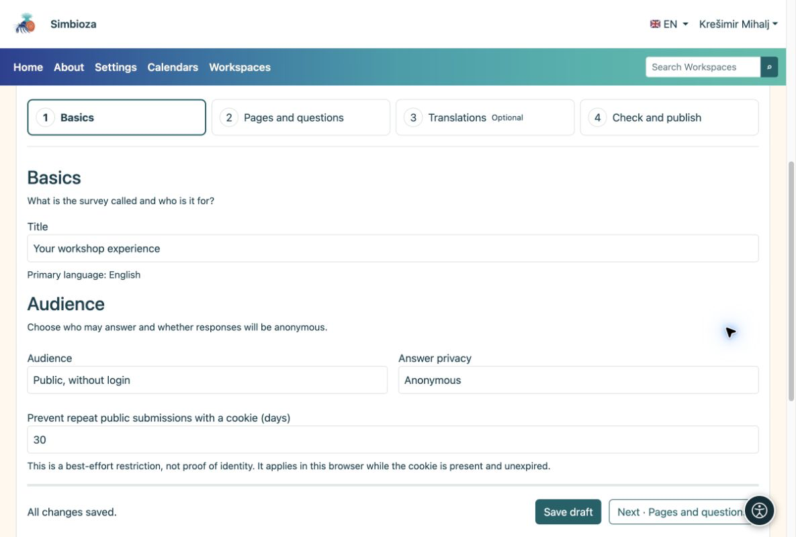

# 1. Einen Entwurf erstellen

> Die Bildschirmaufnahmen zeigen die englische Benutzeroberfläche.

[Für Umfrageautoren](ankete-autori_de.md)

**Ziel:** Öffnen Sie Ihre eigene Umfrage und bereiten Sie sie vor, ohne dass jemand einen unvollständigen Fragebogen beantwortet.

1.  Öffnen Sie **Umfragen → Neue Umfrage**. Um sie in einem Arbeitsbereich zu erstellen, öffnen Sie diesen Arbeitsbereich und wählen Sie das Symbol **Neue Umfrage** in der Symbolleiste des Seitenbaums.
2.  Geben Sie einen eindeutigen Titel ein, z. B. **Ihre Workshop-Erfahrung**, und wählen Sie die Hauptsprache aus. Wählen Sie in einem Arbeitsbereich bei Bedarf eine übergeordnete Seite aus.
3.  Wählen Sie **Entwurf erstellen**. Der Editor öffnet sich mit vier Schritten.
4.  Überprüfen Sie unter **Grundlagen** den Titel. Für einen einfachen öffentlichen Fragebogen wählen Sie **Öffentlich, ohne Login**; Antworten sind dann anonym.
5.  Wählen Sie **Speichern und fortfahren · Seiten und Fragen**. Wenn keine nicht gespeicherten Änderungen vorhanden sind, wird auf derselben Schaltfläche **Weiter · Seiten und Fragen** angezeigt.

<figure>

<figcaption aria-hidden="true">Grundlagen: Titel, Zielgruppe und Antwortschutz.</figcaption>
</figure>

**Ergebnis:** Sie haben einen gespeicherten Entwurf, der für Fragen bereitsteht. Durch das Speichern eines Entwurfs wird dieser nicht veröffentlicht. Suchen Sie während der Arbeit nach **Alle Änderungen gespeichert**.

## Legen Sie fest, wann eine Teilnahme möglich ist

Wenn Sie keine Frist angegeben haben, lassen Sie unter **Grundlagen → Besichtigungsplan** **Öffnet um** und **Schließt um** leer. Geben Sie für einen begrenzten Abholzeitraum das gewünschte Datum und die gewünschte Uhrzeit ein. Die Zeitzone der Anwendung wird neben den Feldern angezeigt. Sie legen nicht für jede Umfrage eine eigene Zeitzone fest.

**Ergebnis:** Eine veröffentlichte Umfrage akzeptiert Antworten während dieses Zeitraums. Eine zukünftige Öffnungszeit ermöglicht noch keine Teilnahme, eine vergangene Schließungszeit stoppt sie. Daten allein veröffentlichen noch keinen Entwurf. Überprüfen Sie diese, bevor Sie sie zur Veröffentlichung einreichen, insbesondere wenn sich Teilnehmer in anderen Zeitzonen befinden.

## Wer kann einen Entwurf sehen?

In einem Arbeitsbereich können Redakteure, Manager und Herausgeber mit den entsprechenden Berechtigungen sowie Administratoren einen Entwurf sehen. Der Baum markiert es als **Entwurf**; ein eingereichter Entwurf verfügt über ein Bewertungslabel. Ein normaler Leser kann eine neue unveröffentlichte Umfrage nicht sehen. Wenn bereits eine veröffentlichte Version vorhanden ist, wird sie den Lesern weiterhin angezeigt, bis die neue Version genehmigt wird.

Bei einer eigenständigen Umfrage steht der Entwurf dem Autor zur Verfügung, während dieser die Managementberechtigung, ausdrücklich autorisierte Mitarbeiter, Herausgeber und Administratoren behält. Durch die Berechtigung, eigene Umfragen zu erstellen, werden die Entwürfe anderer Autoren nicht offengelegt.
