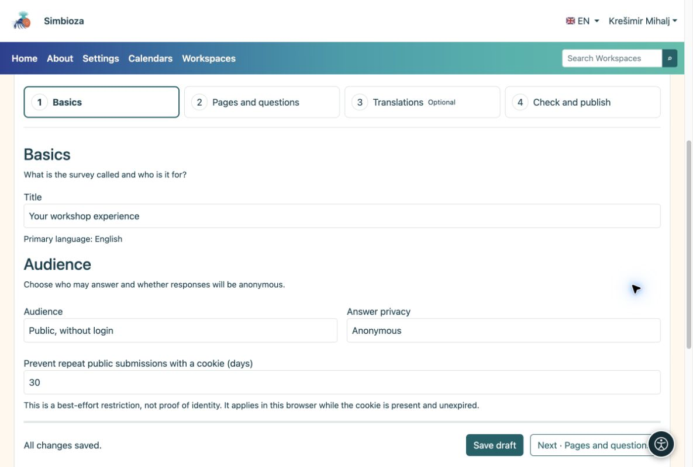

# 1. Create a draft

[For survey authors](ankete-autori_en.md)

**Goal:** open your own survey and prepare it without anyone answering an unfinished questionnaire.

1.  Open **Surveys → New survey**. To create it in a Workspace, open that Workspace and choose the **New survey** icon in the page-tree toolbar.
2.  Enter a clear title, such as **Your workshop experience**, and choose the primary language. In a Workspace, choose a parent page if needed.
3.  Choose **Create draft**. The editor opens with four steps.
4.  Under **Basics**, check the title. For a simple public questionnaire choose **Public, without login**; answers are then anonymous.
5.  Choose **Save and continue · Pages and questions**. When there are no unsaved changes, the same button says **Next · Pages and questions**.

<figure>

<figcaption aria-hidden="true">Basics: title, audience and answer privacy.</figcaption>
</figure>

**Result:** you have a saved draft ready for questions. Saving a draft does not publish it. Look for **All changes saved** as you work.

## Set when participation is available

If you have no deadline, leave **Opens at** and **Closes at** empty under **Basics → Survey schedule**. For a limited collection period, enter the intended date and time. The application time zone is shown beside the fields; you do not set a separate time zone for each survey.

**Result:** a published survey accepts responses during that period. A future opening time does not yet allow participation, and a past closing time stops it. Dates alone do not publish a draft. Check them before submitting for publication, especially when participants are in other time zones.

## Who can see a draft?

In a Workspace, editors, managers and publishers with the relevant permissions, and administrators, can see a draft. The tree marks it **Draft**; a submitted draft has a review label. An ordinary reader cannot see a new unpublished survey. If a published version already exists, readers continue to see it until the new version is approved.

For a standalone survey, the draft is available to its author while they retain management permission, explicitly authorized collaborators, publishers and administrators. Permission to create one's own surveys does not expose other authors’ drafts.
