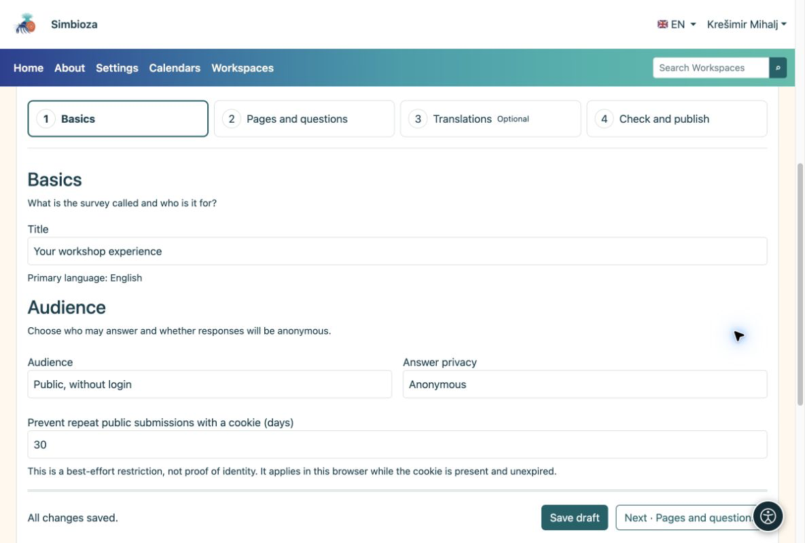

# 1. Crear un borrador

> Las capturas de pantalla muestran la interfaz en inglés.

[Para autores de encuestas](ankete-autori_es.md)

**Objetivo:** abre su propia encuesta y prepárala sin que nadie responda un cuestionario sin terminar.

1.  Abra **Encuestas → Nueva encuesta**. Para crearlo en un espacio de trabajo, abra ese espacio de trabajo y elija el icono **Nueva encuesta** en la barra de herramientas del árbol de páginas.
2.  Ingrese un título claro, como **Su experiencia en el taller**, y elija el idioma principal. En un espacio de trabajo, elija una página superior si es necesario.
3.  Elija **Crear borrador**. El editor se abre con cuatro pasos.
4.  En **Conceptos básicos**, consulta el título. Para un cuestionario público simple, elija **Público, sin iniciar sesión**; Las respuestas son entonces anónimas.
5.  Elija **Guardar y continuar · Páginas y preguntas**. Cuando no hay cambios sin guardar, el mismo botón dice **Siguiente · Páginas y preguntas**.

<figure>

<figcaption aria-hidden="true">Conceptos básicos: título, audiencia y privacidad de las respuestas.</figcaption>
</figure>

**Resultado:** tiene un borrador guardado listo para preguntas. Guardar un borrador no lo publica. Busque **Todos los cambios guardados** mientras trabaja.

## Establecer cuándo está disponible la participación

Si no tiene una fecha límite, deje **Abre a las** y **Cierra a las** vacíos en **Conceptos básicos → Calendario de encuestas**. Para un período de recolección limitado, ingrese la fecha y hora previstas. La zona horaria de la aplicación se muestra al lado de los campos; no establece una zona horaria separada para cada encuesta.

**Resultado:** una encuesta publicada acepta respuestas durante ese período. Un horario de apertura futuro aún no permite la participación y un horario de cierre pasado la detiene. Las fechas por sí solas no publican un borrador. Revíselos antes de enviarlos para su publicación, especialmente cuando los participantes se encuentren en otras zonas horarias.

## ¿Quién puede ver un borrador?

En un espacio de trabajo, los editores, administradores y publicadores con los permisos pertinentes y los administradores pueden ver un borrador. El árbol lo marca **Borrador**; un borrador enviado tiene una etiqueta de revisión. Un lector común y corriente no puede ver una nueva encuesta inédita. Si ya existe una versión publicada, los lectores seguirán viéndola hasta que se apruebe la nueva versión.

Para una encuesta independiente, el borrador está disponible para su autor mientras conserva el permiso de gestión, colaboradores, editores y administradores explícitamente autorizados. El permiso para crear sus propias encuestas no expone los borradores de otros autores.
