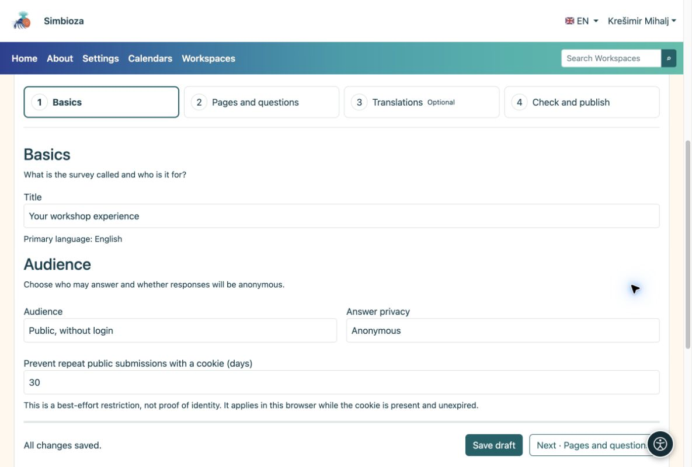

# 1. Créer un brouillon

> Les captures d’écran présentent l’interface en anglais.

[Pour les auteurs du sondage](ankete-autori_fr.md)

**Objectif :** ouvrez votre propre sondage et préparez-le sans que personne ne réponde à un questionnaire inachevé.

1.  Ouvrez **Sondages → Nouveau sondage**. Pour le créer dans un espace de travail, ouvrez cet espace de travail et choisissez l'icône **Nouveau sondage** dans la barre d'outils de l'arborescence des pages.
2.  Saisissez un titre clair, tel que **Votre expérience d'atelier**, et choisissez la langue principale. Dans un espace de travail, choisissez une page parentee si nécessaire.
3.  Choisissez **Créer un brouillon**. L'éditeur s'ouvre en quatre étapes.
4.  Sous **Bases**, vérifiez le titre. Pour un questionnaire public simple, choisissez **Public, sans connexion** ; les réponses sont alors anonymes.
5.  Choisissez **Enregistrer et continuer · Pages et questions**. Lorsqu'il n'y a aucune modification non enregistrée, le même bouton indique **Suivant · Pages et questions**.

<figure>

<figcaption aria-hidden="true">Notions de base : titre, audience et confidentialité des réponses.</figcaption>
</figure>

**Résultat :** vous disposez d'un brouillon enregistré, prêt à recevoir les questions. L'enregistrement d'un brouillon ne le publie pas. Recherchez **Toutes les modifications enregistrées** pendant que vous travaillez.

## Définir quand la participation est disponible

Si vous n'avez pas de date limite, laissez **Ouvre à** et **Ferme à** vides sous **Bases → Calendrier du sondage**. Pour une période de collecte limitée, entrez la date et l'heure prévues. Le fuseau horaire de l'application est affiché à côté des champs ; vous ne définissez pas de fuseau horaire distinct pour chaque sondage.

**Résultat :** un sondage publié accepte les réponses pendant cette période. Une heure d'ouverture future ne permet pas encore la participation, et une heure de fermeture passée l'arrête. Les dates seules ne permettent pas de publier un brouillon. Vérifiez-les avant de les soumettre pour publication, surtout lorsque les participants se trouvent dans d'autres fuseaux horaires.

## Qui peut voir un brouillon ?

Dans un espace de travail, les éditeurs, les responsables de l’espace et les personnes chargées de la publication disposant des droits nécessaires, ainsi que les administrateurs, peuvent consulter un brouillon. L’arborescence l’indique comme **Brouillon** ; un brouillon soumis pour relecture porte une indication correspondante. Un lecteur ordinaire ne peut pas voir un nouveau sondage non publié. Si une version publiée existe déjà, les lecteurs continuent à la voir jusqu’à l’approbation de la nouvelle version.

Pour un sondage autonome, le brouillon est à la disposition de son auteur tant qu'il conserve l'autorisation de gestion, les collaborateurs, responsables de publication et administrateurs explicitement autorisés. L’autorisation de créer ses propres sondages n’expose pas les brouillons des autres auteurs.
