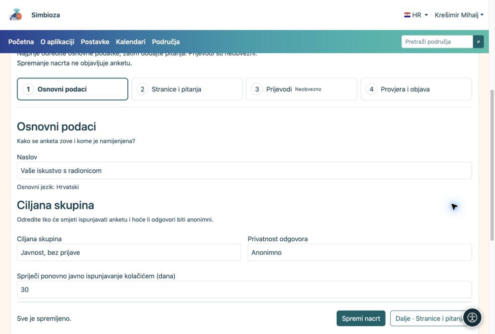

# 1. Kreirajte nacrt

[Za sastavljače anketa](ankete-autori_hr.md)

**Cilj:** otvoriti vlastitu anketu koju možete mirno uređivati. Nacrt još nitko ne ispunjava.

1.  Otvorite **Ankete** pa **Nova anketa**. Ako anketu izrađujete u području, otvorite željeno područje i u alatnoj traci stabla odaberite ikonu **Nova anketa**.
2.  Upišite jasan naslov, primjerice **Vaše iskustvo s radionicom**. Odaberite osnovni jezik. U području po potrebi odaberite nadređenu stranicu.
3.  Odaberite **Kreiraj nacrt**. Otvara se uređivač s četiri koraka.
4.  U **Osnovni podaci** provjerite naslov. Za jednostavan javni upitnik odaberite **Javnost, bez prijave**; odgovori tada ostaju anonimni.
5.  Odaberite **Spremi i nastavi · Stranice i pitanja**. Ako nema nespremljenih izmjena, isti je gumb označen **Dalje · Stranice i pitanja**.

<figure>

<figcaption aria-hidden="true">Osnovni podaci: naslov, ciljana skupina i privatnost odgovora.</figcaption>
</figure>

**Rezultat:** postoji spremljeni nacrt, spreman za pitanja. Spremanje nacrta nije objava. Dok ga uređujete, provjeravajte poruku **Sve je spremljeno**.

## Odredite kada se anketa ispunjava

Ako nemate rok, u **Osnovni podaci → Vrijeme održavanja ankete** ostavite **Početak** i **Završetak** prazne. Za vremenski ograničeno prikupljanje unesite željeni datum i sat. Vrijedi vremenska zona aplikacije prikazana uz polja; ne podešavate zasebnu zonu svake ankete.

**Rezultat:** objavljena anketa prima odgovore u zadanom razdoblju. Budući početak još ne otvara ispunjavanje, a prošli završetak ga zatvara. Datumi sami ne objavljuju nacrt. Provjerite ih prije slanja na objavu, osobito ako ispitanici dolaze iz drugih vremenskih zona.

## Tko vidi nacrt?

U području nacrt vide urednici, upravitelji i objavljivači s odgovarajućim pravima te administrator. U stablu je označen kao **Nacrt**; poslani nacrt ima oznaku pregleda. Obični čitatelj ne vidi novu neobjavljenu anketu. Ako već postoji objavljena verzija, čitatelj i dalje vidi nju dok nova nije odobrena.

Kod samostalne ankete nacrt je dostupan autoru s važećim pravom upravljanja, posebno ovlaštenim suradnicima, objavljivaču i administratoru. Samo pravo izrade vlastitih anketa ne daje pristup tuđim nacrtima.
