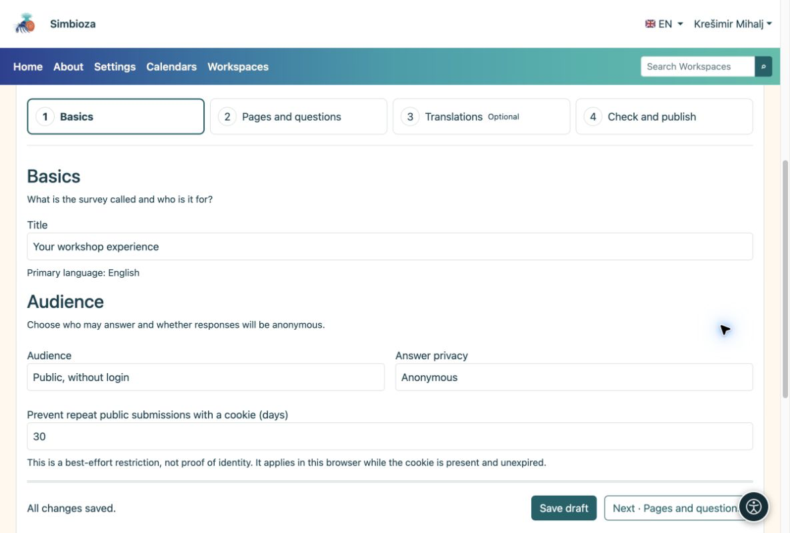

# 1. Crea una bozza

> Le schermate mostrano l’interfaccia in inglese.

[Per gli autori del sondaggio](ankete-autori_it.md)

**Obiettivo:** apri il tuo sondaggio e preparalo senza che nessuno risponda a un questionario incompleto.

1.  Apri **Sondaggi → Nuovo sondaggio**. Per crearlo in un'area di lavoro, apri l'area di lavoro e scegli l'icona **Nuovo sondaggio** nella barra degli strumenti dell'albero della pagina.
2.  Inserisci un titolo chiaro, ad esempio **La tua esperienza nel workshop**, e scegli la lingua principale. In un'area di lavoro, scegli una pagina principale, se necessario.
3.  Scegli **Crea bozza**. L'editor si apre con quattro passaggi.
4.  In **Nozioni di base**, controlla il titolo. Per un semplice questionario pubblico scegli **Pubblico, senza login**; le risposte sono quindi anonime.
5.  Scegli **Salva e continua · Pagine e domande**. Quando non ci sono modifiche non salvate, lo stesso pulsante dice **Avanti · Pagine e domande**.

<figure>

<figcaption aria-hidden="true">Nozioni di base: titolo, pubblico e privacy delle risposte.</figcaption>
</figure>

**Risultato:** hai una bozza salvata pronta per le domande. Il salvataggio di una bozza non la pubblica. Cerca **Tutte le modifiche salvate** mentre lavori.

## Imposta quando è disponibile la partecipazione

Se non c'è una scadenza, lascia vuoti **Apertura** e **Chiusura** in **Informazioni di base → Pianificazione del sondaggio**. Per un periodo di raccolta limitato, inserisci data e ora previste. Accanto ai campi viene mostrato il fuso orario dell'applicazione; non si imposta un fuso orario separato per ciascun sondaggio.

**Risultato:** un sondaggio pubblicato accetta risposte durante quel periodo. Un orario di apertura futuro non consente ancora la partecipazione, un orario di chiusura passato la impedisce. Le date da sole non bastano a pubblicare una bozza. Controllali prima di inviarli per la pubblicazione, soprattutto quando i partecipanti si trovano in altri fusi orari.

## Chi può vedere una bozza?

In un'area di lavoro, gli editor, i gestori e gli editori con le autorizzazioni pertinenti e gli amministratori possono visualizzare una bozza. L'albero lo contrassegna come **Bozza**; una bozza inviata ha un'etichetta di revisione. Un lettore normale non può vedere un nuovo sondaggio inedito. Se esiste già una versione pubblicata, i lettori continueranno a vederla finché la nuova versione non verrà approvata.

Per un sondaggio autonomo, la bozza è a disposizione dell'autore mentre conserva l'autorizzazione di gestione, i collaboratori, gli editori e gli amministratori esplicitamente autorizzati. Il permesso di creare i propri sondaggi non espone le bozze di altri autori.
