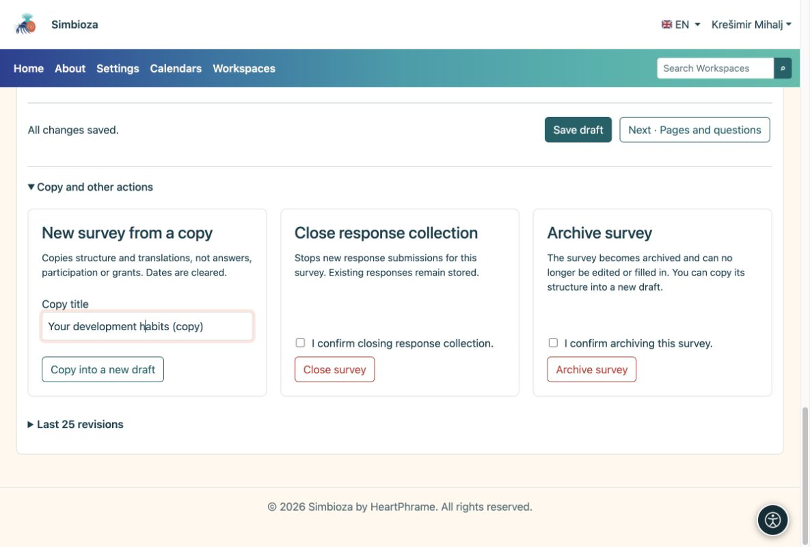

# Eine Umfrage kopieren, schließen oder entfernen

> Die Bildschirmaufnahmen zeigen die englische Benutzeroberfläche.

[Für Umfrageautoren](ankete-autori_de.md)

## Eine neue Umfrage mit ähnlichen Fragen

**Warum kopieren?** Sie behalten die Fragen, ohne eine neue Antwortrunde mit den alten Ergebnissen zu vermischen.

1.  Öffnen Sie den vorhandenen Umfrageeditor.
2.  Erweitern Sie **Kopieren und andere Aktionen**. Geben Sie einen Titel ein und wählen Sie **In einen neuen Entwurf kopieren**.
3.  Überprüfen Sie die neuen Fragen, Termine, Zielgruppen und Berechtigungen. Nehmen Sie Ihre Änderungen vor und folgen Sie den normalen Veröffentlichungsschritten.

<figure>

<figcaption aria-hidden="true">Bei einer Kopie handelt es sich um eine neue Umfrage, nicht um eine Fortsetzung der alten Ergebnisse.</figcaption>
</figure>

**Ergebnis:** ein neuer Entwurf mit Struktur und Übersetzungen, ohne alte Antworten. Termine werden gelöscht; überprüfen Sie die Berechtigungen und die Eingeladenenlisten erneut.

## Sind Sie mit dem Sammeln der Antworten fertig?

Wählen Sie **Umfrage schließen** und bestätigen Sie. Neue Antworten hören auf, während bestehende Antworten bestehen bleiben. Verwenden Sie **Umfrage archivieren**, um es aus der regulären Verwendung zu entfernen. Für diese Aktionen sind die entsprechenden Berechtigungen erforderlich.

Sobald Antworten vorhanden sind, kopieren Sie neue oder geänderte Fragen, damit alte Diagramme ihre Bedeutung behalten. CSV dient der Analyse; Fragen Sie einen Administrator nach betrieblichen Sicherungen und Wiederherstellungen.

## Verwerfen Sie unveröffentlichte Änderungen

Wenn eine Umfrage bereits veröffentlicht ist und Sie ihren neueren Arbeitsentwurf nicht mehr benötigen, öffnen Sie **Kopieren und andere Aktionen → Entwurf verwerfen**. Lesen und überprüfen Sie die Bestätigung und bestätigen Sie dann die Aktion. Nur dieser Arbeitsentwurf wird verworfen; die Veröffentlichung und die akzeptierten Antworten bleiben bestehen. Verschieben Sie bei einem ersten Entwurf, der noch nie veröffentlicht wurde, stattdessen die gesamte Umfrage in den Papierkorb.

## Entfernen Sie eine Umfrage oder ihren ersten Entwurf

1.  Öffnen Sie die Umfrage. Wählen Sie in einem Arbeitsbereich das Symbol **Papierkorb** in der oberen rechten Symbolleiste. Der Editor bietet die gleiche Aktion unter **Kopieren und andere Aktionen** an.
2.  Lesen Sie die Erklärung und überprüfen Sie die Bestätigung zum Verschieben der Umfrage in den Papierkorb.
3.  Wählen Sie **Umfrage in den Papierkorb verschieben**.

**Ergebnis:** Die Umfrage verschwindet aus der Baumstruktur und akzeptiert keine Antworten mehr. Antworten und Einstellungen bleiben für die Wiederherstellung durch den Administrator erhalten. Dadurch werden die Daten nicht dauerhaft gelöscht. In einem Arbeitsbereich benötigen Sie außerdem eine Löschberechtigung auf der Seite; Wenn die Aktion fehlt, fragen Sie den Manager. Bitten Sie einen Administrator, eine entfernte Umfrage wiederherzustellen.
