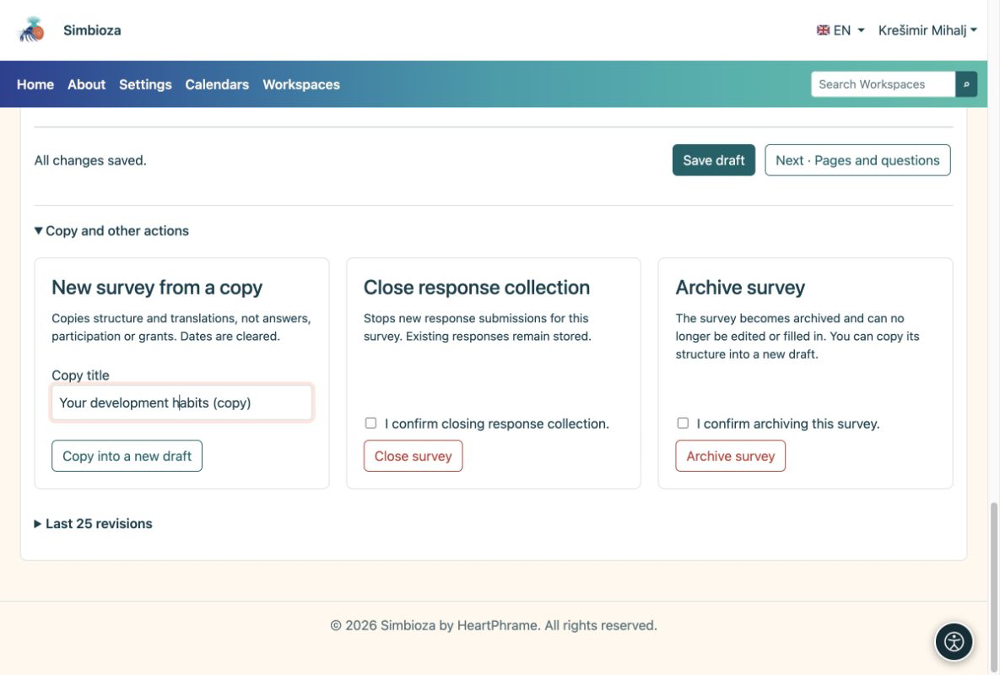

# Copy, close or remove a survey

[For survey authors](ankete-autori_en.md)

## A new survey with similar questions

**Why copy?** You keep the questions without mixing a new round of answers with the old results.

1.  Open the existing survey editor.
2.  Expand **Copying and other actions**. Enter a title and choose **Copy to a new draft**.
3.  Review the new questions, dates, audience and permissions. Make your changes and follow the normal publication steps.

<figure>

<figcaption aria-hidden="true">A copy is a new survey, not a continuation of the old results.</figcaption>
</figure>

**Result:** a new draft with structure and translations, without old responses. Dates are cleared; check permissions and invitee lists again.

## Finished collecting answers?

Choose **Close survey** and confirm. New answers stop, while existing answers remain. Use **Archive survey** to remove it from regular use. These actions require the appropriate permissions.

Once responses exist, make new or changed questions in a copy so old charts keep their meaning. CSV is for analysis; ask an administrator about operational backup and restore.

## Discard unpublished changes

When a survey is already published and you no longer need its newer working draft, open **Copying and other actions → Discard draft**. Read and check the confirmation, then confirm the action. Only that working draft is discarded; the publication and accepted responses remain. For an initial draft that has never been published, move the whole survey to trash instead.

## Remove a survey or its initial draft

1.  Open the survey. In a Workspace, choose the **trash** icon in the upper-right toolbar. The editor offers the same action under **Copying and other actions**.
2.  Read the explanation and check the confirmation for moving the survey to trash.
3.  Choose **Move survey to trash**.

**Result:** the survey disappears from the tree and stops accepting responses. Responses and settings remain for administrator recovery. This does not permanently erase data. In a Workspace, you also need deletion permission on the page; if the action is missing, ask its manager. Ask an administrator to restore a removed survey.
