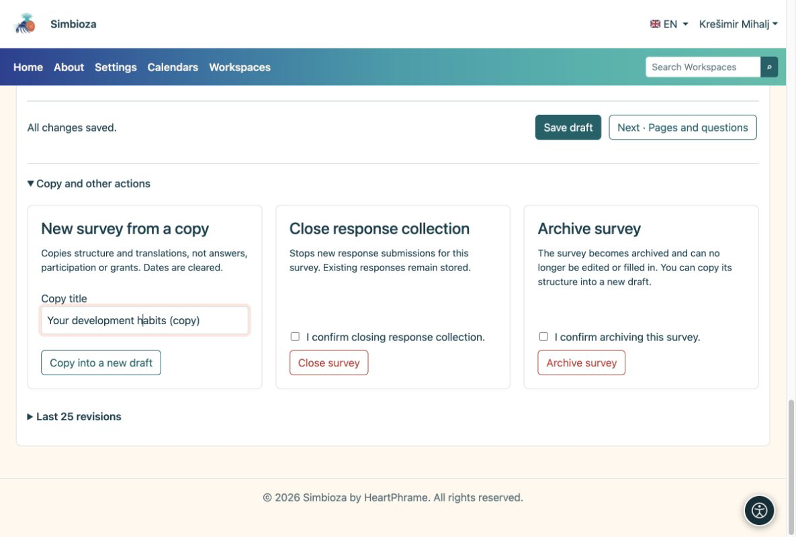

# Copiar, cerrar o eliminar una encuesta

> Las capturas de pantalla muestran la interfaz en inglés.

[Para autores de encuestas](ankete-autori_es.md)

## Una nueva encuesta con preguntas similares

**¿Por qué copiar?** Conservas las preguntas sin mezclar una nueva ronda de respuestas con los resultados anteriores.

1.  Abra el editor de encuestas existente.
2.  Expanda **Copia y otras acciones**. Ingrese un título y elija **Copiar a un nuevo borrador**.
3.  Revise las nuevas preguntas, fechas, audiencia y permisos. Realice sus cambios y siga los pasos normales de publicación.

<figure>

<figcaption aria-hidden="true">Una copia es una encuesta nueva, no una continuación de los resultados anteriores.</figcaption>
</figure>

**Resultado:** un nuevo borrador con estructura y traducciones, sin respuestas antiguas. Se borran las fechas; verifique los permisos y las listas de invitados nuevamente.

## ¿Terminaste de recopilar respuestas?

Elija **Cerrar encuesta** y confirme. Las nuevas respuestas se detienen, mientras que las existentes permanecen. Utilice **Archivar encuesta** para eliminarla del uso habitual. Estas acciones requieren los permisos adecuados.

Una vez que existan respuestas, cree preguntas nuevas o modificadas en una copia para que los cuadros antiguos mantengan su significado. CSV es para análisis; Pregunte a un administrador sobre la copia de seguridad y restauración operativa.

## Descartar cambios no publicados

Cuando una encuesta ya esté publicada y ya no necesite su borrador de trabajo más reciente, abra **Copiar y otras acciones → Descartar borrador**. Lea y verifique la confirmación, luego confirme la acción. Sólo se descarta ese borrador de trabajo; la publicación y las respuestas aceptadas permanecen. Para un borrador inicial que nunca se haya publicado, mueva toda la encuesta a la papelera.

## Eliminar una encuesta o su borrador inicial

1.  Abra la encuesta. En un espacio de trabajo, elija el ícono **papelera** en la barra de herramientas superior derecha. El editor ofrece la misma acción en **Copiar y otras acciones**.
2.  Lea la explicación y verifique la confirmación para mover la encuesta a la papelera.
3.  Elija **Mover encuesta a la papelera**.

**Resultado:** la encuesta desaparece del árbol y deja de aceptar respuestas. Las respuestas y configuraciones permanecen para la recuperación del administrador. Esto no borra datos permanentemente. En un espacio de trabajo, también necesita permiso de eliminación en la página; si falta la acción, pregúntele a su gestor. Pídale a un administrador que restaure una encuesta eliminada.
