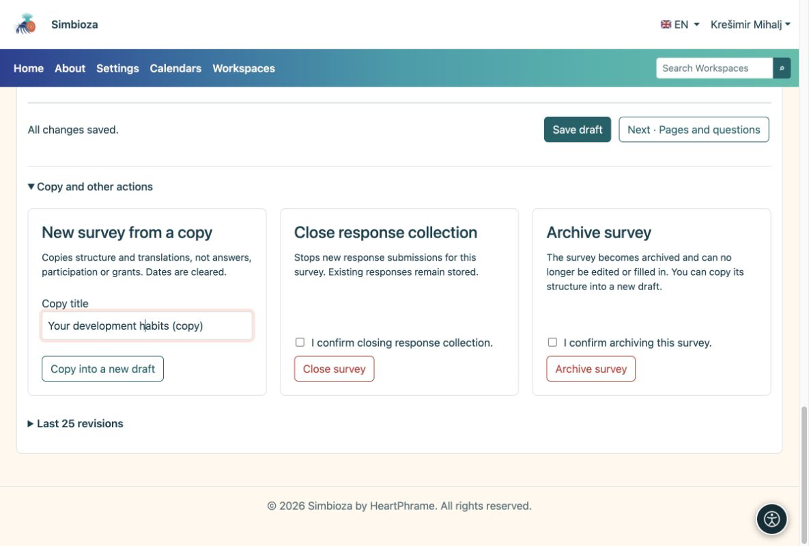

# Copier, fermer ou supprimer un sondage

> Les captures d’écran présentent l’interface en anglais.

[Pour les auteurs du sondage](ankete-autori_fr.md)

## Un nouveau sondage avec des questions similaires

**Pourquoi copier ?** Vous conservez les questions sans mélanger une nouvelle série de réponses avec les anciens résultats.

1.  Ouvrez l'éditeur de sondage existant.
2.  Développez **Copie et autres actions**. Saisissez un titre et choisissez **Copier dans un nouveau brouillon**.
3.  Passez en revue les nouvelles questions, dates, audiences et autorisations. Apportez vos modifications et suivez les étapes normales de publication.

<figure>

<figcaption aria-hidden="true">Une copie est un nouveau sondage et non une continuation des anciens résultats.</figcaption>
</figure>

**Résultat :** une nouvelle ébauche avec structure et traductions, sans anciennes réponses. Les dates sont effacées ; vérifiez à nouveau les autorisations et les listes d’invités.

## Vous avez fini de collecter les réponses ?

Choisissez **Fermer le sondage** et confirmez. Les nouvelles réponses s'arrêtent, tandis que les réponses existantes demeurent. Utilisez **Archive poll** pour le supprimer de l'utilisation régulière. Ces actions nécessitent les autorisations appropriées.

Une fois que les réponses existent, créez des questions nouvelles ou modifiées dans une copie afin que les anciens tableaux conservent leur signification. CSV est destiné à l'analyse ; renseignez-vous auprès d'un administrateur sur la sauvegarde et la restauration opérationnelles.

## Supprimer les modifications non publiées

Lorsqu'un sondage est déjà publié et que vous n'avez plus besoin de son nouveau brouillon, ouvrez **Copie et autres actions → Supprimer le brouillon**. Lisez et vérifiez la confirmation, puis confirmez l'action. Seule cette ébauche de travail est rejetée ; la publication et les réponses acceptées demeurent. Pour un brouillon initial qui n’a jamais été publié, déplacez plutôt l’intégralité du sondage dans la corbeille.

## Supprimer un sondage ou sa version initiale

1.  Ouvrez le sondage. Dans un espace de travail, choisissez l'icône **corbeille** dans la barre d'outils supérieure droite. L'éditeur propose la même action sous **Copie et autres actions**.
2.  Lisez l'explication et vérifiez la confirmation du déplacement du sondage vers la corbeille.
3.  Choisissez **Déplacer le sondage vers la corbeille**.

**Résultat :** le sondage disparaît de l'arborescence et cesse d'accepter les réponses. Les réponses et les paramètres restent pour la récupération de l'administrateur. Cela n’efface pas définitivement les données. Dans un espace de travail, vous avez également besoin d'une autorisation de suppression sur la page ; si l'action manque, demandez à son responsable. Demandez à un administrateur de restaurer un sondage supprimé.
