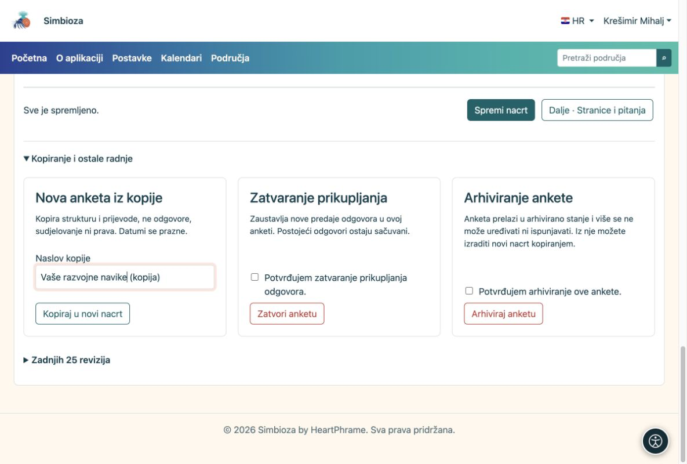

# Kopirajte, zatvorite ili uklonite anketu

[Za sastavljače anketa](ankete-autori_hr.md)

## Nova anketa sa sličnim pitanjima

**Zašto kopirati?** Tako zadržavate pitanja, ali novu skupinu odgovora ne miješate sa starom.

1.  Otvorite uređivač postojeće ankete.
2.  Proširite **Kopiranje i ostale radnje**. Upišite naslov kopije pa odaberite **Kopiraj u novi nacrt**.
3.  Pregledajte pitanja, datum, ciljanu skupinu i prava nove ankete. Promijenite što treba te je redovno pošaljite na objavu.

<figure>

<figcaption aria-hidden="true">Kopija je nova anketa, a ne nastavak starih rezultata.</figcaption>
</figure>

**Rezultat:** novi nacrt sa strukturom i prijevodima, bez starih odgovora. Datumi se prazne, a prava i popise ispitanika treba ponovno provjeriti.

## Završili ste s prikupljanjem?

Odaberite **Zatvori anketu** i potvrdite radnju. Novi odgovori više se ne primaju, a stari ostaju. Za uklanjanje iz redovne uporabe koristite **Arhiviraj anketu**. Te radnje traže odgovarajuća prava.

Kada već postoje odgovori, nova ili promijenjena pitanja radite u kopiji. Tako stari grafovi i dalje znače isto. CSV čuva podatke za analizu; za sigurnosnu kopiju i povrat obratite se administratoru.

## Odbacite neobjavljene izmjene

Ako je anketa već objavljena, a novi radni nacrt više ne trebate, otvorite **Kopiranje i ostale radnje → Odbaci nacrt**. Pročitajte potvrdu, označite je i potvrdite radnju. Odbacuje se samo taj radni nacrt; objavljena anketa i prikupljeni odgovori ostaju. Za nacrt koji još nikada nije objavljen koristite premještanje cijele ankete u smeće.

## Uklonite anketu ili početni nacrt

1.  Otvorite anketu. U području odaberite ikonu **koša** u gornjoj desnoj alatnoj traci. U uređivaču je ista radnja u **Kopiranje i ostale radnje**.
2.  Pročitajte što će se dogoditi pa označite potvrdu premještanja u smeće.
3.  Odaberite **Premjesti anketu u smeće**.

**Rezultat:** anketa nestaje iz stabla i prestaje primati odgovore. Odgovori i postavke ostaju sačuvani za administratorski povrat. To nije trajno brisanje podataka. U području trebate i pravo brisanja na toj stranici; ako radnju ne vidite, zatražite je od upravitelja. Za vraćanje se obratite administratoru.
