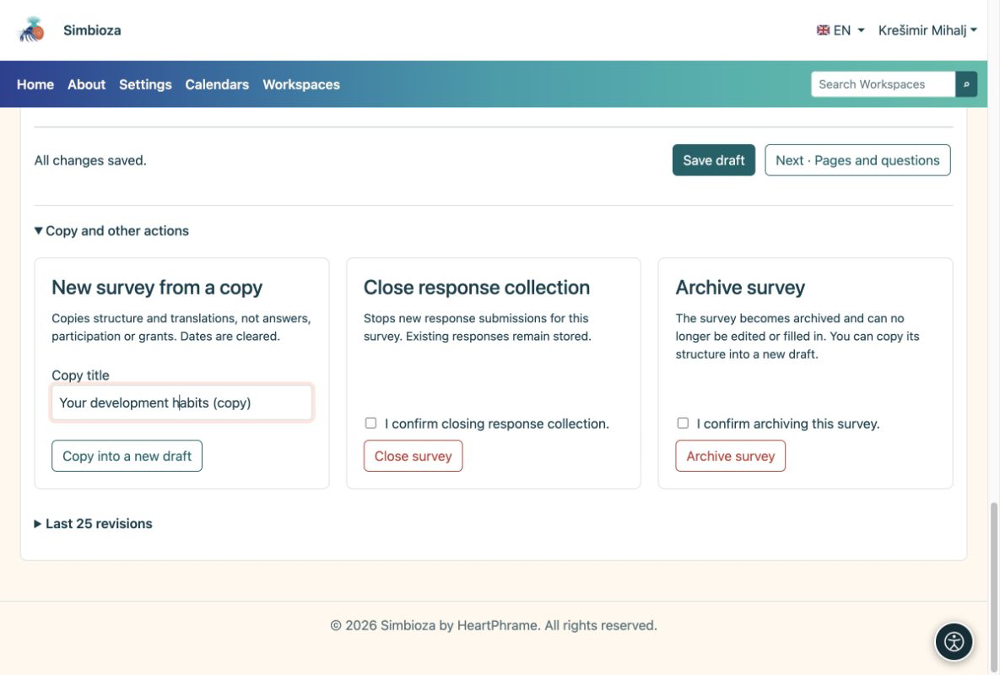

# Copia, chiudi o rimuovi un sondaggio

> Le schermate mostrano l’interfaccia in inglese.

[Per gli autori del sondaggio](ankete-autori_it.md)

## Un nuovo sondaggio con domande simili

**Perché copiare?** Conserva le domande senza mescolare un nuovo ciclo di risposte con i vecchi risultati.

1.  Apri l'editor del sondaggio esistente.
2.  Espandi **Copia e altre azioni**. Inserisci un titolo e scegli **Copia in una nuova bozza**.
3.  Esamina le nuove domande, date, pubblico e autorizzazioni. Apporta le modifiche e segui i normali passaggi di pubblicazione.

<figure>

<figcaption aria-hidden="true">Una copia è un nuovo sondaggio, non una continuazione dei vecchi risultati.</figcaption>
</figure>

**Risultato:** una nuova bozza con struttura e traduzioni, senza vecchie risposte. Le date vengono cancellate; controlla nuovamente le autorizzazioni e gli elenchi degli invitati.

## Hai finito di raccogliere le risposte?

Scegli **Chiudi sondaggio** e conferma. Non saranno accettate nuove risposte, mentre quelle esistenti rimangono. Usa **Archivia sondaggio** per rimuoverlo dall'uso ordinario. Queste azioni richiedono le autorizzazioni appropriate.

Una volta che esistono le risposte, crea domande nuove o modificate in una copia in modo che i vecchi grafici mantengano il loro significato. CSV è per l'analisi; chiedere a un amministratore informazioni su backup e ripristino operativi.

## Elimina le modifiche non pubblicate

Quando un sondaggio è già pubblicato e non hai più bisogno della sua bozza di lavoro più recente, apri **Copia e altre azioni → Elimina bozza**. Leggere e controllare la conferma, quindi confermare l'azione. Solo quella bozza di lavoro viene scartata; la pubblicazione e le risposte accettate rimangono. Per una bozza iniziale che non è mai stata pubblicata, sposta invece l'intero sondaggio nel cestino.

## Rimuovere un sondaggio o la sua bozza iniziale

1.  Apri il sondaggio. In un'area di lavoro, scegli l'icona del **cestino** nella barra degli strumenti in alto a destra. L'editor offre la stessa azione in **Copia e altre azioni**.
2.  Leggi la spiegazione e controlla la conferma per spostare il sondaggio nel cestino.
3.  Scegli **Sposta sondaggio nel cestino**.

**Risultato:** il sondaggio scompare dall'albero e non accetta più risposte. Le risposte e le impostazioni rimangono per il ripristino dell'amministratore. Ciò non cancella permanentemente i dati. In un'area di lavoro è necessaria anche l'autorizzazione all'eliminazione sulla pagina; se manca l'azione, chiedi al suo responsabile. Chiedi a un amministratore di ripristinare un sondaggio rimosso.
