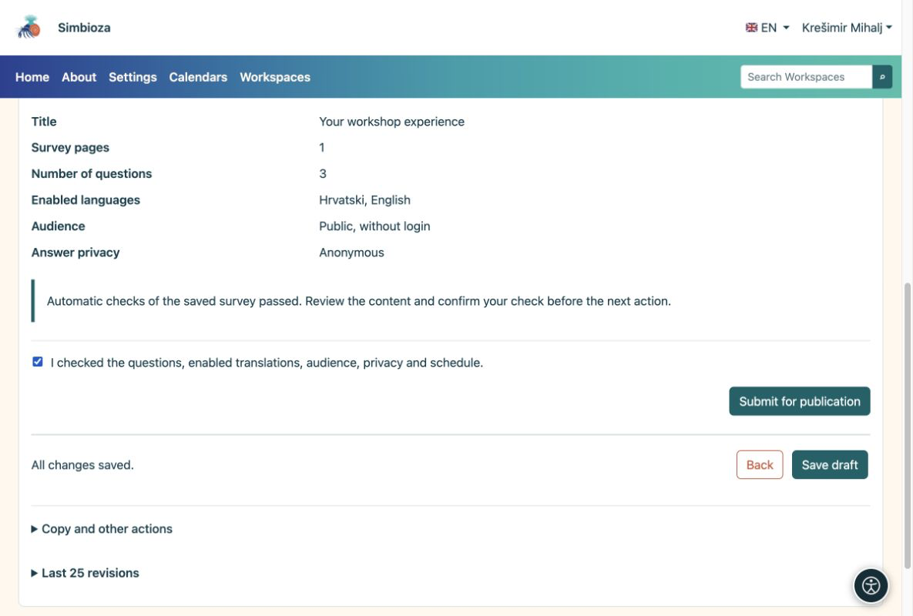
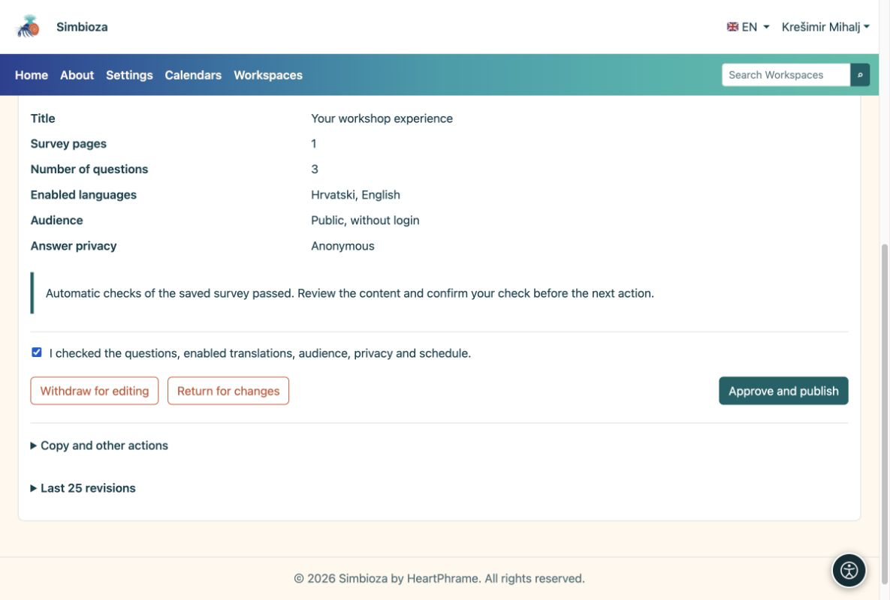

# 4. Die Umfrage prüfen und veröffentlichen

> Die Bildschirmaufnahmen zeigen die englische Benutzeroberfläche.

[Für Umfrageautoren](ankete-autori_de.md)

**Ziel:** Eine fertige Umfrage für Teilnehmer freigeben. Dazu sind zwei Schritte erforderlich: Der Autor reicht die Umfrage ein, anschließend genehmigt eine zur Veröffentlichung berechtigte Person sie.

1.  Speichern Sie den Entwurf und öffnen Sie **Überprüfen und veröffentlichen**.
2.  Wählen Sie **Versuchen Sie, an der Umfrage teilzunehmen**. Überprüfen Sie die Einleitung, Fragen, erforderliche Antworten, Bedingungen und Übersetzungen. Ein Test speichert keine echten Antworten.
3.  Kehren Sie zur Prüfung zurück. Wenn alles bereit ist, bestätigen Sie Ihre Prüfung und wählen Sie **Zur Veröffentlichung einreichen**. Der Status wechselt zu **Warten auf Überprüfung**.

<figure>

<figcaption aria-hidden="true">Der Autor bestätigt die Prüfung und übermittelt den gespeicherten Entwurf.</figcaption>
</figure>

## Was macht der Herausgeber?

Eine Person mit Veröffentlichungsberechtigung öffnet die übermittelte Umfrage, überprüft sie und wählt **Genehmigen und veröffentlichen** oder sendet sie zur Änderung zurück. Wenn Sie über beide Berechtigungen verfügen, müssen Sie dennoch beide Schritte ausführen.

<figure>

<figcaption aria-hidden="true">Der Herausgeber genehmigt die Veröffentlichung gesondert.</figcaption>
</figure>

**Ergebnis:** Die veröffentlichte Umfrage steht den berechtigten Teilnehmern zur Verfügung. Öffnen Sie ihre Seite und senden Sie den Link an die vorgesehenen Teilnehmer. Liegt das Startdatum in der Zukunft, können Antworten erst ab diesem Datum erfasst werden. Ein leeres Enddatum bedeutet, dass es keine automatische Frist gibt.

**Keine Schaltfläche „Genehmigen und veröffentlichen“?** Sie verfügen wahrscheinlich über die Berechtigung zum Verfassen, aber nicht zur Veröffentlichung. Warten Sie auf einen autorisierten Herausgeber. Wenn Sie den Entwurf erneut speichern, wird er nicht veröffentlicht.
