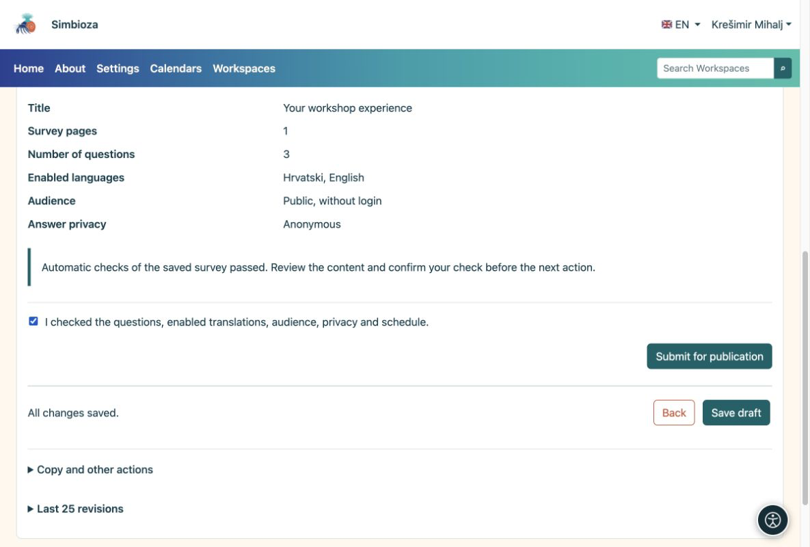
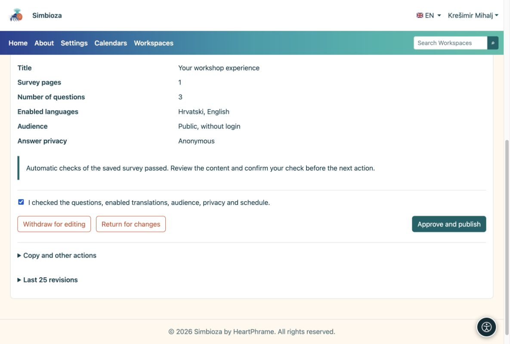

# 4. Check and publish the survey

[For survey authors](ankete-autori_en.md)

**Goal:** make a finished survey available to participants. There are two steps: the author submits it, then an authorized publisher approves it.

1.  Save the draft and open **Check and publish**.
2.  Choose **Try completing the survey**. Check the introduction, questions, required answers, conditions and translations. A trial does not save real responses.
3.  Return to the check. If everything is ready, confirm your review and choose **Submit for publication**. The status becomes **Awaiting review**.

<figure>

<figcaption aria-hidden="true">The author confirms the check and submits the saved draft.</figcaption>
</figure>

## What does the publisher do?

A person with publication permission opens the submitted survey, reviews it and chooses **Approve and publish**, or returns it for changes. If you hold both permissions, you must still complete both steps.

<figure>

<figcaption aria-hidden="true">The publisher approves publication separately.</figcaption>
</figure>

**Result:** the published survey is available to eligible participants. Open its page and send its link to the people who should answer. A future start date delays collection until that date. An empty closing date means no automatic deadline.

**No “Approve and publish” button?** You probably have authoring but not publishing permission. Wait for an authorized publisher; saving the draft again does not publish it.
