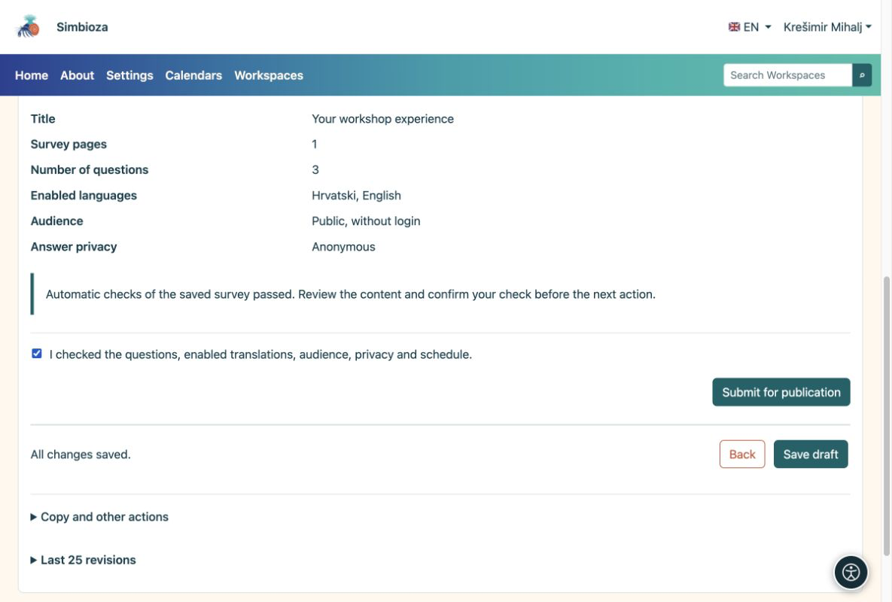
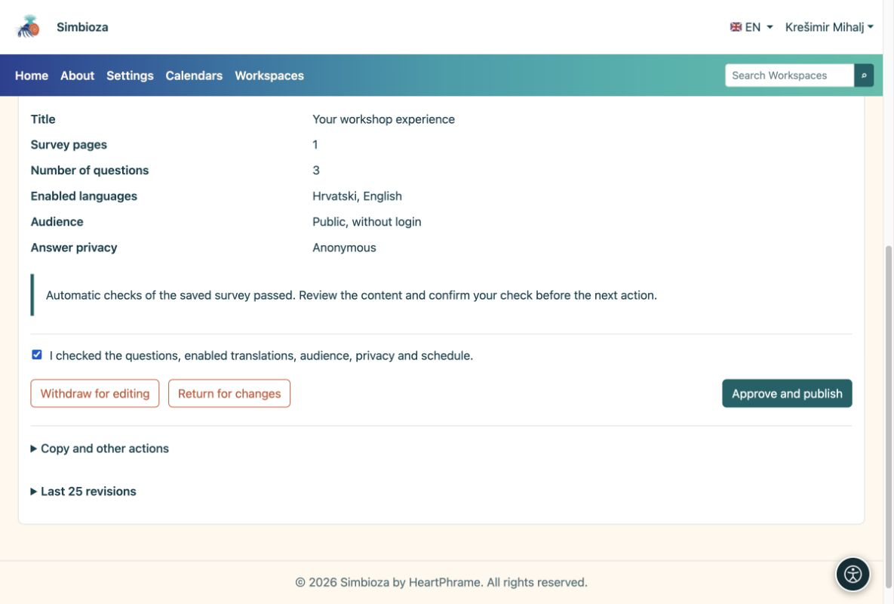

# 4. Revisar y publicar la encuesta

> Las capturas de pantalla muestran la interfaz en inglés.

[Para autores de encuestas](ankete-autori_es.md)

**Objetivo:** poner una encuesta terminada a disposición de los participantes. Hay dos pasos: el autor la envía y después una persona con permiso de publicación la aprueba.

1.  Guarde el borrador y abra **Verificar y publicar**.
2.  Elija **Intente completar la encuesta**. Consulte la introducción, preguntas, respuestas requeridas, condiciones y traducciones. Un ensayo no guarda respuestas reales.
3.  Vuelva a la revisión. Si todo está listo, confirme que ha revisado la encuesta y seleccione **Enviar para publicación**. El estado cambiará a **En espera de revisión**.

<figure>

<figcaption aria-hidden="true">El autor confirma la verificación y envíe el borrador guardado.</figcaption>
</figure>

## ¿Qué hace la persona con permiso para publicar?

Una persona con permiso de publicación abre la encuesta enviada, la revisa y elige **Aprobar y publicar**, o la devuelve para realizar cambios. Si posee ambos permisos, aún debe completar ambos pasos.

<figure>

<figcaption aria-hidden="true">La persona con permiso para publicar aprueba la publicación por separado.</figcaption>
</figure>

**Resultado:** la encuesta publicada está disponible para los participantes elegibles. Abra su página y envíe su enlace a las personas que deberían responder. Una fecha de inicio futura retrasa el cobro hasta esa fecha. Una fecha de cierre vacía significa que no hay fecha límite automática.

**¿No aparece el botón «Aprobar y publicar»?** Probablemente tenga permiso de creación, pero no de publicación. Espere a una persona con permiso para publicar; guardar otra vez el borrador no lo publica.
