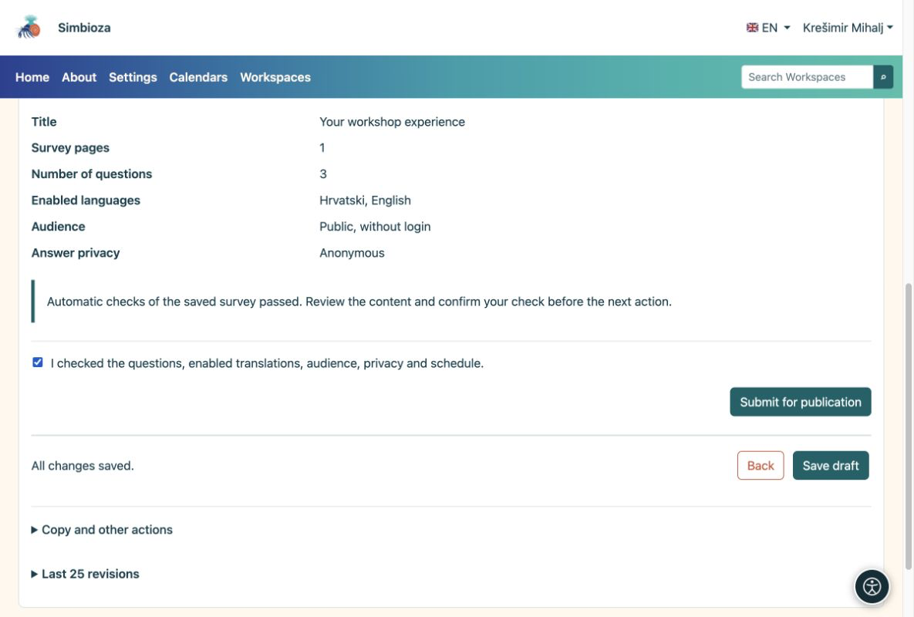
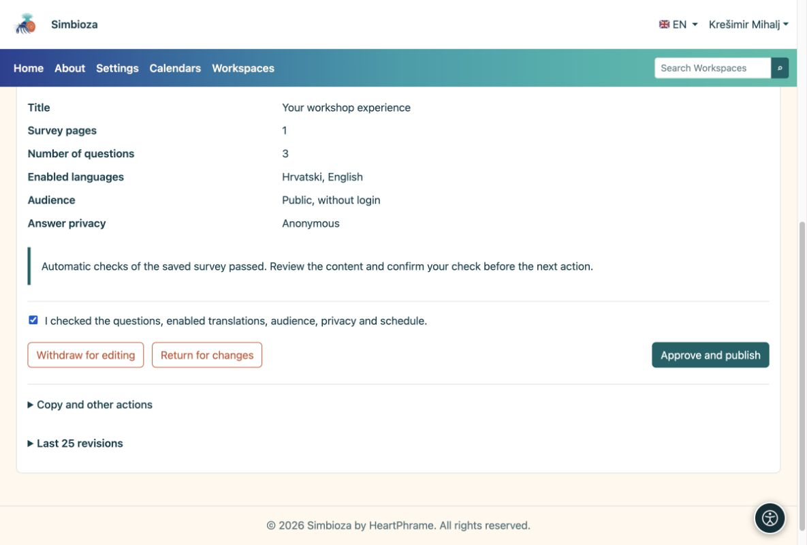

# 4. Vérifier et publier le sondage

> Les captures d’écran présentent l’interface en anglais.

[Pour les auteurs du sondage](ankete-autori_fr.md)

**Objectif :** mettre un sondage terminé à la disposition des participants. Il y a deux étapes : l'auteur le soumet, puis un responsable de publication agréé l'approuve.

1.  Enregistrez le brouillon et ouvrez **Vérifier et publier**.
2.  Choisissez **Essayez de répondre au sondage**. Vérifiez l'introduction, les questions, les réponses requises, les conditions et les traductions. Un essai ne sauve pas de vraies réponses.
3.  Revenez au chèque. Si tout est prêt, confirmez votre avis et choisissez **Soumettre pour publication**. Le statut devient **En attente de révision**.

<figure>

<figcaption aria-hidden="true">L'auteur confirme le chèque et soumet le brouillon enregistré.</figcaption>
</figure>

## Que fait l'responsable de publication ?

Une personne disposant de l'autorisation de publication ouvre le sondage soumis, l'examine et choisit **Approuver et publier**, ou le renvoie pour modification. Si vous détenez les deux autorisations, vous devez quand même effectuer les deux étapes.

<figure>

<figcaption aria-hidden="true">L'responsable de publication approuve la publication séparément.</figcaption>
</figure>

**Résultat :** le sondage publié est disponible pour les participants éligibles. Ouvrez sa page et envoyez son lien aux personnes qui doivent répondre. Une date de début future retarde la collecte jusqu'à cette date. Une date de clôture vide signifie qu’il n’y a pas de date limite automatique.

**Pas de bouton « Approuver et publier » ?** Vous disposez probablement d'une autorisation de création, mais pas de publication. Attendez un responsable de publication autorisé ; enregistrer à nouveau le brouillon ne le publie pas.
