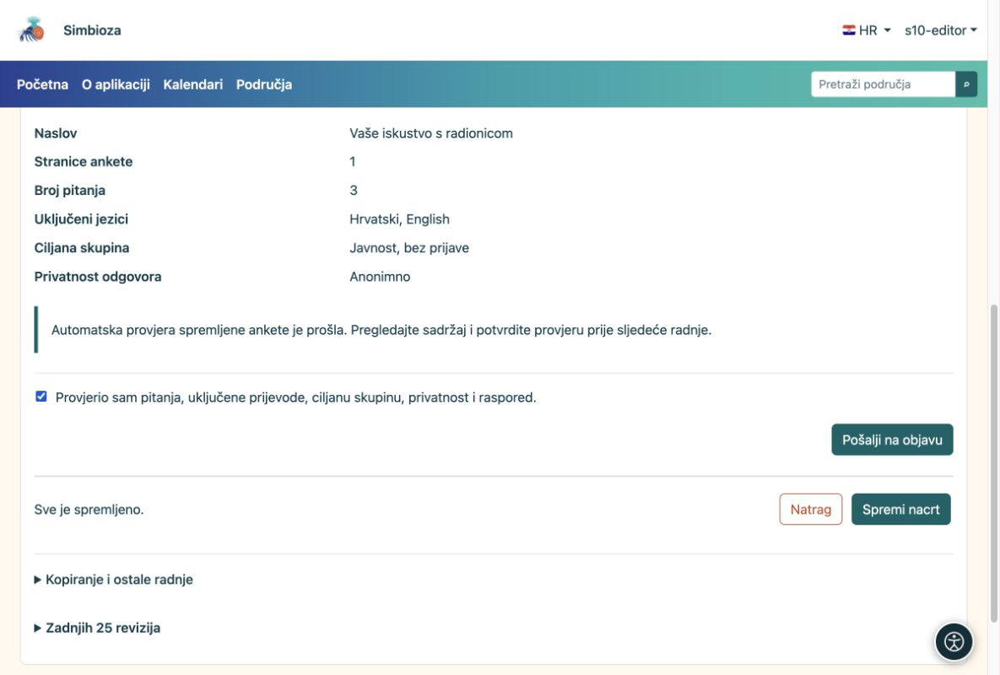
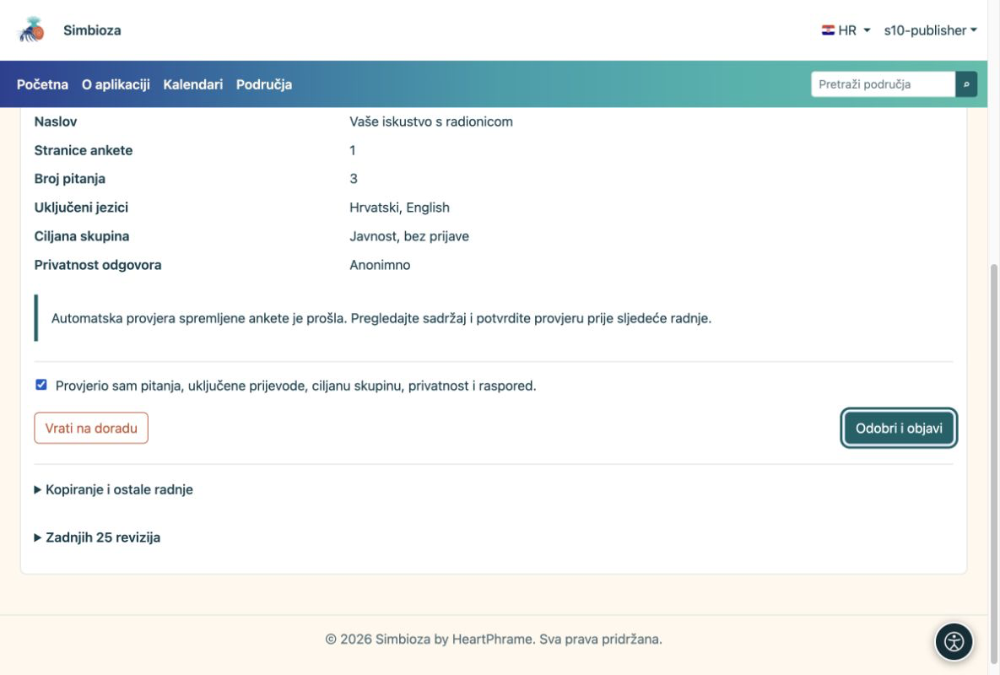

# 4. Provjerite i objavite anketu

[Za sastavljače anketa](ankete-autori_hr.md)

**Cilj:** otvoriti dovršenu anketu ispitanicima. Postoje dva koraka: sastavljač šalje na objavu, a ovlašteni objavljivač odobrava objavu.

1.  Spremite nacrt i otvorite **Provjera i objava**.
2.  Odaberite **Isprobaj ispunjavanje ankete**. Provjerite uvod, sva pitanja, obvezne odgovore, uvjete i prijevode. Proba ne sprema stvarne odgovore.
3.  Vratite se na provjeru. Ako je sve u redu, označite potvrdu pregleda i odaberite **Pošalji na objavu**. Status postaje **Čeka pregled**.

<figure>

<figcaption aria-hidden="true">Sastavljač potvrđuje provjeru i šalje spremljeni nacrt na objavu.</figcaption>
</figure>

## Što radi objavljivač?

Osoba s pravom objavljivanja otvara poslanu anketu, pregledava je i bira **Odobri i objavi**. Može je i vratiti na doradu. Ako imate oba prava, i sami morate napraviti oba koraka.

<figure>

<figcaption aria-hidden="true">Objavljivač zasebno odobrava objavu.</figcaption>
</figure>

**Rezultat:** objavljena anketa dostupna je dopuštenim ispitanicima. Otvorite njezinu stranicu i pošaljite poveznicu osobama koje trebaju odgovoriti. Ako ste zadali budući početak, odgovaranje počinje tek tada. Prazan završetak znači da nema automatskog roka zatvaranja.

**Ne vidite „Odobri i objavi”?** Vjerojatno imate pravo sastavljanja, ali ne objavljivanja. Pričekajte ovlaštenog objavljivača; ponovno spremanje nacrta ne zamjenjuje objavu.
