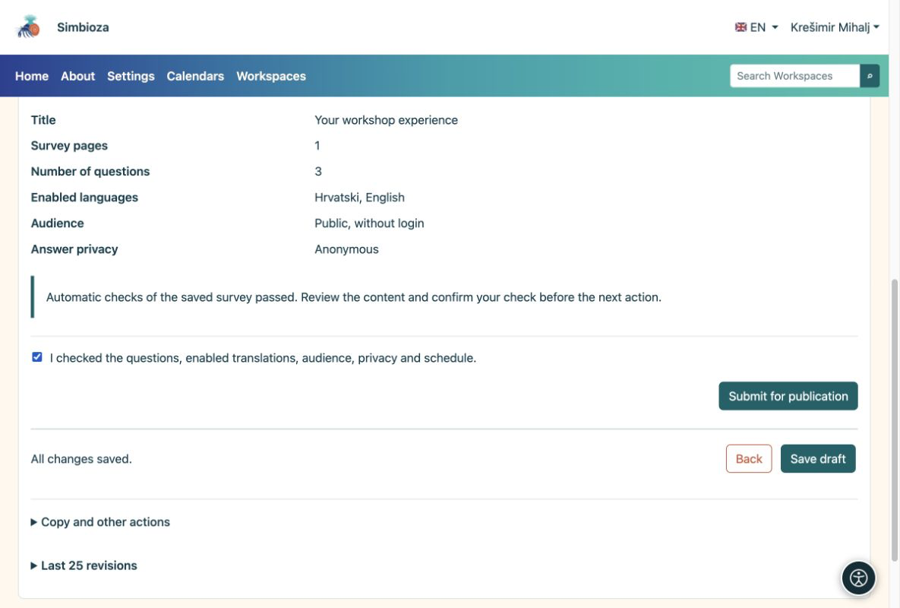
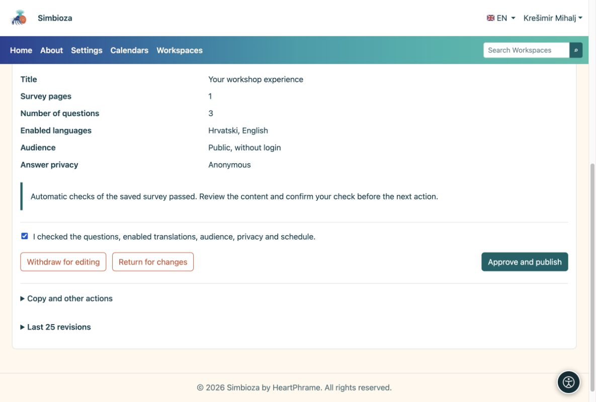

# 4. Controlla e pubblica il sondaggio

> Le schermate mostrano l’interfaccia in inglese.

[Per gli autori del sondaggio](ankete-autori_it.md)

**Obiettivo:** rendere disponibile ai partecipanti un sondaggio finito. Ci sono due passaggi: l'autore lo invia, poi un editore autorizzato lo approva.

1.  Salva la bozza e apri **Controlla e pubblica**.
2.  Scegli **Prova a completare il sondaggio**. Controlla l'introduzione, le domande, le risposte richieste, le condizioni e le traduzioni. Una prova non salva risposte reali.
3.  Torna alla verifica. Se tutto è pronto, conferma di aver controllato il sondaggio e scegli **Invia per pubblicazione**. Lo stato diventa **In attesa di revisione**.

<figure>

<figcaption aria-hidden="true">L'autore conferma il controllo e invia la bozza salvata.</figcaption>
</figure>

## Cosa fa l'editore?

Una persona con autorizzazione alla pubblicazione apre il sondaggio inviato, lo esamina e sceglie **Approva e pubblica** oppure lo restituisce per modifiche. Se disponi di entrambe le autorizzazioni, devi comunque completare entrambi i passaggi.

<figure>

<figcaption aria-hidden="true">L'editore approva la pubblicazione separatamente.</figcaption>
</figure>

**Risultato:** il sondaggio pubblicato è disponibile per i partecipanti idonei. Apri la sua pagina e invia il suo link alle persone che dovrebbero rispondere. Una data di inizio futura ritarda la raccolta fino a quella data. Una data di chiusura vuota non significa alcuna scadenza automatica.

**Nessun pulsante "Approva e pubblica"?** Probabilmente disponi dell'autorizzazione di creazione ma non di pubblicazione. Attendi un editore autorizzato; salvare nuovamente la bozza non la pubblica.
