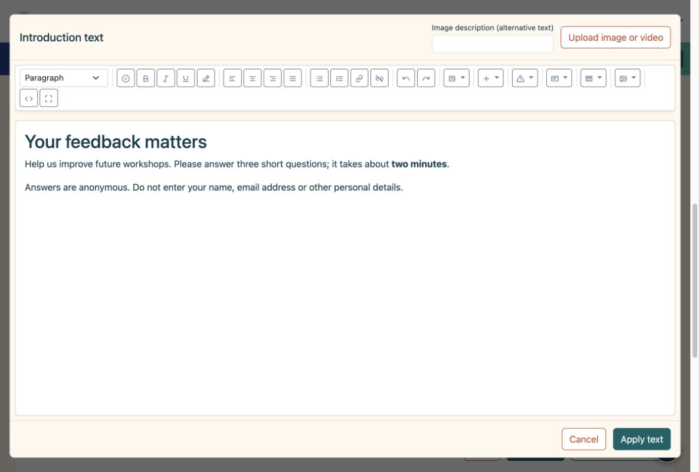
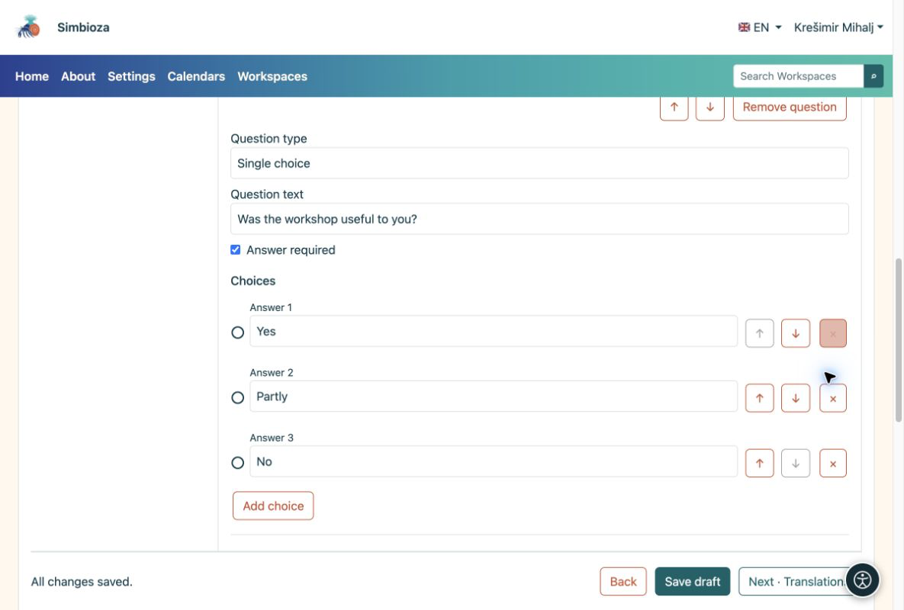
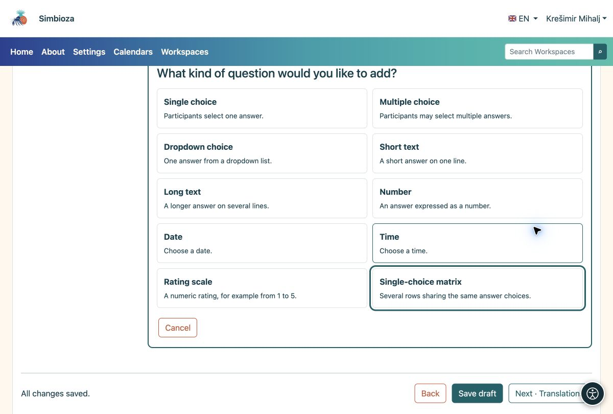

# 2. Eine Einleitung und Fragen hinzufügen

> Die Bildschirmaufnahmen zeigen die englische Benutzeroberfläche.

[Für Umfrageautoren](ankete-autori_de.md)

**Ziel:** Sagen Sie den Teilnehmern, was Sie fragen, und gestalten Sie die Antwort einfach.

## Beginnen Sie mit einer kurzen Einführung

1.  Wählen Sie unter **Seiten und Fragen** die Option **Einführung hinzufügen**.
2.  Wählen Sie **Inhalt im Editor HTML bearbeiten**. Erklären Sie den Zweck, die ungefähre Dauer und ob personenbezogene Daten vermieden werden sollten. Verwenden Sie die Symbolleiste, um Text zu formatieren oder Bilder, Videos und Links hinzuzufügen.
3.  Wählen Sie **Text anwenden** und dann **Entwurf speichern**. Durch Anwenden wird der Texteditor geschlossen; Beim Speichern wird die gesamte Umfrage gespeichert.

<figure>

<figcaption aria-hidden="true">Die Einführung verwendet den vollständigen HTML-Editor.</figcaption>
</figure>

## Fügen Sie die erste Frage hinzu

1.  Wählen Sie **Frage hinzufügen → Einzelauswahl**. Wählen Sie den Typ aus, bevor Sie die Frage schreiben.
2.  Geben Sie **War der Workshop für Sie nützlich?** und die Auswahlmöglichkeiten **Ja**, **Teilweise** und **Nein** ein. Verwenden Sie **Auswahl hinzufügen** für die dritte Auswahl.
3.  Aktivieren Sie **Antwort erforderlich**, wenn Teilnehmer diese Frage vor dem Absenden beantworten müssen. Wählen Sie **Bearbeitung abschließen** und speichern Sie den Entwurf.

<figure>

<figcaption aria-hidden="true">Eine Frage mit drei Auswahlmöglichkeiten und der Option „Antwort erforderlich“.</figcaption>
</figure>

## Welchen Typ soll ich wählen?

| Sie brauchen… | Fragetyp |
|----|----|
| Genau eine Antwort | Einzelauswahl; Dropdown für eine längere Liste |
| Mehrere Möglichkeiten auf einmal | Multiple Choice |
| Ein kurzer Vorschlag oder Eintragsname | Kurzer Text |
| Ein Kommentar in mehreren Sätzen | Langer Text |
| Eine Menge, ein Datum oder eine Uhrzeit | Nummer, Datum oder Uhrzeit |
| Eine Punktzahl wie 1–5 | Bewertungsskala |
| Mehrere Anweisungen mit den gleichen Auswahlmöglichkeiten | Single-Choice-Matrix |

<figure>

<figcaption aria-hidden="true">Alle zehn Fragetypen haben eine kurze Erklärung.</figcaption>
</figure>

**Ergebnis:** Auf der Seite werden Ihre Einführungs- und Fragenkarten angezeigt. Klicken Sie auf eine Karte, um sie zu ändern. Eine kurze Umfrage benötigt nur eine Seite; Verwenden Sie **Seite hinzufügen**, wenn Sie separate Schritte wünschen.

## Einen Eintrag neu anordnen oder entfernen

1. Öffnen Sie die Fragenkarte. Verwenden Sie ** ↑ / ↓ **, um es innerhalb derselben Seite zu verschieben. Die Pfeile neben einer Auswahl ändern die Reihenfolge der Auswahl.
2. Verwenden Sie **Frage entfernen** oder **×** neben einer Antwortoption, um sie zu entfernen. Lesen Sie zuerst die Bestätigung: Bedingungen, die von diesem Element abhängen, können ebenfalls entfernt werden.
3. Wenn Sie einen Fehler gemacht haben und nicht gespeichert haben, nutzen Sie die angebotene Option **Entfernung rückgängig machen**. Überprüfen Sie den Inhalt und speichern Sie den Entwurf.

Öffnen Sie für eine ganze Seite **Seiteneinstellungen und Bestellung**. Eine Neuordnung kann sich auf [Sichtbarkeitsbedingungen](ankete-grananje-prijevodi_de.md) auswirken: Eine von einer Bedingung verwendete Frage muss weiterhin früher in der Umfrage erscheinen.

## Ändern Sie den Typ oder beschränken Sie eine Antwort

Ändern Sie den **Fragetyp** einer offenen Frage nur, wenn Sie eine andere Antwortart benötigen. Durch eine Typänderung werden möglicherweise vorhandene Auswahlmöglichkeiten und Einschränkungen entfernt, die für den neuen Typ nicht gelten. Lesen Sie die Warnung, bevor Sie sie bestätigen.

Öffnen Sie **Erläuterungen, Beschriftungen und Grenzwerte**, um Hilfetext hinzuzufügen und Grenzwerte für den ausgewählten Typ festzulegen. Die Grenzen der Bewertungsskala erscheinen auch direkt auf der Fragenkarte.

| Typ | Verfügbares Limit | Beispiel |
| --- | --- | --- |
| Kurzer oder langer Text | Minimale und maximale Antwortlänge. | Eine kurze Beschreibung mit bis zu 200 Zeichen. |
| Multiple Choice | Minimale und maximale Auswahlanzahl. | Wählen Sie zwischen 1 und 3 Optionen. |
| Zahl oder Bewertungsskala | Minimaler und maximaler Wert. | Eine Punktzahl von 1 bis 5. |
| Datum oder Uhrzeit | Frühester und spätester zulässiger Wert. | Ein Termin innerhalb des Workshop-Zeitraums. |

**Ergebnis:** Teilnehmer erhalten das entsprechende Feld und müssen ungültige Werte vor dem Absenden korrigieren. Eine Beschränkung ersetzt nicht **Antwort erforderlich**: Aktivieren Sie diese Option auch, wenn die Frage nicht leer bleiben darf. Überprüfen Sie die Grenzen der Testteilnahme.

## Erstellen Sie eine Matrix

Wählen Sie **Single-Choice-Matrix** für mehrere Anweisungen mit denselben Auswahlmöglichkeiten. Wählen Sie unter **Matrixzeilen** die Option **Zeile hinzufügen** und geben Sie jede Aussage ein, beispielsweise „Klarheit der Erklärungen“ und „Nützlichkeit der Beispiele“. Fügen Sie die gemeinsamen Bewertungen oder Übereinstimmungsgrade als Auswahlmöglichkeiten hinzu. Verwenden Sie die Pfeile, um die Zeilen neu anzuordnen. ***** entfernt die ausgewählte Zeile.

**Ergebnis:** Teilnehmer wählen eine Antwort pro Zeile aus. Überprüfen Sie auch die Lesbarkeit auf einem Telefon. Bei längeren Aussagen kann es einfacher sein, separate Fragen zu stellen.

## Bieten Sie „Anderes“ oder eine Möglichkeit an, eine Antwort abzulehnen

Legen Sie unter **Bezeichnungen und spezielle Antworten** die **Auswahlbedeutung** für die entsprechende Option fest:

| Bedeutung | Verhalten |
| --- | --- |
| Regelmäßige Auswahl | Eine gewöhnliche Antwortmöglichkeit. |
| Andere | Nach der Auswahl müssen die Teilnehmer eine Erklärung hinzufügen. |
| Ich weiß es nicht | Eine besondere Wahl; Bei Multiple-Choice-Antworten ist eine Kombination mit anderen Antworten nicht möglich. |
| Antworte lieber nicht | Eine besondere Wahl; Bei Multiple-Choice-Antworten ist eine Kombination mit anderen Antworten nicht möglich. |

Geben Sie außerdem klaren, auf die Teilnehmer gerichteten Text ein, z. B. „Sonstiges – bitte angeben“. Die Benennung einer regulären Auswahl „Andere“ ändert weder ihre Bedeutung noch öffnet sie ein Textfeld. Überprüfen Sie sein Verhalten bei der Testteilnahme.

## Frage- und Antwortcodes

Für Ihre erste Umfrage können Sie die automatischen Codes hinterlassen. **Fragecode** und **Antwortcode** sind kurze Bezeichner, z. B. `Q1` und `YES`; sie übersetzen den Text nicht. Fragecodes müssen sich innerhalb der Umfrage unterscheiden, und Auswahlcodes müssen sich innerhalb ihrer Frage unterscheiden. Verwenden Sie 1–64 Zeichen: Buchstaben A–Z und a–z, Zahlen, einen Bindestrich oder einen Unterstrich, ohne Leerzeichen.

Ihre dem Teilnehmer zugewandte Anzeige wird separat unter **Grundlagen → Erweiterte Einstellungen** über **Fragecodes anzeigen** und **Auswahlcodes anzeigen** gesteuert. Durch das Ausblenden von Codes werden diese nicht gelöscht. Speichern Sie den Entwurf nach Änderungen und überprüfen Sie die Teilnehmeransicht vor der Veröffentlichung.
