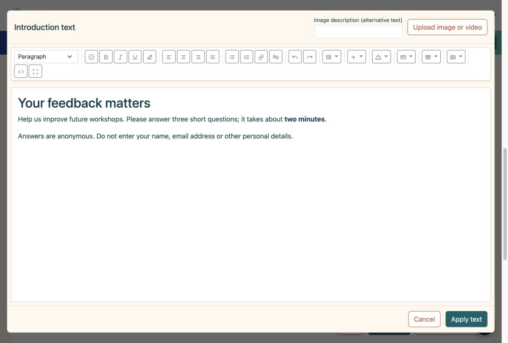
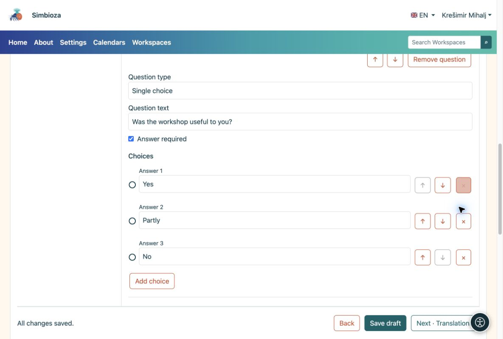
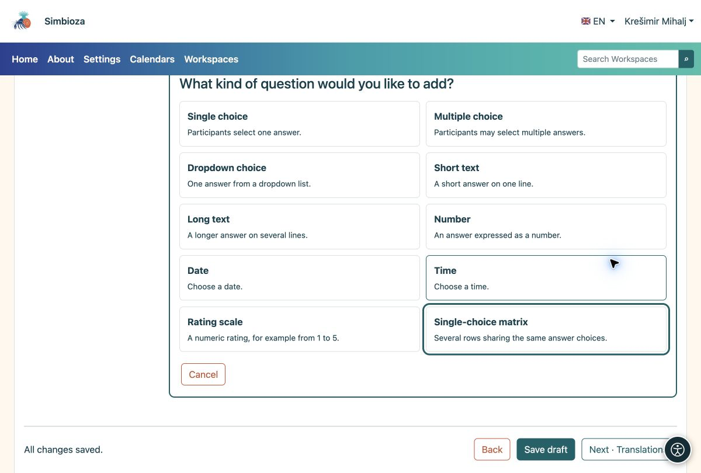

# 2. Add an introduction and questions

[For survey authors](ankete-autori_en.md)

**Goal:** tell participants what you are asking and make answering straightforward.

## Start with a short introduction

1.  Under **Pages and questions**, choose **Add introduction**.
2.  Choose **Edit content in HTML editor**. Explain the purpose, approximate duration and whether personal details should be avoided. Use the toolbar to format text or add images, video and links.
3.  Choose **Apply text**, then **Save draft**. Applying closes the text editor; saving stores the entire survey.

<figure>

<figcaption aria-hidden="true">The introduction uses the full HTML Editor.</figcaption>
</figure>

## Add the first question

1.  Choose **Add question → Single choice**. Select the type before writing the question.
2.  Enter **Was the workshop useful to you?** and the choices **Yes**, **Partly** and **No**. Use **Add choice** for the third choice.
3.  Enable **Answer required** if participants must answer this question before submitting. Choose **Finish editing** and save the draft.

<figure>

<figcaption aria-hidden="true">A question with three choices and the required-answer option.</figcaption>
</figure>

## Which type should I choose?

| You need… | Question type |
|----|----|
| Exactly one answer | Single choice; Dropdown for a longer list |
| Several choices at once | Multiple choice |
| A short suggestion or item name | Short text |
| A comment in several sentences | Long text |
| A quantity, date or time | Number, Date or Time |
| A score such as 1–5 | Rating scale |
| Several statements with the same choices | Single-choice matrix |

<figure>

<figcaption aria-hidden="true">All ten question types have a short explanation.</figcaption>
</figure>

**Result:** the page shows your introduction and question cards. Click a card to change it. A short survey needs only one page; use **Add page** when you want separate steps.

## Reorder or remove an item

1. Open the question card. Use **↑ / ↓** to move it within the same page. The arrows beside a choice change the order of choices.
2. Use **Remove question** or **×** beside a choice to remove it. Read the confirmation first: conditions depending on that item may also be removed.
3. If you made a mistake and have not saved, use the offered **Undo removal**. Review the content and save the draft.

For a whole page, open **Page settings and order**. Reordering can affect [visibility conditions](ankete-grananje-prijevodi_en.md): a question used by a condition must still appear earlier in the survey.

## Change the type or limit an answer

Change **Question type** on an open question only when you need a different way of answering. A type change may remove existing choices and limits that do not apply to the new type; read the warning before confirming.

Open **Explanation, labels and limits** to add help text and set limits for the selected type. Rating-scale boundaries also appear directly on its question card.

| Type | Available limit | Example |
| --- | --- | --- |
| Short or long text | Minimum and maximum answer length. | A short description of up to 200 characters. |
| Multiple choice | Minimum and maximum number of selections. | Choose between 1 and 3 options. |
| Number or rating scale | Minimum and maximum value. | A score from 1 to 5. |
| Date or time | Earliest and latest permitted value. | A date within the workshop period. |

**Result:** participants receive the appropriate field and must correct invalid values before submitting. A limit does not replace **Answer required**: enable that option too when the question must not be left blank. Check the boundaries in trial participation.

## Create a matrix

Choose **Single-choice matrix** for several statements sharing the same choices. Under **Matrix rows**, choose **Add row** and enter each statement, such as “Clarity of explanations” and “Usefulness of examples”. Add the shared scores or levels of agreement as choices. Use arrows to reorder rows; **×** removes the selected row.

**Result:** participants select one answer per row. Check readability on a phone too; separate questions may be easier for lengthy statements.

## Offer Other or a way to decline an answer

Under **Labels and special answers**, set **Choice meaning** for the relevant option:

| Meaning | Behaviour |
| --- | --- |
| Regular choice | An ordinary answer choice. |
| Other | After selecting it, participants must add an explanation. |
| Do not know | A special choice; in multiple choice it cannot be combined with other answers. |
| Prefer not to answer | A special choice; in multiple choice it cannot be combined with other answers. |

Also enter clear participant-facing text, such as “Other — please specify”. Naming a regular choice “Other” does not change its meaning or open a text field. Check its behaviour in trial participation.

## Question and answer codes

For your first survey, you can leave the automatic codes. **Question code** and **Answer code** are short identifiers, such as `Q1` and `YES`; they do not translate the text. Question codes must differ within the survey, and choice codes must differ within their question. Use 1–64 characters: letters A–Z and a–z, numbers, a hyphen or an underscore, without spaces.

Their participant-facing display is controlled separately in **Basics → Advanced settings**, using **Show question codes** and **Show choice codes**. Hiding codes does not delete them. Save the draft after changes and inspect the participant view before publication.
