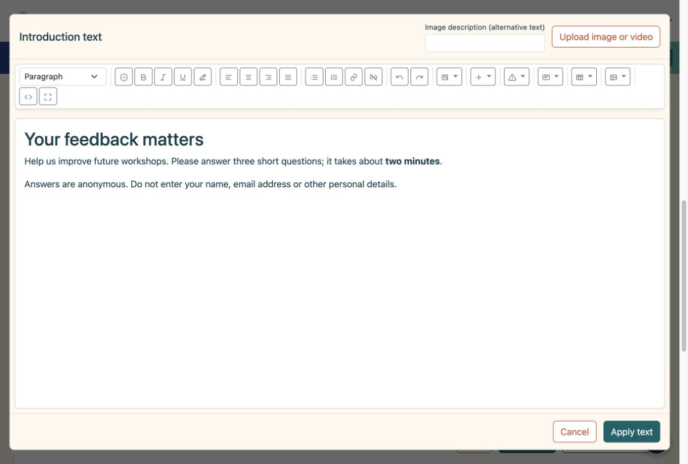
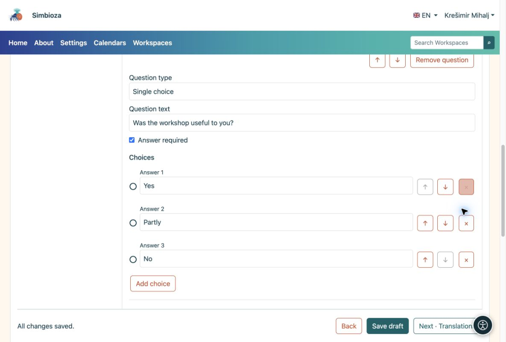
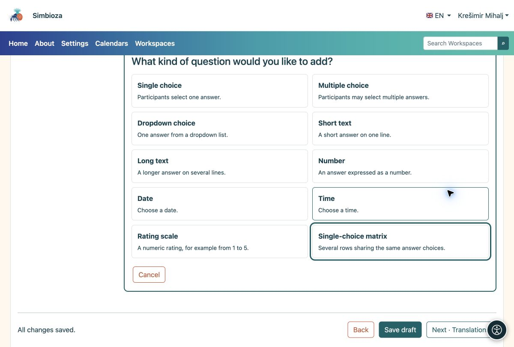

# 2. Añadir una introducción y preguntas

> Las capturas de pantalla muestran la interfaz en inglés.

[Para autores de encuestas](ankete-autori_es.md)

**Objetivo:** decirle a los participantes lo que está preguntando y hacer que la respuesta sea sencilla.

## Comience con una breve introducción

1.  En **Páginas y preguntas**, elija **Agregar introducción**.
2.  Elija **Editar contenido en el editor HTML**. Explique la finalidad, duración aproximada y si se deben evitar datos personales. Utilice la barra de herramientas para dar formato al texto o agregar imágenes, videos y enlaces.
3.  Elija **Aplicar texto** y luego **Guardar borrador**. Al aplicar se cierra el editor de texto; guardar almacena toda la encuesta.

<figure>

<figcaption aria-hidden="true">La introducción utiliza el editor HTML completo.</figcaption>
</figure>

## Añade la primera pregunta.

1.  Elija **Agregar pregunta → Opción única**. Seleccione el tipo antes de escribir la pregunta.
2.  Ingrese **¿Le resultó útil el taller?** y las opciones **Sí**, **Parcialmente** y **No**. Utilice **Agregar opción** para la tercera opción.
3.  Habilite **Respuesta requerida** si los participantes deben responder esta pregunta antes de enviarla. Elija **Finalizar edición** y guarde el borrador.

<figure>

<figcaption aria-hidden="true">Una pregunta con tres opciones y la opción de respuesta obligatoria.</figcaption>
</figure>

## ¿Qué tipo debo elegir?

| Necesitas… | Tipo de pregunta |
|----|----|
| exactamente una respuesta | Elección única; Menú desplegable para una lista más larga |
| Varias opciones a la vez | opción múltiple |
| Una breve sugerencia o nombre del artículo. | texto corto |
| Un comentario en varias frases. | texto largo |
| Una cantidad, fecha u hora | Número, fecha u hora |
| Una puntuación como 1 a 5 | Escala de calificación |
| Varias declaraciones con las mismas opciones. | Matriz de elección única |

<figure>

<figcaption aria-hidden="true">Los diez tipos de preguntas tienen una breve explicación.</figcaption>
</figure>

**Resultado:** la página muestra sus tarjetas de introducción y preguntas. Haga clic en una tarjeta para cambiarla. Una encuesta breve necesita sólo una página; use **Agregar página** cuando desee pasos separados.

## Reordenar o eliminar un artículo

1. Abra la tarjeta de preguntas. Utilice ** ↑ / ↓ ** para moverlo dentro de la misma página. Las flechas al lado de una opción cambian el orden de las opciones.
2. Utilice **Eliminar pregunta** o **×** junto a una opción para quitarla. Lea primero la confirmación: también pueden eliminarse las condiciones que dependan de ese elemento.
3. Si cometió un error y no guardó, use la opción **Deshacer eliminación** que se ofrece. Revise el contenido y guarde el borrador.

Para ver una página completa, abra **Configuración de página y orden**. El reordenamiento puede afectar [condiciones de visibilidad](ankete-grananje-prijevodi_es.md): una pregunta utilizada por una condición aún debe aparecer antes en la encuesta.

## Cambiar el tipo o limitar una respuesta

Cambie el **Tipo de pregunta** en una pregunta abierta solo cuando necesite una forma diferente de responder. Un cambio de tipo puede eliminar opciones y límites existentes que no se aplican al nuevo tipo; Lea la advertencia antes de confirmar.

Abra **Explicación, etiquetas y límites** para agregar texto de ayuda y establecer límites para el tipo seleccionado. Los límites de la escala de calificación también aparecen directamente en su tarjeta de preguntas.

| Tipo | Límite disponible | Ejemplo |
| --- | --- | --- |
| Texto corto o largo | Longitud mínima y máxima de respuesta. | Una breve descripción de hasta 200 caracteres. |
| opción múltiple | Número mínimo y máximo de selecciones. | Elija entre 1 y 3 opciones. |
| Escala numérica o de calificación | Valor mínimo y máximo. | Una puntuación del 1 al 5. |
| Fecha u hora | Valor permitido más temprano y más reciente. | Una fecha dentro del periodo del taller. |

**Resultado:** los participantes reciben el campo apropiado y deben corregir los valores no válidos antes de enviarlos. Un límite no reemplaza **Respuesta requerida**: habilite esa opción también cuando la pregunta no deba quedar en blanco. Verifique los límites en la participación en el ensayo.

## Crear una matriz

Elija **Matriz de opción única** para varias declaraciones que comparten las mismas opciones. En **Filas de matriz**, elija **Agregar fila** e ingrese cada afirmación, como "Claridad de las explicaciones" y "Utilidad de los ejemplos". Agregue las puntuaciones compartidas o los niveles de acuerdo como opciones. Utilice flechas para reordenar las filas; **×** elimina la fila seleccionada.

**Resultado:** los participantes seleccionan una respuesta por fila. Compruebe también la legibilidad en un teléfono; preguntas separadas pueden ser más fáciles para declaraciones largas.

## Ofrecer otro o una forma de rechazar una respuesta

En **Etiquetas y respuestas especiales**, establezca **Significado de elección** para la opción correspondiente:

| Significado | Comportamiento |
| --- | --- |
| Elección habitual | Una elección de respuesta ordinaria. |
| Otro | Tras seleccionarlo, los participantes deberán añadir una explicación. |
| no lo se | Una elección especial; en opción múltiple no se puede combinar con otras respuestas. |
| Prefiero no responder | Una elección especial; en opción múltiple no se puede combinar con otras respuestas. |

Introduzca también un texto claro para los participantes, como "Otro: especifique". Nombrar una opción normal como "Otro" no cambia su significado ni abre un campo de texto. Comprobar su comportamiento en la participación en el ensayo.

## Códigos de preguntas y respuestas

Para su primera encuesta, puede dejar los códigos automáticos. **Código de pregunta** y **Código de respuesta** son identificadores cortos, como `Q1` y `YES`; no traducen el texto. Los códigos de preguntas deben diferir dentro de la encuesta y los códigos de elección deben diferir dentro de su pregunta. Utilice entre 1 y 64 caracteres: letras A–Z y a–z, números, un guión o un guión bajo, sin espacios.

Su visualización orientada al participante se controla por separado en **Configuración básica → Configuración avanzada**, mediante **Mostrar códigos de preguntas** y **Mostrar códigos de elección**. Ocultar códigos no los elimina. Guarde el borrador después de los cambios e inspeccione la vista del participante antes de su publicación.
