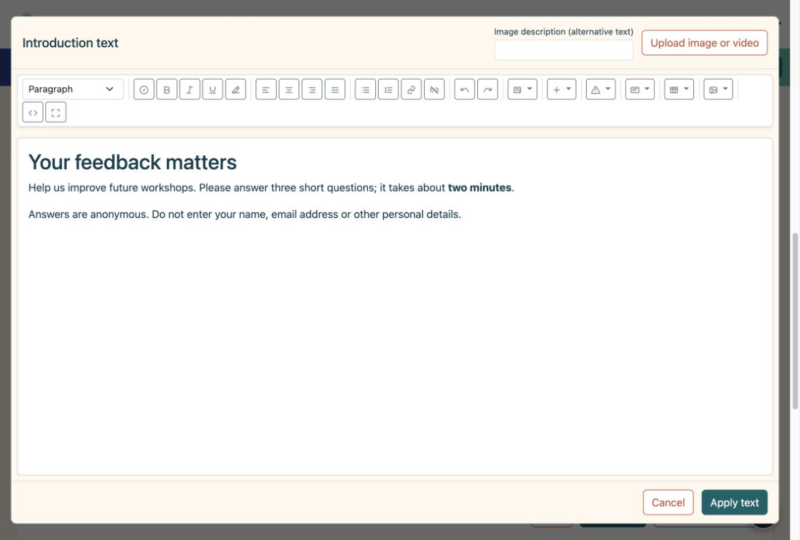
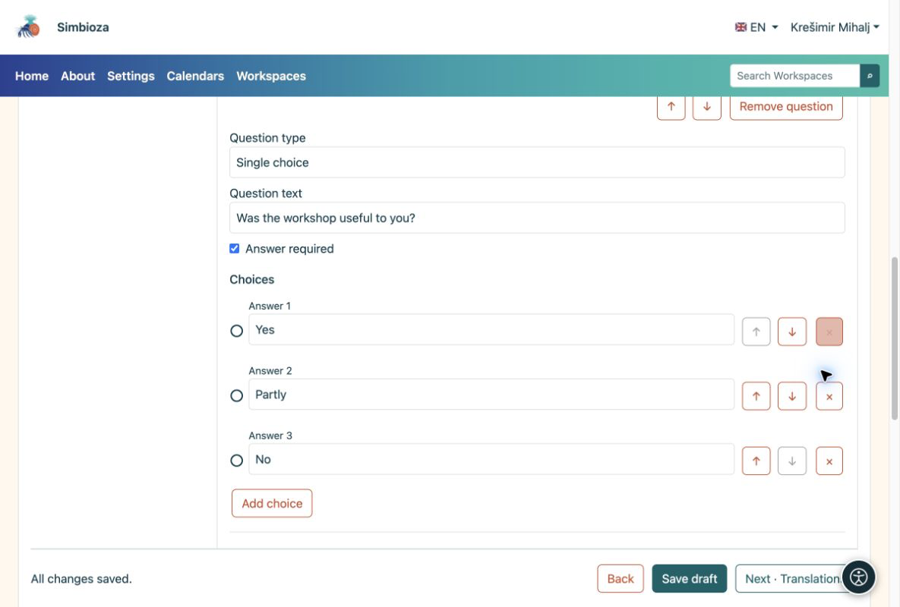
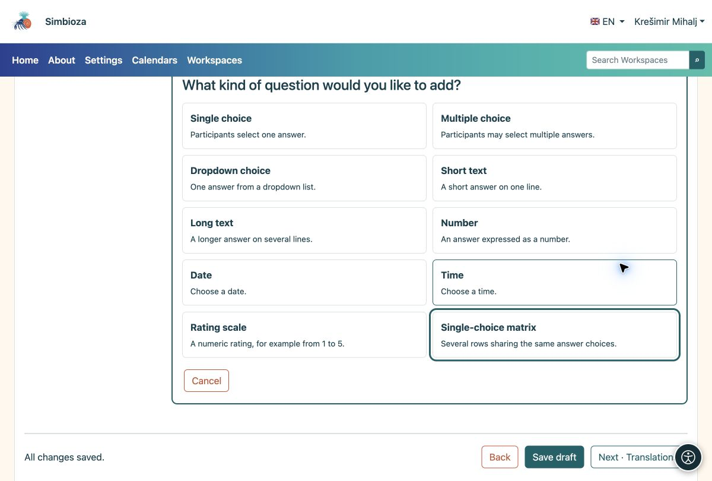

# 2. Ajouter une introduction et des questions

> Les captures d’écran présentent l’interface en anglais.

[Pour les auteurs du sondage](ankete-autori_fr.md)

**Objectif :** dites aux participants ce que vous demandez et simplifiez la réponse.

## Commencez par une courte introduction

1.  Sous **Pages et questions**, choisissez **Ajouter une introduction**.
2.  Choisissez **Modifier le contenu dans l'éditeur HTML**. Expliquez le but, la durée approximative et si les données personnelles doivent être évitées. Utilisez la barre d'outils pour formater du texte ou ajouter des images, des vidéos et des liens.
3.  Choisissez **Appliquer le texte**, puis **Enregistrer le brouillon**. L'application ferme l'éditeur de texte ; l'enregistrement stocke l'intégralité du sondage.

<figure>

<figcaption aria-hidden="true">L'introduction utilise l'éditeur HTML complet.</figcaption>
</figure>

## Ajouter la première question

1.  Choisissez **Ajouter une question → Choix unique**. Sélectionnez le type avant de rédiger la question.
2.  Entrez **L'atelier vous a-t-il été utile ?** et les choix **Oui**, **En partie** et **Non**. Utilisez **Ajouter un choix** pour le troisième choix.
3.  Activez **Réponse requise** si les participants doivent répondre à cette question avant de soumettre. Choisissez **Terminer la modification** et enregistrez le brouillon.

<figure>

<figcaption aria-hidden="true">Une question avec trois choix et l'option de réponse obligatoire.</figcaption>
</figure>

## Quel type dois-je choisir ?

| Vous avez besoin… | Type de question |
|----|----|
| Exactement une réponse | Choix unique ; Liste déroulante pour une liste plus longue |
| Plusieurs choix à la fois | Choix multiple |
| Une courte suggestion ou un nom d'article | Texte court |
| Un commentaire en plusieurs phrases | Texte long |
| Une quantité, une date ou une heure | Numéro, date ou heure |
| Un score tel que 1 à 5 | Échelle de notation |
| Plusieurs déclarations avec les mêmes choix | Matrice à choix unique |

<figure>

<figcaption aria-hidden="true">Les dix types de questions comportent une brève explication.</figcaption>
</figure>

**Résultat :** la page affiche vos cartes d'introduction et de questions. Cliquez sur une carte pour la modifier. Un court sondage ne nécessite qu’une seule page ; utilisez **Ajouter une page** lorsque vous souhaitez des étapes distinctes.

## Réorganiser ou supprimer un article

1. Ouvrez la carte de questions. Utilisez **↑ / ↓** pour le déplacer dans la même page. Les flèches à côté d'un choix changent l'ordre des choix.
2. Utilisez **Supprimer la question** ou **×** à côté d’un choix pour le supprimer. Lisez d’abord la confirmation : les conditions qui dépendent de cet élément peuvent également être supprimées.
3. Si vous avez commis une erreur et que vous n'avez pas enregistré, utilisez l'option **Annuler la suppression** proposée. Vérifiez le contenu et enregistrez le brouillon.

Pour une page entière, ouvrez **Paramètres de la page et commande**. Le réordonnancement peut affecter les [conditions de visibilité](ankete-grananje-prijevodi_fr.md) : une question utilisée par une condition doit quand même apparaître plus tôt dans le sondage.

## Changer le type ou limiter une réponse

Modifiez le **Type de question** sur une question ouverte uniquement lorsque vous avez besoin d'une manière différente de répondre. Un changement de type peut supprimer les choix et limites existants qui ne s'appliquent pas au nouveau type ; lisez l’avertissement avant de confirmer.

Ouvrez **Explication, étiquettes et limites** pour ajouter un texte d'aide et définir des limites pour le type sélectionné. Les limites de l'échelle de notation apparaissent également directement sur sa carte de questions.

| Taper | Limite disponible | Exemple |
| --- | --- | --- |
| Texte court ou long | Longueur de réponse minimale et maximale. | Une brève description de 200 caractères maximum. |
| Choix multiple | Nombre minimum et maximum de sélections. | Choisissez entre 1 et 3 options. |
| Chiffre ou échelle de notation | Valeur minimale et maximale. | Une note de 1 à 5. |
| Date ou heure | Valeur la plus ancienne et la plus récente autorisée. | Une date dans la période de l'atelier. |

**Résultat :** les participants reçoivent le champ approprié et doivent corriger les valeurs non valides avant de soumettre. Une limite ne remplace pas **Réponse requise** : activez également cette option lorsque la question ne doit pas rester vide. Vérifiez les limites de la participation aux essais.

## Créer une matrice

Choisissez **Matrice à choix unique** pour plusieurs instructions partageant les mêmes choix. Sous **Lignes de la matrice**, choisissez **Ajouter une ligne** et saisissez chaque affirmation, telle que « Clarté des explications » et « Utilité des exemples ». Ajoutez les scores partagés ou les niveaux d’accord comme choix. Utilisez les flèches pour réorganiser les lignes ; **×** supprime la ligne sélectionnée.

**Résultat :** les participants sélectionnent une réponse par ligne. Vérifiez également la lisibilité sur un téléphone ; des questions séparées peuvent être plus faciles pour les déclarations longues.

## Proposer autre ou un moyen de refuser une réponse

Sous **Étiquettes et réponses spéciales**, définissez **Signification du choix** pour l'option appropriée :

| Signification | Comportement |
| --- | --- |
| Choix régulier | Un choix de réponse ordinaire. |
| Autre | Après l'avoir sélectionné, les participants doivent ajouter une explication. |
| Je ne sais pas | Un choix spécial ; dans les choix multiples, elle ne peut pas être combinée avec d'autres réponses. |
| Je préfère ne pas répondre | Un choix spécial ; dans les choix multiples, elle ne peut pas être combinée avec d'autres réponses. |

Saisissez également un texte clair destiné aux participants, tel que « Autre – veuillez préciser ». Nommer un choix normal « Autre » ne change pas sa signification et n'ouvre pas de champ de texte. Vérifiez son comportement lors de la participation à l'essai.

## Codes questions et réponses

Pour votre premier sondage, vous pouvez laisser les codes automatiques. Le **Code de question** et le **Code de réponse** sont des identifiants courts, tels que `Q1` et `YES` ; ils ne traduisent pas le texte. Les codes de question doivent différer au sein du sondage, et les codes de choix doivent différer au sein de leur question. Utilisez 1 à 64 caractères : lettres A à Z et a à z, chiffres, trait d'union ou trait de soulignement, sans espaces.

Leur affichage face aux participants est contrôlé séparément dans **Bases → Paramètres avancés**, à l'aide de **Afficher les codes de question** et **Afficher les codes de choix**. Masquer les codes ne les supprime pas. Enregistrez le brouillon après les modifications et inspectez la vue des participants avant la publication.
