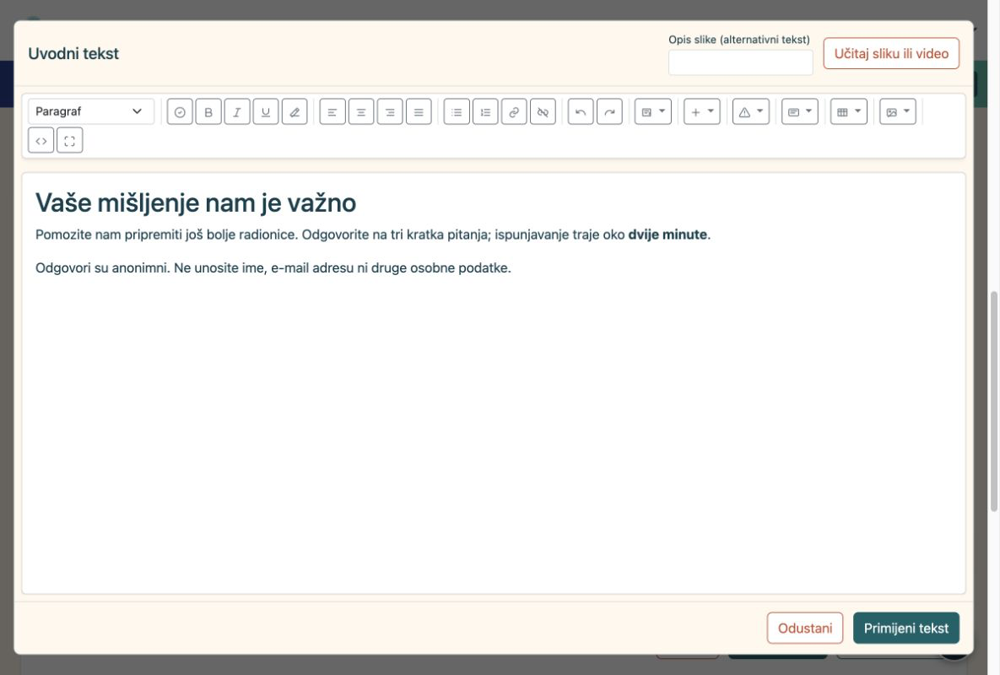
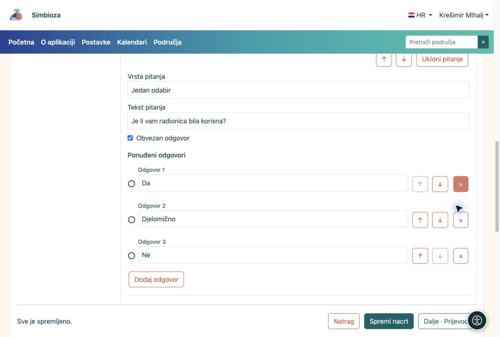
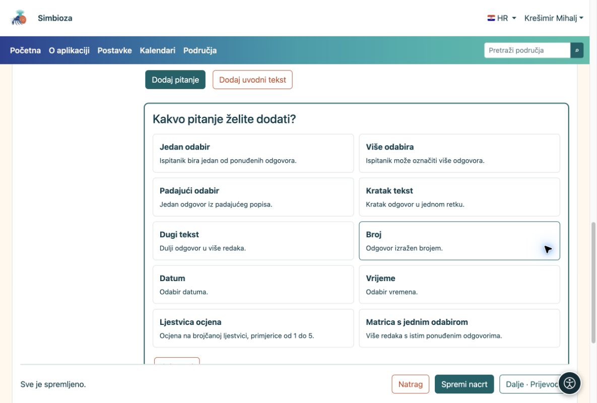

# 2. Dodajte uvod i pitanja

[Za sastavljače anketa](ankete-autori_hr.md)

**Cilj:** ispitaniku jasno objasniti što ga pitate i ponuditi jednostavan način odgovaranja.

## Najprije kratak uvod

1.  U koraku **Stranice i pitanja** odaberite **Dodaj uvodni tekst**.
2.  Odaberite **Uredi sadržaj u HTML editoru**. Napišite čemu anketa služi, koliko približno traje i treba li izbjegavati osobne podatke. Alatna traka služi oblikovanju teksta, slikama, videu i poveznicama.
3.  Odaberite **Primijeni tekst**, zatim **Spremi nacrt**. Primjena zatvara uređivač teksta; spremanje čuva cijelu anketu.

<figure>

<figcaption aria-hidden="true">Uvodni tekst uređuje se punim HTML Editorom.</figcaption>
</figure>

## Dodajte prvo pitanje

1.  Odaberite **Dodaj pitanje** pa **Jedan odabir**. Vrstu birate prije teksta pitanja.
2.  Upišite **Je li vam radionica bila korisna?** te odgovore **Da**, **Djelomično** i **Ne**. Za treći odgovor odaberite **Dodaj odgovor**.
3.  Uključite **Obvezan odgovor** ako bez tog odgovora ne želite dopustiti predaju. Odaberite **Završi uređivanje** pa spremite nacrt.

<figure>

<figcaption aria-hidden="true">Jedno pitanje, tri ponuđena odgovora i oznaka obveznog odgovora.</figcaption>
</figure>

## Koju vrstu odabrati?

| Trebate… | Vrsta pitanja |
|----|----|
| Samo jedan odgovor | Jedan odabir; za dulji popis Padajući odabir |
| Više odgovora odjednom | Više odabira |
| Ime predmeta ili kratak prijedlog | Kratak tekst |
| Komentar u nekoliko rečenica | Dugi tekst |
| Količinu, datum ili sat | Broj, Datum ili Vrijeme |
| Ocjenu, primjerice od 1 do 5 | Ljestvica ocjena |
| Ocijeniti više tvrdnji istim odgovorima | Matrica s jednim odabirom |

<figure>

<figcaption aria-hidden="true">Birač nudi svih deset vrsta pitanja uz kratko objašnjenje.</figcaption>
</figure>

**Rezultat:** na stranici su vidljivi uvod i kartice vaših pitanja. Kliknite karticu za izmjenu. Za kratku anketu dovoljna je jedna stranica; **Dodaj stranicu** koristite tek kada pitanja želite podijeliti u korake.

## Promijenite redoslijed ili uklonite stavku

1. Otvorite karticu pitanja. Strelicama **↑ / ↓** pomaknite ga unutar iste stranice. Istim strelicama uz ponuđeni odgovor mijenjate redoslijed odgovora.
2. Za uklanjanje upotrijebite **Ukloni pitanje** ili **×** uz odgovor. Prije potvrde pročitajte upozorenje: mogu se ukloniti i uvjeti koji ovise o toj stavci.
3. Ako ste pogriješili i još niste spremili, upotrijebite ponuđeni **Poništi uklanjanje**. Pregledajte sadržaj pa spremite nacrt.

Za cijelu stranicu otvorite **Postavke i redoslijed stranice**. Promjena redoslijeda može utjecati na [uvjete prikaza](ankete-grananje-prijevodi_hr.md): pitanje na koje se uvjet oslanja mora ostati ranije u anketi.

## Promijenite vrstu ili ograničite odgovor

U otvorenom pitanju promijenite **Vrsta pitanja** samo ako vam treba drukčiji način odgovaranja. Promjena vrste može ukloniti postojeće ponuđene odgovore i ograničenja koja novoj vrsti ne odgovaraju; pročitajte upozorenje prije potvrde.

Otvorite **Objašnjenje, oznake i ograničenja**. Ondje možete dodati pomoćni tekst ispitaniku te postaviti ograničenja za izabranu vrstu. Granice ljestvice ocjena nalaze se i izravno na kartici pitanja.

| Vrsta | Što možete ograničiti | Primjer |
| --- | --- | --- |
| Kratak ili dugi tekst | Najmanja i najveća duljina odgovora. | Kratak opis do 200 znakova. |
| Više odabira | Najmanje i najviše odabira. | Odaberite od 1 do 3 mogućnosti. |
| Broj ili ljestvica ocjena | Najmanja i najveća vrijednost. | Ocjena od 1 do 5. |
| Datum ili vrijeme | Najranija i najkasnija dopuštena vrijednost. | Datum unutar razdoblja radionice. |

**Rezultat:** ispitanik dobiva odgovarajuće polje, a nevaljan odgovor mora ispraviti prije predaje. Ograničenje nije zamjena za **Obvezan odgovor**: ako odgovor ne smije ostati prazan, uključite i tu mogućnost. Provjerite granice u probnom ispunjavanju.

## Napravite matricu

Za nekoliko tvrdnji s istim odgovorima odaberite **Matrica s jednim odabirom**. Pod **Retci matrice** odaberite **Dodaj redak** i upišite svaku tvrdnju, primjerice „Jasnoća objašnjenja” i „Korisnost primjera”. Kao ponuđene odgovore unesite zajedničke ocjene ili stupnjeve slaganja. Strelicama rasporedite retke; **×** uklanja odabrani redak.

**Rezultat:** ispitanik bira jedan odgovor u svakom retku. Provjerite čitljivost i na telefonu; za dugačke tvrdnje jednostavnija zasebna pitanja mogu biti ugodnija.

## Ponudite Drugo ili mogućnost neodgovaranja

U **Oznake i posebni odgovori** postavite **Značenje odgovora** za pojedinu ponuđenu stavku:

| Značenje | Ponašanje |
| --- | --- |
| Uobičajeni odgovor | Običan ponuđeni izbor. |
| Drugo | Nakon odabira ispitanik mora dopisati objašnjenje. |
| Ne znam | Poseban izbor; kod više odabira ne može se kombinirati s drugim odgovorima. |
| Ne želim odgovoriti | Poseban izbor; kod više odabira ne može se kombinirati s drugim odgovorima. |

Upišite i jasan tekst koji ispitanik vidi, primjerice „Drugo — navedite”. Sam naziv „Drugo” bez promjene značenja ostaje običan odgovor i ne otvara dodatni tekst. Provjerite ponašanje u probnom ispunjavanju.

## Oznake pitanja i odgovora

Za prvu anketu možete ostaviti automatske oznake. **Oznaka pitanja** i **Oznaka odgovora** kratki su kodovi za razlikovanje stavki, primjerice `Q1` i `DA`; nisu prijevod teksta. Pitanja trebaju različite oznake unutar ankete, a odgovori različite oznake unutar pitanja. Dopušteno je 1–64 znaka: slova A–Z i a–z, brojevi, crtica i podvlaka, bez razmaka.

Prikaz tih oznaka ispitaniku uključuje se zasebno u **Osnovni podaci → Napredne postavke**, pomoću **Prikaži oznake pitanja** i **Prikaži oznake odgovora**. Isključivanje prikaza ne briše oznake. Nakon promjena spremite nacrt i provjerite čitateljski prikaz prije objave.
