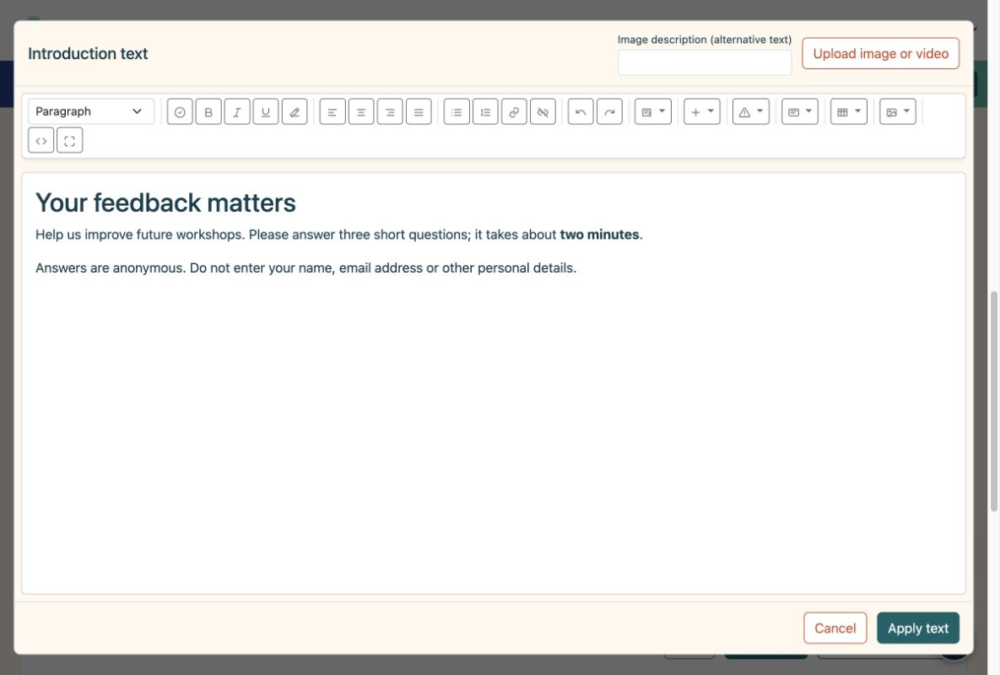
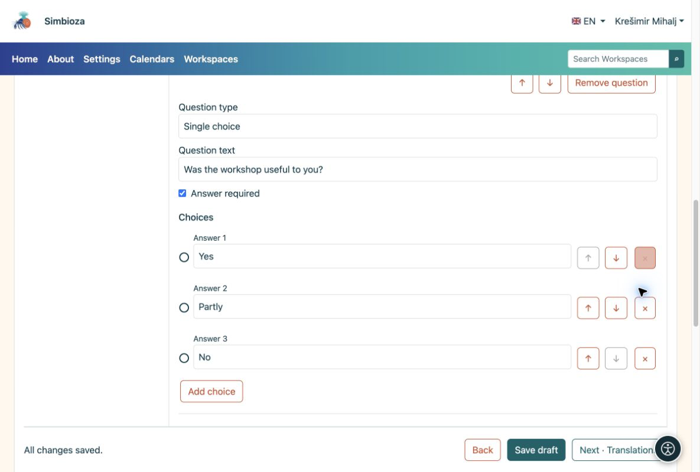
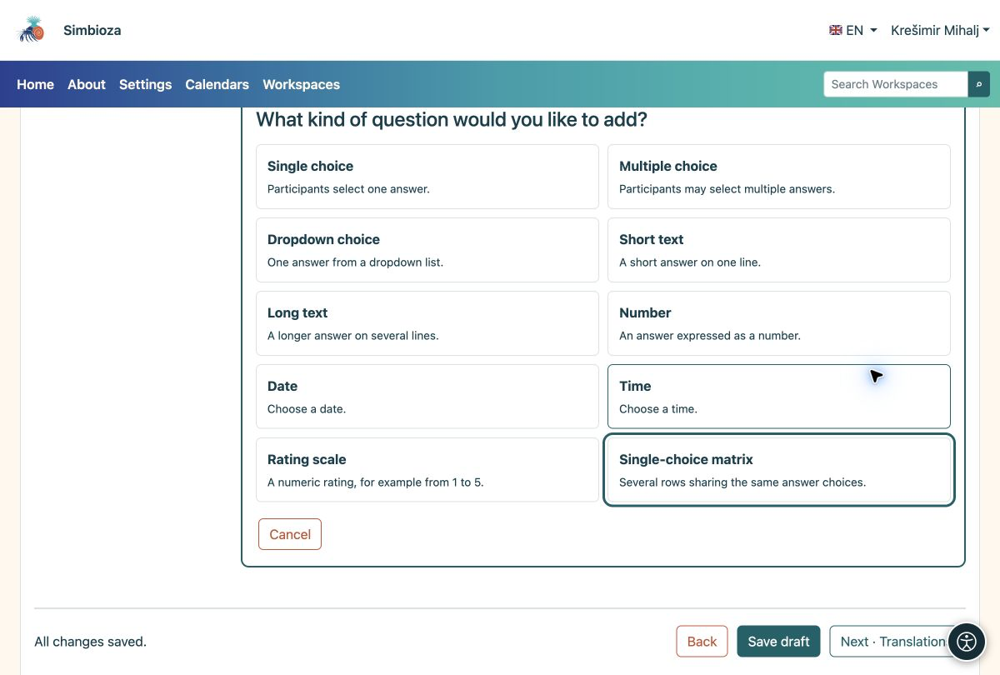

# 2. Aggiungi un'introduzione e domande

> Le schermate mostrano l’interfaccia in inglese.

[Per gli autori del sondaggio](ankete-autori_it.md)

**Obiettivo:** spiega ai partecipanti cosa stai chiedendo e rendi la risposta semplice.

## Inizia con una breve introduzione

1.  In **Pagine e domande**, scegli **Aggiungi introduzione**.
2.  Scegli **Modifica contenuto nell'editor HTML**. Spiegare lo scopo, la durata approssimativa e se i dati personali dovrebbero essere evitati. Utilizza la barra degli strumenti per formattare il testo o aggiungere immagini, video e collegamenti.
3.  Scegli **Applica testo**, quindi **Salva bozza**. L'applicazione chiude l'editor di testo; il salvataggio memorizza l'intero sondaggio.

<figure>

<figcaption aria-hidden="true">L'introduzione utilizza l'editor completo HTML.</figcaption>
</figure>

## Aggiungi la prima domanda

1.  Scegli **Aggiungi domanda → Scelta singola**. Seleziona la tipologia prima di scrivere la domanda.
2.  Inserisci **Il workshop ti è stato utile?** e le scelte **Sì**, **Parzialmente** e **No**. Utilizza **Aggiungi scelta** per la terza scelta.
3.  Abilita **Risposta richiesta** se i partecipanti devono rispondere a questa domanda prima di inviare. Scegli **Termina modifica** e salva la bozza.

<figure>

<figcaption aria-hidden="true">Una domanda con tre scelte e l'opzione di risposta obbligatoria.</figcaption>
</figure>

## Quale tipo dovrei scegliere?

| Hai bisogno di… | Tipo di domanda |
|----|----|
| Esattamente una risposta | Scelta unica; Menu a discesa per un elenco più lungo |
| Diverse scelte contemporaneamente | Scelta multipla |
| Un breve suggerimento o nome dell'articolo | Breve testo |
| Un commento in più frasi | Testo lungo |
| Una quantità, una data o un'ora | Numero, data o ora |
| Un punteggio come 1–5 | Scala di valutazione |
| Diverse dichiarazioni con le stesse scelte | Matrice a scelta singola |

<figure>

<figcaption aria-hidden="true">Tutti e dieci i tipi di domande hanno una breve spiegazione.</figcaption>
</figure>

**Risultato:** la pagina mostra la tua introduzione e le schede delle domande. Fare clic su una scheda per modificarla. Un breve sondaggio richiede solo una pagina; utilizza **Aggiungi pagina** quando desideri passaggi separati.

## Riordina o rimuovi un articolo

1. Apri la scheda delle domande. Usa **↑ / ↓** per spostarlo all'interno della stessa pagina. Le frecce accanto a una scelta cambiano l'ordine delle scelte.
2. Utilizza **Rimuovi domanda** o **×** accanto a un'opzione per rimuoverla. Leggi prima la conferma: anche le condizioni dipendenti da quell'articolo potrebbero essere rimosse.
3. Se hai commesso un errore e non hai salvato, utilizza la funzione **Annulla rimozione** offerta. Rivedi il contenuto e salva la bozza.

Per una pagina intera, apri **Impostazioni e ordine pagina**. Il riordino può influenzare le [condizioni di visibilità](ankete-grananje-prijevodi_it.md): una domanda utilizzata da una condizione deve comunque apparire in precedenza nel sondaggio.

## Cambia il tipo o limita una risposta

Modifica il **Tipo di domanda** su una domanda aperta solo quando hai bisogno di un modo diverso di rispondere. Una modifica del tipo può rimuovere le scelte e i limiti esistenti che non si applicano al nuovo tipo; leggere l'avviso prima di confermare.

Apri **Spiegazione, etichette e limiti** per aggiungere testo di aiuto e impostare limiti per il tipo selezionato. I confini della scala di valutazione appaiono anche direttamente sulla sua scheda domanda.

| Tipo | Limite disponibile | Esempio |
| --- | --- | --- |
| Testo breve o lungo | Lunghezza minima e massima della risposta. | Una breve descrizione fino a 200 caratteri. |
| Scelta multipla | Numero minimo e massimo di selezioni. | Scegli tra 1 e 3 opzioni. |
| Numero o scala di valutazione | Valore minimo e massimo. | Un punteggio da 1 a 5. |
| Data o ora | Primo e ultimo valore consentito. | Una data compresa nel periodo del workshop. |

**Risultato:** i partecipanti trovano il campo appropriato e devono correggere i valori non validi prima dell'invio. Un limite non sostituisce **Risposta obbligatoria**: abilita anche questa opzione quando la domanda non deve rimanere vuota. Verifica i limiti con una compilazione di prova.

## Crea una matrice

Scegli **Matrice a scelta singola** per più affermazioni che condividono le stesse risposte. In **Righe della matrice**, scegli **Aggiungi riga** e inserisci ciascuna affermazione, per esempio «Chiarezza delle spiegazioni» e «Utilità degli esempi». Aggiungi i punteggi o i livelli di accordo comuni come opzioni di risposta. Usa le frecce per riordinare le righe; **×** rimuove la riga selezionata.

**Risultato:** i partecipanti selezionano una risposta per riga. Verifica la leggibilità anche su un telefono; domande separate potrebbero essere più facili per affermazioni lunghe.

## Offri Altro o un modo per rifiutare una risposta

In **Etichette e risposte speciali**, imposta **Significato scelta** per l'opzione pertinente:

| Significato | Comportamento |
| --- | --- |
| Scelta regolare | Una scelta di risposta ordinaria. |
| Altro | Dopo averlo selezionato, i partecipanti devono aggiungere una spiegazione. |
| Non lo so | Una scelta speciale; nella scelta multipla non è cumulabile con altre risposte. |
| Preferisco non rispondere | Una scelta speciale; nella scelta multipla non è cumulabile con altre risposte. |

Inserisci anche un testo chiaro rivolto ai partecipanti, ad esempio "Altro: specifica". Denominare una scelta normale "Altro" non ne cambia il significato né apre un campo di testo. Controlla il suo comportamento nella partecipazione alla prova.

## Codici di domande e risposte

Per il tuo primo sondaggio puoi lasciare i codici automatici. **Codice domanda** e **Codice risposta** sono identificatori brevi, come `Q1` e `YES`; non traducono il testo. I codici delle domande devono differire all'interno del sondaggio e i codici di scelta devono differire all'interno della domanda. Utilizza da 1 a 64 caratteri: lettere A–Z e a–z, numeri, un trattino o un carattere di sottolineatura, senza spazi.

La loro visualizzazione rivolta ai partecipanti è controllata separatamente in **Impostazioni di base → Impostazioni avanzate**, utilizzando **Mostra codici domanda** e **Mostra codici di scelta**. Nascondere i codici non li elimina. Salva la bozza dopo le modifiche e controlla la vista del partecipante prima della pubblicazione.
