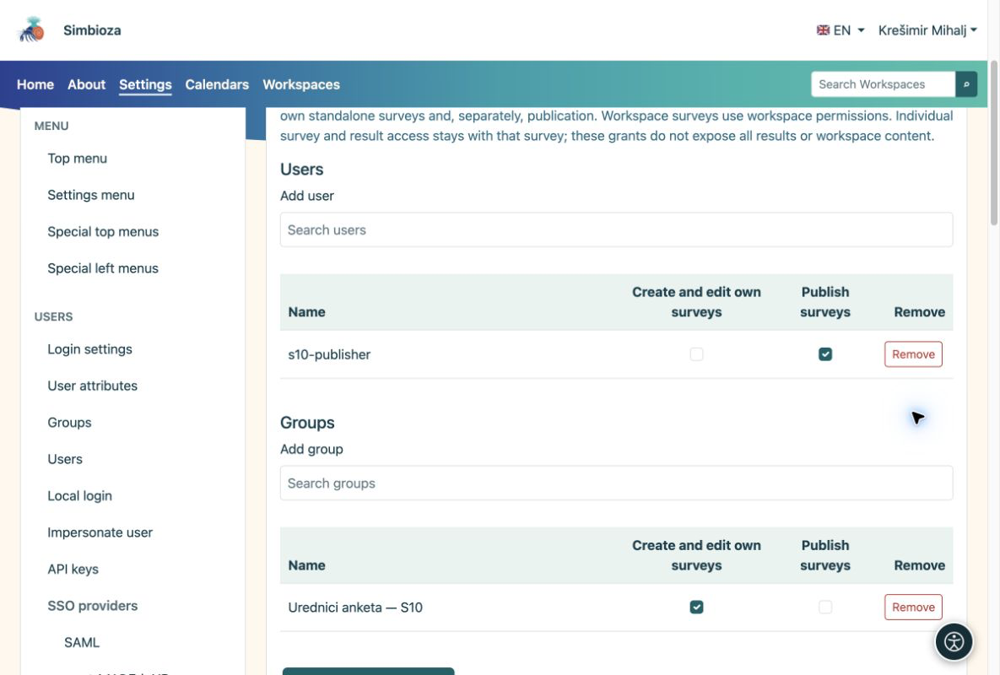

# Berechtigungen zum Erstellen und Veröffentlichen

> Die Bildschirmaufnahmen zeigen die englische Benutzeroberfläche.

[Für Administratoren](ankete-administratori_de.md)

**Ziel:** Ermöglichen Sie es einem Redakteur, an Umfragen zu arbeiten, ohne die Bearbeitung aller Seiten oder die Anwendungsverwaltung zu gestatten.

1.  Öffnen Sie **Einstellungen → Umfragen → Berechtigungen**.
2.  Suchen Sie nach dem Benutzer oder der Gruppe. Der Picker lädt eine begrenzte Liste; es werden nicht alle Konten gleichzeitig angezeigt.
3.  Vergeben Sie die Berechtigung zum Verwalten von Umfragen. Erteilen Sie die Veröffentlichungsberechtigung separat der Person, die fertige Umfragen freigibt, und speichern Sie anschließend.

<figure>

<figcaption aria-hidden="true">Globale Umfragezuschüsse sind vom Administratorstatus getrennt.</figcaption>
</figure>

## Berechtigungen in einem Arbeitsbereich

Öffnen Sie in der Arbeitsbereichsverwaltung **Mitglieder und Berechtigungen → Umfragen**. Fügen Sie einen Benutzer oder eine Gruppe hinzu und aktivieren Sie die erforderlichen Rechte. Inhaltsberechtigungen, die bereits für Umfragen gelten, werden als vererbt angezeigt. Umfragespezifische Rechte gewähren keine normale Seitenbearbeitung. Die Veröffentlichung bleibt eine gesonderte Berechtigung.

Durch die Teilnahme und das Lesen aggregierter Ergebnisse ist kein Bearbeitungs- oder Einzelantwortzugriff möglich. Seitenrechte, Gruppen und Zugriffsausnahmen bleiben in der Verantwortung von Arbeitsbereich.

**Überprüfen:** Melden Sie sich als Testbenutzer an oder bitten Sie ihn, dies zu überprüfen. Ein Redakteur sollte in der Lage sein, einen Entwurf zu erstellen, ihn jedoch nicht ohne Berechtigung zur Veröffentlichung genehmigen zu dürfen.
