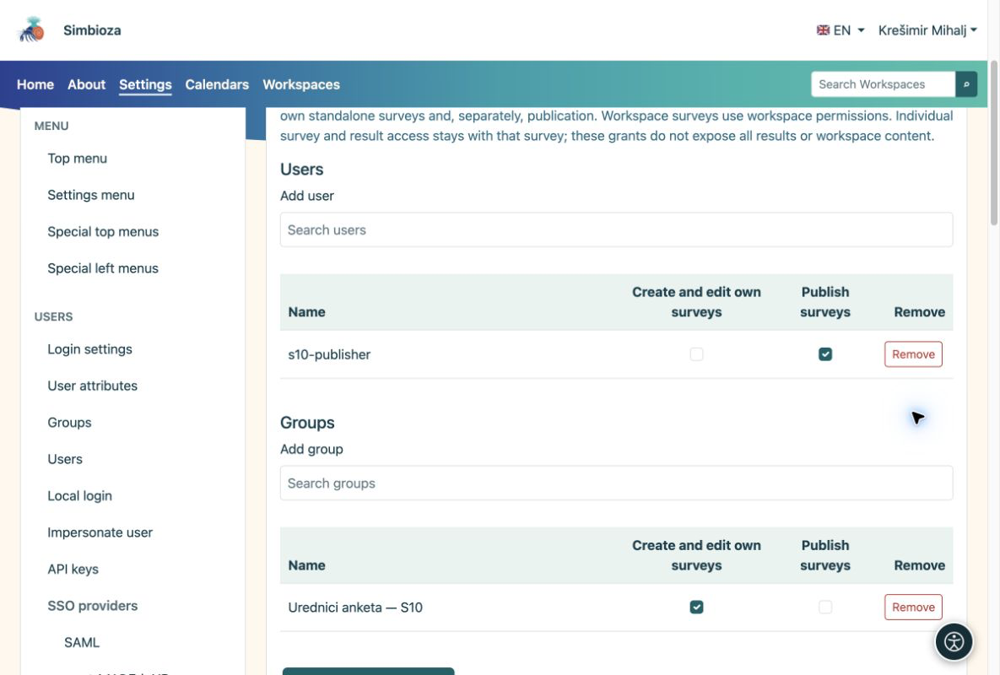

# Authoring and publication permissions

[For administrators](ankete-administratori_en.md)

**Goal:** let an editor work on surveys without granting all-page editing or application administration.

1.  Open **Settings → Surveys → Permissions**.
2.  Search for the user or group. The picker loads a bounded list; it does not display every account at once.
3.  Grant survey management. Grant publication separately to the person who approves completed surveys, then save.

<figure>

<figcaption aria-hidden="true">Global survey grants are separate from administrator status.</figcaption>
</figure>

## Permissions in one Workspace

In Workspace management, open **Members and permissions → Surveys**. Add a user or group and enable the required rights. Content permissions that already apply to surveys are shown as inherited. Survey-specific rights do not grant ordinary-page editing. Publication remains a separate permission.

Participation and aggregate-result reading do not grant editing or individual-response access. Page rights, groups and access exceptions remain Workspace responsibilities.

**Check:** sign in as a test user or ask them to check. An editor should be able to create a draft, but should not approve it without publication permission.
